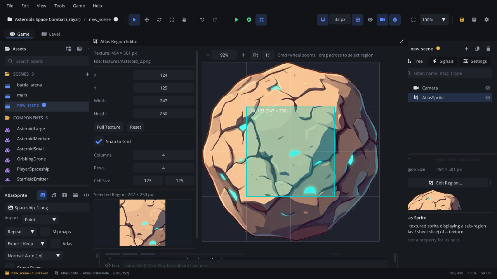

# Atlas Region Editor

The **Atlas Region Editor** picks which rectangle of its image an
[Atlas Sprite](../nodes/AtlasSpriteNode.md) draws. Drag a rectangle on the
image or type its position and size, snap it to the sheet's grid if you
like, check the cropped preview, and **Apply**. Nothing changes on the
node until you apply.

## When to use it

- **Showing one icon, prop or frame** of a bigger image with an Atlas
  Sprite.
- **Lining a region up with a sheet's cells** with **Snap to Grid**.
- To make many Atlas Sprites at once, one per cell, use the
  [Sprite Sheet Slicer](sprite-slicer.md) instead.
- Not to be confused with packing textures into an atlas page on export:
  that is the **Atlas** import setting, see
  [Sprite atlases](../../engine/docs/atlas.md).

## Opening it

Select an Atlas Sprite that has a texture. In the
[Inspector](inspector.md)'s **Atlas Sprite** section, click
**Edit Region...** (under the **Region** fields). The editor opens on the
node's current region, or the whole image when it has none.

## What's in it

### Settings (left)

| Control | What it does |
|---|---|
| *Texture: W × H px*, *File:* | The image's size and path. |
| **X**, **Y**, **Width**, **Height** | The region in image pixels; drag or double-click to type. It is kept inside the image. |
| **Full Texture** | The whole image. |
| **Reset** | Back to the region the node had when the editor opened. |
| **Snap to Grid** | Shows a grid on the image and snaps the dragged rectangle's corners to its lines. |
| **Columns**, **Rows** | (Snap to Grid) The grid's cells across and down, 1 to 256. They set **Cell Size**. |
| **Cell Size** | (Snap to Grid) A cell's width and height in pixels. Sets the columns and rows to how many fit. |
| *Selected Region: W × H px* | The region's size. |
| Preview | The region alone, as the sprite will show it. |
| **Apply** | Sets the node's region (one undo step) and closes the editor. |
| **Cancel** | Closes without changing the node. The close button (x) does the same. |

### The image (right)

The whole image, the region tinted with its position and size written in
its corner. Above it, a zoom bar:

| Control | What it does |
|---|---|
| **-** / **+** | Zoom out / in. |
| Zoom field | The zoom in %; drag or type (5% to 3200%). |
| **Fit** | The whole image in the view (the default). |
| **1:1** | One screen pixel per image pixel. |

| Mouse | What it does |
|---|---|
| Drag | Draw the region from corner to corner (snapped with **Snap to Grid**). |
| Cmd+wheel (Ctrl+wheel) | Zoom around the mouse. |
| Wheel | Scroll; Shift+wheel scrolls sideways. |
| Middle-drag | Pan. |

## Walkthrough

One rock from `textures/Props-Rocks.png`:

1. **Add Node** > *Atlas Sprite*. In the Inspector, set its **Texture** to
   `textures/Props-Rocks.png`.
2. Click **Edit Region...**.
3. Turn on **Snap to Grid** and set **Cell Size** to the sheet's cell size
   (or **Columns** and **Rows** to its layout).
4. Drag from the rock's top-left grid corner to its bottom-right one. The
   preview shows just the rock.
5. Click **Apply**. The sprite in the viewport now shows the rock; Cmd+Z
   (Ctrl+Z) brings the old region back.

## Tips

- Drag from corner to corner: a click without a drag makes a 1 x 1 region.
  **Reset** gets the previous one back.
- With **Snap to Grid**, the grid is the image split evenly into columns
  and rows. A **Cell Size** that doesn't divide the image exactly snaps to
  the even split, not to that size.
- The Inspector's **Region** fields set the same four numbers without the
  editor; scripts change it with `atlas_set_region` (see
  [Atlas Sprite](../nodes/AtlasSpriteNode.md)).
- **Snap to Grid** and its columns, rows and cell size stay as you left
  them the next time you open the editor, until the editor quits.
- Related: [Atlas Sprite](../nodes/AtlasSpriteNode.md),
  [Sprite Sheet Slicer](sprite-slicer.md), [Inspector](inspector.md).
