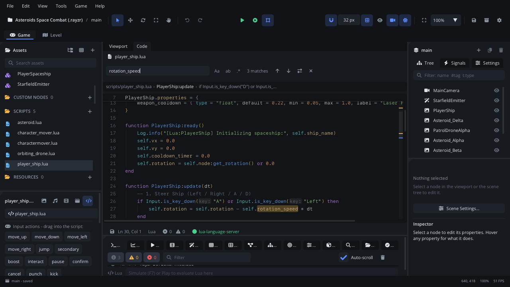

# Code tab

The **Code** tab edits your game's Lua scripts (and shaders) inside the
editor, with completion, hover help, errors and go to definition from
`lua-language-server`, and extras that know your project: node names,
asset paths and engine functions. It opens next to the Viewport the first
time you open a script. This page is an overview; every command and
shortcut is in the [full reference](../../editor/CODE_EDITOR.md).

## When to use it

- **Writing and fixing scripts**: a node's behaviour, a global script, a
  test in `tests/`.
- **Finding your way round the code**: go to a function's definition, see
  where something is used, rename it everywhere.
- **Debugging**: breakpoints in the gutter, then step through a game started
  with Play (see [Playtesting](playtesting.md)).
- **Looking up the API**: hover an engine function for its description, or
  press **F1** on it for the Scripting Reference.
- For a node's exported values, use the [Inspector](inspector.md);
  scripts' `properties` show up there.

## Opening it

The Code tab exists while a script is open. Open one by:

- double-clicking a `.lua` (or shader) file in [Assets](assets.md);
- the code button beside a node's script in the Inspector (**Edit script**),
  or **New Script...** there for a new one;
- right-click a node in the [Scene panel](scene-tree.md) > **Open Script**;
- double-clicking a Console message with `file.lua:LINE`, or a failure in
  the [Tests tab](tab-tests.md);
- **Cmd+P** (Go to File) and typing the script's name.

**Cmd+2** focuses the Code tab again, **Cmd+1** the Viewport.

## What's in it

On macOS the shortcuts use **Cmd**; on Windows and Linux read **Ctrl**.
Where the table says **Ctrl**, it means the Control key on every system.

### Tab strip

One tab per open file. A dot marks unsaved changes. A file reached by
jumping (go to definition, search results) opens as a **preview** tab: dim,
with an eye, replaced by the next preview until you edit it or double-click
its tab. Drag tabs to reorder them.

Right-click a tab: **Save**, **Save As...**, **Local History...**, **Find
Usages of This Script**, **Close**, **Pin Tab** / **Unpin Tab**, **Keep
Open** (a preview), **Close Others**, **Close to the Right**, **Close
Saved**, **Close All**, **Copy Path**, **Copy Absolute Path**, **Reveal in
Assets**, **Reveal in Finder**. Tabs with unsaved changes are never closed
by the bulk closes.

### Breadcrumbs

A bar above the code: the file, then the function and blocks around the
caret (`PlayerShip:update › if ...`). Click one to go to its first line.
While you scroll inside a block, its first lines stay pinned at the top
(sticky scroll). Both can be turned off in Settings > Code Editor.

### Gutter

- **Line numbers**. Click one to add or remove a **breakpoint**. Right-click
  it: **Add Breakpoint** / **Remove Breakpoint**, **Add Condition...** /
  **Edit Condition...**, **Run to Here** (while paused), **Select Line**,
  **Copy Location**.
- **Fold arrows** (when the mouse is over the gutter): fold a function,
  `if`, loop or table to one line; the **… N lines** chip unfolds it.
- **Problems**: errors and warnings from the language server and from the
  last Simulate or Play, also as squiggles under the code.
- **Changes** since the last git commit: green (added), blue (changed), red
  (removed).
- A **lightbulb** on a line with a quick fix (**Cmd+.**).

At the right edge, the **overview strip** shows the whole file: problems,
find matches, breakpoints, changes and the visible part. Click it to scroll
there.

### Find bar

**Cmd+F** opens it over the code:

| Control | What it does |
|---|---|
| **Find** field | The text. **Enter**: next match, **Shift+Enter**: previous. |
| **Aa** / **ab** / **.\*** | Match case, whole word, regular expression. |
| Count | `3 of 12`, **No results** or **Invalid regex**. |
| Up / down arrows | Previous / next match (also **Cmd+G** / **Cmd+Shift+G**, **F3** / **Shift+F3**). |
| Swap arrows | Show the **Replace** row: **Replace** (this match) and **Replace All**. |
| **X** | Close (**Esc**). |

**Cmd+Alt+F** (or **Cmd+H**) opens it with Replace. **Cmd+Shift+F**
searches every script in the bottom panel's [Search tab](tab-search.md).

### Status line

Under the code: a **Save** button (highlighted while there are unsaved
changes), the caret's **Ln** and **Col**, the language, the error and
warning counts, and the language server's state (`lua-language-server` in
green when it's ready).

### The context menu

Right-click in the code. First come entries for what's under the mouse:

- a string naming a node: **Select ... in the Scene Tree**;
- a string naming a project file: **Reveal in Assets** (and **Open ...** for
  a script or shader);
- a symbol: **Go to Definition**, **Peek Definition**, **Find All
  References**, **Rename Symbol**, **Scripting Reference for Symbol**,
  **Show in Inspector**;
- a selection: **Copy as Markdown** and **Wrap In** (`if ... end`,
  `do ... end`, `local function ... end`).

Then **Cut**, **Copy**, **Paste**, **Paste from Clipboard History**; the
**Selection**, **Go To**, **Lines** and **Refactor** submenus; **Format
Document**; **Find**, **Find and Replace**, **Find in Files**; **Copy
Path**, **Copy Location (path:line)**. Each entry shows its shortcut;
entries that need the language server are greyed out until it's ready.

### Most-used shortcuts

| Shortcut | Command |
|---|---|
| Cmd+S | Save the file |
| Cmd+Z / Cmd+Shift+Z | Undo / redo |
| Cmd+/ | Toggle comment |
| Cmd+] / Cmd+[ | Indent / outdent |
| Alt+Up / Alt+Down | Move line up / down |
| Cmd+Shift+D | Duplicate line down |
| Cmd+Shift+K | Delete line |
| Cmd+D | Select next occurrence (another cursor) |
| Cmd+Shift+L | Select all occurrences |
| Cmd+Alt+Up / Cmd+Alt+Down | Add cursor above / below |
| Ctrl+Space | Show completions |
| Cmd+Shift+Space | Show signature help |
| F12 (or Cmd+click) / Shift+F12 | Go to definition / find all references |
| Alt+F12 | Peek definition |
| F2 | Rename symbol |
| **F1** | **Scripting Reference** for the symbol under the caret (elsewhere F1 opens the focused panel's manual page; **Help > Help for Code Tab** opens this page) |
| Cmd+. | Code actions (quick fix) |
| Cmd+Shift+I | Format document |
| Cmd+Shift+O / Cmd+T | Go to symbol in file / in project |
| Ctrl+G | Go to line |
| Ctrl+- / Ctrl+Shift+- | Go back / forward |
| F8 / Shift+F8 | Next / previous problem (while paused in the debugger F8 is Continue) |
| Cmd+Alt+[ / Cmd+Alt+] | Fold / unfold |
| Alt+Z | Toggle soft wrap |
| Cmd+Shift+V | Paste from clipboard history |
| Cmd+W / Cmd+Shift+T | Close tab / reopen closed tab |
| Ctrl+Tab / Ctrl+Shift+Tab | Next / previous tab |
| Cmd+= / Cmd+- / Cmd+0 | Bigger / smaller / reset font size |

Every command is also in the command palette (**Cmd+Shift+P**) and can be
rebound in Settings > General > Keymap.

## Walkthrough

Make the ship turn faster and check the change:

1. In Assets, double-click `scripts/player_ship.lua`. The Code tab opens
   next to the Viewport.
2. Press **Cmd+Shift+O**, type `update` and press Enter: the caret jumps to
   the function, and the breadcrumbs show `PlayerShip:update`.
3. Press **Cmd+F**, type `rotation_speed`. Press Enter to step through the
   matches, then **Esc**.
4. Put the caret on an engine call such as `Input` and press **F1**: the
   Scripting Reference opens at it. Close it.
5. Type `self.node:` on a new line inside `update`: the completion list
   shows the node's methods. Press **Esc**, then **Cmd+Z** to take it back.
6. Click the line number of a line in `update` to add a breakpoint, and
   click it again to remove it.
7. Press **Cmd+S**. The tab's dot goes; press **F5** to play the game with
   the saved script.

## Tips

- Play saves modified scenes, not scripts: press **Cmd+S** (or **Cmd+Alt+S**,
  Save All) before **F5**. Running tests saves both.
- A script changed outside the editor reloads by itself when you have no
  unsaved edits; otherwise a bar asks **Reload** or **Keep Mine**.
- Every save keeps a copy: tab menu > **Local History...** restores one.
- Drag a node from the Scene panel, or an asset, into a script to insert a
  reference to it.
- Full reference (every command, the language server, refactoring,
  debugging): [Code editor](../../editor/CODE_EDITOR.md). Related:
  [Node in Lua](../lua/Node.md), [Playtesting](playtesting.md),
  [Tests tab](tab-tests.md).
