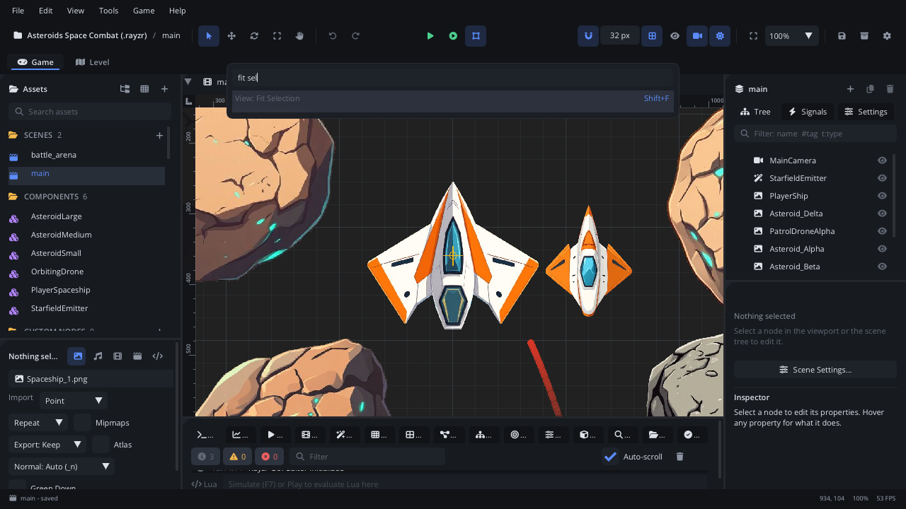

# Command palette

The command palette runs any editor command by name: press
**Cmd+Shift+P** (Ctrl+Shift+P), type a few letters and press Enter. The
same box, opened with **Cmd+P**, finds and opens project files, goes to a
line, and lists search results such as a symbol's references.

## When to use it

- Run a command without looking for it in the menus, or when you don't
  know its shortcut (the palette shows it next to the name).
- Open a scene, script, component or asset by name: **Cmd+P**.
- Jump to a line of the open script: type `:` and the line number.
- To see every command and shortcut at once, use
  [Keyboard Shortcuts](keyboard-shortcuts.md) (Cmd+Shift+K); to rebind
  keys, [Settings](settings.md) > Keymap.

## Opening it

| Shortcut | Opens |
|---|---|
| **Cmd+Shift+P** | Commands. Also **View > Command Palette** and **Help > Command Palette**. |
| **F1** | Commands, when no panel has focus (with a panel focused, F1 opens that panel's page of this manual). |
| **Cmd+P** | Files (**File > Open File...**). |
| **Ctrl+G** | Go to line, while the Code tab has focus. |
| **Shift+F12** (Code tab) | The references of the symbol at the caret. |
| **Cmd+Shift+O** (Code tab) / **Cmd+T** | The symbols of the open script / of every script in the project. |

## What's in it

A text box at the top of the window and up to twelve rows under it (the
list scrolls for more).

| Control | What it does |
|---|---|
| **Text box** | Filters as you type. Letters match in order, not necessarily side by side: `fsel` finds *View: Fit Selection*. Matches at the start of words, and letters next to each other, rank first. |
| **Rows** | The matches, best first. A command shows its menu and name (*File: Save*) and its shortcuts at the right; a file its name and its folder. A greyed-out command can't run now (nothing selected, no scene open...). |
| **Up / Down**, **Page Up / Page Down** | Move the highlight (one row, ten rows). |
| **Enter** or a click | Runs the command, or opens the file or place. |
| **Esc** or a click outside | Closes the palette. |

### Commands

Every command of the editor - the same list as the menus and the
Keyboard Shortcuts window, including commands that plugins add. With
nothing typed, the commands you ran last (up to twelve) come first, the
latest at the top.

### Files

Lists the project's scenes, scripts, components, levels, images, sounds
and packages (`.json`, `.lua`, `.ldtk`, `.png`, `.jpg`, `.wav`, `.ogg`,
`.mp3`, `.rayzr`), in every folder except hidden ones. Picking one opens
it as a double-click in Assets would:

| File | Opens |
|---|---|
| Scene | In its scene tab. |
| Script or shader | In the [Code tab](code.md). |
| Component | In its own tab, to edit. |
| Custom node type | Adds one to the scene, at the centre of the view. |
| LDtk project (`.ldtk`) | Adds an LDtk Level node for it to the scene. |
| Level generator (`.levelgen.json`) | In the [Level Generator](level-generator.md) window. |
| Image, sound, package, other | Selects it in [Assets](assets.md), with its preview. |

### Prefixes

| Type first | Switches to |
|---|---|
| `>` | Commands (from the file finder: `>save`). |
| `:` | Go to line in the open script: `:120`, or `:120:8` for a column too. Without a script open it says *Open a script to go to a line*. |

### Lists of places

Commands that find several places show them in the palette: **Find All
References** (*References*), **Go to Symbol in File...** and **Go to
Symbol in Project...**. Each row is the line's text with its file and
line; type to filter them, Enter to go there.

## Walkthrough

Fit the view to a node, then open its script without the mouse:

1. Click a node in the Scene panel.
2. Press **Cmd+Shift+P** and type `fit sel`. *View: Fit Selection* is at
   the top, with **Shift+F** at the right.
3. Press **Enter**. The view zooms to the node.
4. Press **Cmd+P** and type part of the script's name (`play` for
   `player_ship.lua`). Press **Enter**: it opens in the Code tab.
5. Press **Cmd+P** again and type `:30`, then **Enter**: the caret goes to
   line 30.
6. Press **Cmd+Shift+P** with nothing typed: *View: Fit Selection* is
   first, as the command you ran last. (Opening the palette or the file
   finder doesn't count.)

## Tips

- Typing in the palette never runs shortcuts: Esc first, then the key.
- A command you rebound shows its new shortcut here too.
- Related: [Keyboard Shortcuts](keyboard-shortcuts.md),
  [Toolbar and menus](toolbar-menus.md), [Code tab](code.md) (Go to
  Symbol, references).
