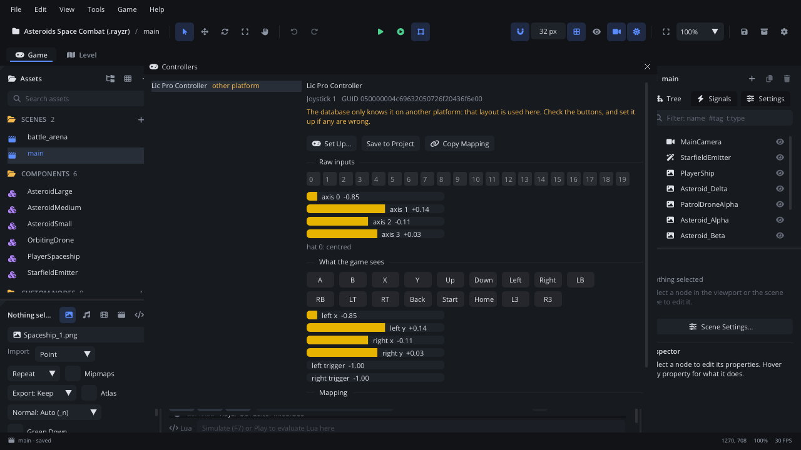

# Controllers

**Tools > Controllers...** shows every controller connected to this
computer:

- its name, and its id (GUID) for the controller database,
- where its **mapping** comes from: which raw button is A, which axis is the
  left stick,
- its raw buttons, axes and hats, live,
- what the game sees through the mapping.

For a controller that isn't recognised, or whose buttons are wrong,
**Set Up...** walks through each button. The result is saved in the
project, so the game has it on every computer.

## When to use it

- A controller does nothing in the game, or its buttons are mixed up
  (A jumps when B should).
- You want to check what a controller reports before writing input code
  for it (a flight stick, a wheel, an arcade panel).
- You want to ship a mapping with your game for a controller you know your
  players use.

## Opening it

- **Tools > Controllers...**, or the command palette (**Controllers...**).
- **Project Settings > Input > Controllers...**
- **F1** in the window opens this page.

## What's in it

| Part | What it shows |
|---|---|
| **The list** (left) | Each connected controller, with where its mapping comes from. **not mapped** in red: the game sees no buttons. **guessed** or **other platform** in amber: it works, but check the buttons. |
| **Source** | The line under the name says where the mapping comes from, in words. |
| **Raw inputs** | Numbered boxes for the buttons, lit while held; a bar per axis (-1 to 1); each hat's direction. Numbers count from 0, as mapping lines name them. |
| **What the game sees** | The gamepad buttons (A, B, X, Y, the d-pad, bumpers, triggers, Back, Start, Home, the stick presses) and the six gamepad axes, through the mapping. |
| **Mapping** | The SDL mapping line in use. |

| Button | What it does |
|---|---|
| **Set Up...** | Starts Controller Setup (below). |
| **Save to Project** | Keeps the mapping in use (the database's, a guess, another platform's) in the project's `gamecontrollerdb.txt`. |
| **Remove from Project** | Takes this controller's line out of the project's `gamecontrollerdb.txt`. |
| **Copy Mapping** | Copies the mapping line, to share or to add to [SDL_GameControllerDB](https://github.com/mdqinc/SDL_GameControllerDB) for everyone. |

## Where mappings come from

The **source** of a mapping is one of these, later ones winning:

| Source | |
|---|---|
| **database** | The controller database Rayzr ships (about 2,300 controllers, refreshed every week). |
| **built in** | GLFW's own, raylib's input library. |
| **project** | The project's `gamecontrollerdb.txt`, next to `project.json`. It's exported with the game. |
| **player** | The player's own, from the built-in Controller Setup screen in a game. |
| **environment** | `SDL_GAMECONTROLLERCONFIG` / `SDL_GAMECONTROLLERCONFIG_FILE`. |
| **other platform** | The database only has it for another platform, so that layout is used here. |
| **guessed** | Unknown controller: a standard layout. **Project Settings > Input > Guess Unknown Controllers** turns this off. |
| **this session** | Set up but not saved. |

## Controller Setup

1. Select the controller and click **Set Up...**. Leave the sticks centred
   and the triggers released: how they sit now counts as rest.
2. Do what it asks: **Press A (the bottom face button)**, **Press up on the
   d-pad**, **Move the left stick right**, and so on (21 steps). Each step
   takes the first button, hat direction or axis that moves, then waits
   until you let go.
3. A button already used for an earlier step is refused, and the window
   says which step has it.
4. **Skip** a button the controller doesn't have. **Back** redoes the last
   step.
5. **Save to Project** uses the mapping at once and writes it to the
   project's `gamecontrollerdb.txt`. Steps you haven't reached are left out,
   so you can stop early.

"A" means the bottom face button whatever is printed on it. On a Nintendo
layout that's the button marked B. Games then read the same positions on
every controller.

## Tips

- Commit `gamecontrollerdb.txt` with the project: it's a plain text file of
  SDL mapping lines, one per controller and platform.
- To let players fix their own controllers, call
  `Input.open_controller_setup()` from your game's options menu.
  [Gamepads](../../engine/docs/gamepads.md#controllers-that-arent-recognised)
  has that and a custom-screen example.
- Controllers are read through raylib's GLFW. On macOS, a controller paired
  over Bluetooth shows up as soon as it's connected in System Settings.
