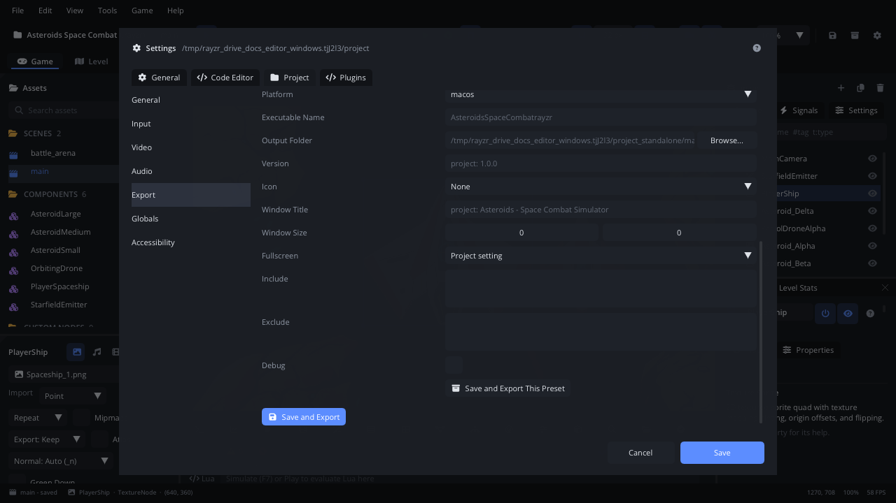

# Export

Exporting turns your project into a game other people can run without the
editor: a macOS app, a Windows program, a Linux program and AppImage, a web
page, or an Android app. **File > Export** starts it; **Project Settings >
Export** holds what each export makes - its platforms, presets, names,
icon and signing. This page is the reference; the
[Exporting your game](../tutorials/exporting.md) tutorial walks through a
whole export step by step.

## When to use it

- Hand your game to players or testers, or put it on a store or a web page.
- Make several builds from one project: one per platform, a demo with
  fewer levels, a debug build with a console.
- Try the game the way a player gets it, outside the editor.
- To run the game while you work, use **Play** instead
  ([Playtesting](playtesting.md)): it needs no export.

## Opening it

| Item | What it does |
|---|---|
| **File > Export > .rayzr Package** | Asks for a folder and writes `<project>.rayzr` there: the whole project in one file, for a runner you already have (modified scenes are saved first). The toolbar's box icon does the same. |
| **File > Export > Standalone Game** | Saves every scene and script and exports each preset (or each ticked target) with the settings below. Greyed out while a build runs. |
| **File > Export > Open Web Export in Browser** | Serves the last web export on `http://127.0.0.1:8765/` (the next free port up to 8799) and opens it in your browser. |
| **Project Settings > Export** | The settings; **Save and Export** (or **Save and Export All**) at the bottom saves them and exports. Open it from the gear in the toolbar or **File > Settings...** > **Project**. |

## What's in it

**Project Settings > Export** has the settings every export shares, then
the presets. Every field is listed in [Settings](settings.md#project--export);
in short:

| Control | What it does |
|---|---|
| **Executable Name** | The program's name (default: the project name without spaces). |
| **Output Folder** | Where exports go (default: `<project>_standalone` beside the project folder). |
| **Targets** | Without presets: the platforms to export, one export each. |
| **Runners** | Which platforms' game runners are *ready*, *missing*, or (this computer's) *built on export*. |
| **Compress Package**, **Include UI Font** | Compress `game.rayzr`; ship the font the UI widgets draw with. |
| **Mods** | Let players mod the exported game: **Off** (default), **Assets only** (their files replace or add to the game's) or **Assets + scripts** (their Lua runs too, sandboxed). Desktop only; see [Modding](../../engine/docs/modding.md). |
| macOS: **Bundle ID**, **Signing Identity**, **Notary Profile** | Shown with a macOS export (below). |
| Android: **Android Package**, **Version Code**, **Keystore**, **Key Alias** | Shown with an Android export ([Android export](../../engine/docs/android_export.md)). |

### Presets

A preset is one export with its own settings. Without presets, the editor
exports each ticked target; **Use Presets** turns those targets into
presets.

| Control | What it does |
|---|---|
| The list | Each preset with its platform (and *debug*). Click one to edit it. |
| **Add Preset** | A new preset for **macos**, **windows**, **linux** or **web** (Android exports use the targets, without presets). |
| **Duplicate** / **Remove** | Copy the selected preset (`<name> copy`) or delete it. |
| **Name**, **Platform** | The preset's name (its folder's name too) and platform. |
| **Executable Name**, **Output Folder** | Override the shared ones (default folder: `<output>/<preset name>`). |
| **Version**, **Icon**, **Window Title**, **Window Size**, **Fullscreen** | Override the project's (empty, *None* or `0 x 0`: the project's own; Fullscreen: *Project setting*, *On* or *Off*). The packaged `project.json` carries them. |
| **Include** / **Exclude** | File patterns, one per line: `audio/` a folder, `*.psd` a file name anywhere, `levels/*.ldtk` a path. With Include patterns, only matching files go in; Exclude leaves files out. |
| **Debug** | Use the debug runner: debug info, and a console window on Windows. |
| **Single File** | Windows and Linux: one executable with the game and the UI font inside it (on by default). Off: the executable, `game.rayzr` and `fonts/` in a folder. |
| **Save and Export This Preset** | Saves the settings and exports this preset only. |

Presets are saved in `project.json` under `"export": {"presets": [...]}`.

### What goes into the game

Every file in the project folder goes into `game.rayzr`, except hidden
files and folders (`.rayzr/`, `.luarc.json`, `.DS_Store`) and what the
preset leaves out. `project.json` always goes in, with the preset's
changes. Textures set to QOI or an atlas in their
[import settings](../../engine/docs/import_settings.md) are converted on
the way.

### Runners

The game runner is the engine built for one platform. It is **prebuilt**:
no compiler is needed to export. The editor looks in `runners/<platform>/`
beside it (or `bin/runners/` in a source checkout). Editor releases ship
every platform's, so one computer exports for all of them. In a source
checkout, `scripts/build_runners.sh` builds this platform's runners
(release and debug); run it on each platform you ship for. Without a
runner for this platform the editor builds it once, which needs `odin`.
A preset whose runner is missing is skipped with a warning.

### What each platform gets

Each preset writes its own folder. `THIRD_PARTY_NOTICES.txt` is in every
one, because the engine's libraries' licenses ask for it: ship it with the
game.

| Platform | The folder |
|---|---|
| **macOS** | `<Name>.app`: `Contents/Info.plist` (name, version, bundle ID - default `com.rayzr.<name>`), the runner in `Contents/MacOS`, its libraries (Lua) in `Contents/Frameworks`, and `game.rayzr`, the font and `AppIcon.icns` (made from the project icon) in `Contents/Resources`. The runner is universal (arm64 + x86_64) when `scripts/build_runners.sh` found the x86_64 libraries; otherwise it is built for the Mac's own architecture. |
| **Windows** | `<Name>.exe`, with the game and the font inside it. With **Single File** off: `<Name>.exe`, `game.rayzr` and `fonts/` (and the runner's libraries). Release runners have no console window. Exported on Windows, the exe gets the project icon (16 to 256 px) and version info (name, description, version); exports made elsewhere keep the runner's own. |
| **Linux** | `<Name>`, one executable with the game inside (for stores and archives), and `<Name>.AppDir` (`AppRun`, a `.desktop` file, the icon, the runner and the game). On Linux with `appimagetool` on `PATH`, also `<Name>-<arch>.AppImage`. |
| **Web** | A static site: `index.html` (titled with the window title, the project icon as `favicon.png`), `index.js`, `index.wasm`, `odin.js`, `game.rayzr` and the font. Building the web runner once needs emscripten: `scripts/build_web_runner.sh`. See [web export](../../engine/docs/web_export.md). |
| **Android** | `<Name>.apk` and `<Name>.aab`. See [Android export](../../engine/docs/android_export.md). |

A single-file game writes its UI font to the system's temp folder the
first time it runs.

### Signing on macOS

The app is signed with `codesign`: ad-hoc by default (it runs on this
Mac), or with the **Signing Identity** you set - a Developer ID to hand it
out; `none` skips signing. With a Developer ID and a **Notary Profile**
(made with `xcrun notarytool store-credentials`), the app is then
notarized and stapled in the background; the Console shows the progress.
Windows exports aren't code-signed. What players see for unsigned games:
[the tutorial's section 7](../tutorials/exporting.md#7-signed-and-unsigned-games).

## Walkthrough

Export a Windows build and a smaller demo build:

1. Open **Project Settings** (the gear) > **Export**.
2. Set **Executable Name** to `CaveRun`.
3. Under **Presets**, click **Use Presets**, then **Add Preset** >
   **windows**. Click the new preset and set its **Name** to `Windows`.
4. Click **Duplicate**. Name the copy `Demo`, and in **Exclude** type
   `scenes/level_3*` on a line of its own.
5. Click **Save and Export All**. The Console lists each export and its
   folder: `Exported Windows (windows): <project>_standalone/Windows`.
6. Open the output folder (`<project>_standalone` beside the project
   folder) and run `Windows/CaveRun.exe` on a Windows PC.

## Tips

- Run an exported game from a terminal with `--user-data <folder>` to keep
  its saves away from your own and read its log (the tutorial's section 6).
- There's no command-line export: exports are made in the editor. A
  runner plays a `.rayzr` package from the command line
  (`runners/<platform>/runner game.rayzr`), or from **Assets > Packages** >
  right-click > **Run Game From Package**, which plays it like Play
  ([Playtesting](playtesting.md)).
- The project's **Icon** (Project > General, a PNG) becomes the game
  window's icon and every platform's app icon.
- Plugins can react to an export (their `after_export` event): see
  [Plugins](plugins.md).
- With **Mods** on, players put mods in a `mods/` folder beside the
  exported game (beside the `.app` on macOS) or in the game's user-data
  folder; `--no-mods` plays without them. Try your own mods with
  `--mods <folder>`. Editor Play never loads mods. See
  [Modding](../../engine/docs/modding.md).
- Related: [Exporting your game](../tutorials/exporting.md),
  [Settings](settings.md), [Playtesting](playtesting.md).
