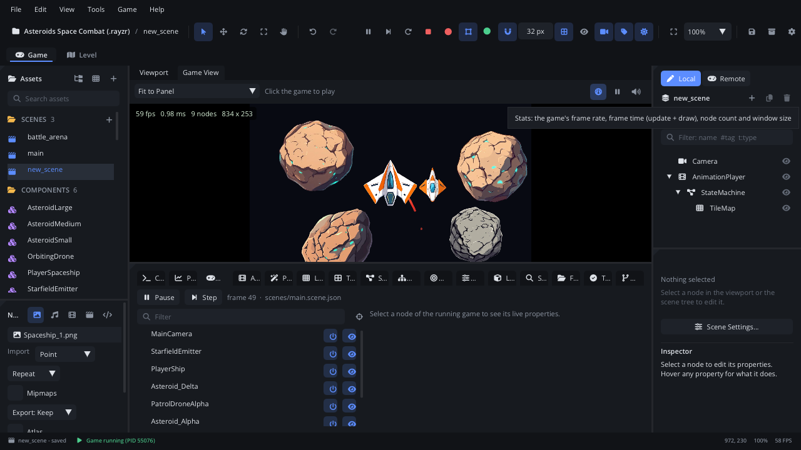

# Game View

The **Game View** plays your game inside the editor, in a tab next to the
Viewport, so the bottom panel stays in sight while you play. It's the real
game, the same one **Play** starts: the Game tab, breakpoints, Pause and
Step, the Remote tree, the Mixer and the Console's Lua line all work as
they do with Play. Only the window is different. Its pictures come to the
editor instead of the screen, and your keys and mouse go to it from here.

## When to use it

- Play and debug at once: watch the [Game tab](tab-game.md),
  [Console](tab-console.md) or [Profiler](tab-profiler.md) while you play,
  with no window in the way.
- Step through a script at a breakpoint with the game beside the
  [Code tab](code.md).
- See the game at other screen sizes (a phone, 720p, 1080p) without
  resizing a window.
- For the game in its own window (full size, another monitor), use
  **Play** (F5 / F6) instead - see [Playtesting](playtesting.md).

## What's in it

### Starting and stopping

| Command | Shortcut | What it does |
|---|---|---|
| **Play Project in Game View** | Opt+F5 (Alt+F5) | Runs the game from its startup scene in the Game View. |
| **Play Current Scene in Game View** | Opt+F6 (Alt+F6) | Runs only the scene you're editing there. |

Both are in the **Game** menu. The toolbar's screen button (next to Play)
does the first; right-click it for the second. Like Play, they save your
scenes first and rebuild the game if its code changed. **Stop** (Shift+F5),
**Pause** (F9), **Step** (Shift+F9) and **Restart** (Cmd+Shift+F5
(Ctrl+Shift+F5)) work as with Play; Restart plays in the Game View again.

The tab opens and comes to the front when the game starts. Click
**Viewport** to edit the scene while the game keeps running, then
**Game View** to go back. You can close the tab when no game is running in
it; the commands above open it again.

### Playing: the keyboard and mouse

| Action | What happens |
|---|---|
| Click the game | The game gets the keyboard and mouse (the click counts in the game too). The picture gets a blue outline and the bar says *Playing*. |
| Shift+Esc | Gives the keyboard back to the editor. The game still gets a plain Esc, for its own menus. |
| Click another panel, or another app | Same: the editor has the keyboard again. |

While the game has the keyboard, the editor's shortcuts are off, so W moves
your player and doesn't pick the Move tool. Play, Stop, Pause, Step,
Restart and the debugger's keys (F8, F10, F11) still work.

Gamepads always go to the game.

### The bar

| Control | What it does |
|---|---|
| **Size** | The game's window size. **Fit to Panel** (the default): the game sees a window the panel's size, so its [Screen Fill](settings.md#project--video) setting applies live as you resize the panel. **Project Resolution**: the project's window size. **Phone Portrait**, **Phone Landscape**, **Tablet**, **720p**, **1080p**, or **Custom** (type a width and height). |
| **Zoom** | With a fixed size: **Fit** scales the game to the panel (letterboxed); **100%** and **200%** show it pixel for pixel, cut at the edges when it's bigger than the panel. |
| *Status* | *Not running*, *Starting the game...*, *Click the game to play*, or *Playing*. |
| **Stats** (gauge) | Shows the game's frame rate, frame time (update and draw, without the wait for the next frame), node count and window size over the picture. |
| **Pause When Unfocused** (pause) | The game pauses when it loses the keyboard (Shift+Esc, another panel, another app) and goes on when you click it again. Off: it keeps running. |
| **Mute** (speaker) | Silences the game. |

The size, zoom and toggles are remembered (editor settings).

When the game is paused, *Paused* shows in the corner of the picture.

## Walkthrough

Watch a variable change while you play:

1. Open the level and press **Opt+F6** (Alt+F6). The Game View opens and the
   game starts in it.
2. In the bottom panel, open the **Game** tab and select your player in the
   tree. Its live values show beside it.
3. Click the game and play: run and jump. The player's position and its
   script's values update in the Game tab as you move.
4. Press **F9** to pause at the moment something goes wrong, and
   **Shift+F9** to step a frame at a time.
5. Press **Shift+Esc**, change a value in the Game tab, then click the game
   and press **F9** to carry on.
6. Press **Shift+F5** to stop.

## Tips

- The game runs at its own frame rate, whatever the editor's; the picture
  you see is one frame behind it.
- **Fit to Panel** is like resizing a game window. To check the size your
  players get, pick **Project Resolution** (or a device size) with
  **Zoom: Fit**.
- **Simulate** (F7) is different: it runs the open scene's scripts and
  physics in the Viewport itself, and puts the scene back when you stop -
  see [Playtesting](playtesting.md#simulate-in-editor).
- More: [Playtesting](playtesting.md), [Game tab](tab-game.md),
  [Toolbar and menus](toolbar-menus.md),
  [Keyboard shortcuts](keyboard-shortcuts.md).
