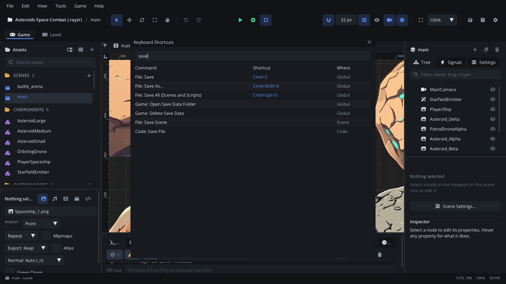

# Keyboard Shortcuts

**Help > Keyboard Shortcuts** (Cmd+Shift+K) lists every editor command
with its shortcuts and where it works. Every command comes from one table,
which also drives the keys, the menus and the
[command palette](command-palette.md), so a shortcut shown anywhere is the
one that works. This page lists the default shortcuts.

## When to use it

- Look up the key for a command, or find what a key does.
- Before rebinding a key: see what else uses it. You change shortcuts in
  [Settings](settings.md) > General > **Keymap**, which also flags
  conflicts.
- To run a command whose key you don't remember, use the
  [command palette](command-palette.md) instead: it runs what you pick.

## What's in it

On macOS the shortcuts use **Cmd** and **Opt**; on Windows and Linux,
Cmd is **Ctrl** and Opt is **Alt**. **Ctrl** shortcuts (Ctrl+Tab, Ctrl+G,
Ctrl+Space) use the Control key everywhere. The window shows your own
bindings with your platform's names.

| Control | What it does |
|---|---|
| **Filter** | Type part of a command's name or of a key (`save`, `shift+f`): only the matching rows stay. |
| **Command** | The command's menu and name, as in the palette (*File: Save*). |
| **Shortcut** | Its shortcuts. A command can have up to three; some have none, but you can give them one in the Keymap. |
| **Where** | **Global**: anywhere, except while you type in a text field. **Scene**: while you edit the scene (the viewport, Scene panel, Inspector), not while the Code tab has focus. **Code**: while the Code tab has focus. |

**F1** in the window opens this page.

Some panels have their own keys besides these: the
[viewport](viewport.md) (mouse and gizmo keys), the
[Animation tab](tab-animation.md)'s timeline, the
[State Machine](tab-stategraph.md), [Behavior Tree](tab-behaviortree.md)
and [GOAP](tab-goap.md) graphs, the [Level tab](level.md) (its own
shortcut list: **Help > Level Editor Shortcuts**), the
[Level Generator](level-generator.md), and the
[Code tab](../../editor/CODE_EDITOR.md)'s editing keys.

## Every command

In the list below, **Where** is *Anywhere* (global), *Scene editing* or
*Code tab*.

<!-- shortcuts:begin - generated from editor/actions.odin by `bin/editor --dump-shortcuts docs/editor/keyboard-shortcuts.md`; don't edit by hand -->

### Help

| Command | Shortcut | Where |
|---|---|---|
| Help for This Panel | `F1` | Anywhere |
| Welcome |  | Anywhere |
| Scripting Reference |  | Anywhere |
| Node Reference |  | Anywhere |
| Editor Manual |  | Anywhere |
| Documentation for the Selected Node | `Shift+F1` | Scene editing |
| Level Editor Reference |  | Anywhere |
| Level Editor Shortcuts |  | Anywhere |
| Report a Bug... |  | Anywhere |
| Open Crash Reports Folder |  | Anywhere |
| Keyboard Shortcuts | `Cmd+Shift+K` | Anywhere |

### View

| Command | Shortcut | Where |
|---|---|---|
| Command Palette | `Cmd+Shift+P`, `F1` | Anywhere |
| Go to File | `Cmd+P` | Anywhere |
| Focus Viewport | `Cmd+1` | Anywhere |
| Focus Code Editor | `Cmd+2` | Anywhere |
| Focus Console | `Cmd+J` | Anywhere |
| Game Tab | `Cmd+Shift+1` | Anywhere |
| Level Tab (LDtk level editor) | `Cmd+Shift+2` | Anywhere |
| Frame Selection | `F` | Scene editing |
| Reset Zoom (100%) | `Cmd+0` | Scene editing |
| Fit Scene to View | `Home` | Scene editing |
| Fit Game View | `Shift+Home` | Scene editing |
| Fit Selection | `Shift+F` | Scene editing |
| Zoom In | `Cmd+=` | Scene editing |
| Zoom Out | `Cmd+-` | Scene editing |
| Show Grid | `Shift+G` | Scene editing |
| Show Bounds & Colliders |  | Scene editing |
| Show Camera Frames |  | Scene editing |
| Rulers & Guides | `Cmd+Shift+R` | Scene editing |
| Clear Guides |  | Scene editing |
| Smart Snapping |  | Scene editing |
| Show All Colliders |  | Scene editing |
| File Browser | `Cmd+Shift+B` | Anywhere |
| Inspector Help |  | Anywhere |
| Show Tab Bars |  | Anywhere |
| Colour Vision: Protanopia |  | Scene editing |
| Colour Vision: Deuteranopia |  | Scene editing |
| Colour Vision: Tritanopia |  | Scene editing |
| Snap to Grid | `Shift+S` | Scene editing |
| Snap Rotation |  | Scene editing |

### File

| Command | Shortcut | Where |
|---|---|---|
| Save | `Cmd+S` | Anywhere |
| Save As... | `Cmd+Shift+S` | Anywhere |
| Revert Scene |  | Anywhere |
| New Project... |  | Anywhere |
| Open Project... | `Cmd+Shift+O` | Anywhere |
| Save All (Scenes and Scripts) | `Cmd+Opt+S` | Anywhere |
| Settings... | `Cmd+,` | Anywhere |
| Project Settings... |  | Anywhere |
| Export .rayzr Package... |  | Anywhere |
| Open Web Export in Browser |  | Anywhere |
| Export Standalone Game... |  | Anywhere |
| Quit | `Cmd+Q` | Anywhere |
| New Scene | `Cmd+N` | Scene editing |
| Save Scene |  | Scene editing |

### Game

| Command | Shortcut | Where |
|---|---|---|
| Play Project | `F5` | Anywhere |
| Play Current Scene | `F6` | Anywhere |
| Stop Game | `Shift+F5` | Anywhere |
| Pause Game | `F9` | Anywhere |
| Step One Frame | `Shift+F9` | Anywhere |
| Restart Game | `Cmd+Shift+F5` | Anywhere |
| Show Colliders in Game |  | Anywhere |
| Simulate in Editor | `F7` | Anywhere |
| Open Save Data Folder |  | Anywhere |
| Delete Save Data |  | Anywhere |

### Debug

| Command | Shortcut | Where |
|---|---|---|
| Continue | `F8` | Anywhere |
| Step Over | `F10` | Anywhere |
| Step Into | `F11` | Anywhere |
| Step Out | `Shift+F11` | Anywhere |

### Edit

| Command | Shortcut | Where |
|---|---|---|
| Undo | `Cmd+Z` | Scene editing |
| Redo | `Cmd+Shift+Z`, `Cmd+Y` | Scene editing |
| Add Node... | `Cmd+A` | Scene editing |
| Copy | `Cmd+C` | Scene editing |
| Cut | `Cmd+X` | Scene editing |
| Paste | `Cmd+V` | Scene editing |
| Duplicate | `Cmd+D` | Scene editing |
| Delete | `Del`, `Backspace` | Scene editing |
| Lock in Viewport | `Cmd+L` | Scene editing |
| Hide in Editor | `Cmd+Shift+H` | Scene editing |
| Rename Node | `F2` | Scene editing |
| Select All Nodes | `Cmd+Shift+A` | Scene editing |
| Deselect | `Esc` | Scene editing |
| Nudge Left | `Left`, `Shift+Left` | Scene editing |
| Nudge Right | `Right`, `Shift+Right` | Scene editing |
| Nudge Up | `Up`, `Shift+Up` | Scene editing |
| Nudge Down | `Down`, `Shift+Down` | Scene editing |

### Align

| Command | Shortcut | Where |
|---|---|---|
| Align Left Edges |  | Scene editing |
| Align Horizontal Centers |  | Scene editing |
| Align Right Edges |  | Scene editing |
| Align Top Edges |  | Scene editing |
| Align Vertical Centers |  | Scene editing |
| Align Bottom Edges |  | Scene editing |
| Distribute Horizontally |  | Scene editing |
| Distribute Vertically |  | Scene editing |

### Tools

| Command | Shortcut | Where |
|---|---|---|
| Select Tool | `Q` | Scene editing |
| Move Tool | `W` | Scene editing |
| Rotate Tool | `E` | Scene editing |
| Scale Tool | `R` | Scene editing |
| Sprite Sheet Slicer... |  | Anywhere |
| Pan Tool | `T` | Scene editing |
| Format Scene Files |  | Anywhere |
| Set Up Scene Merging |  | Anywhere |
| Merge Conflicts... |  | Anywhere |
| Registry... |  | Anywhere |
| New Plugin... |  | Anywhere |

### Scene

| Command | Shortcut | Where |
|---|---|---|
| Close Scene Tab | `Cmd+W` | Scene editing |
| Next Scene Tab | `Ctrl+PageDown`, `Ctrl+Tab`, `Cmd+Opt+Right` | Scene editing |
| Previous Scene Tab | `Ctrl+PageUp`, `Ctrl+Shift+Tab`, `Cmd+Opt+Left` | Scene editing |
| New Component |  | Anywhere |
| New Custom Node Type |  | Anywhere |

### Code

| Command | Shortcut | Where |
|---|---|---|
| Scripting Reference for Symbol | `F1` | Code tab |
| Paste from Clipboard History | `Cmd+Shift+V` | Code tab |
| Copy Path |  | Code tab |
| Copy Absolute Path |  | Code tab |
| Copy Location (path:line) |  | Code tab |
| Copy as Markdown |  | Code tab |
| Wrap in if ... end |  | Code tab |
| Wrap in do ... end |  | Code tab |
| Wrap in local function ... end |  | Code tab |
| Expand Selection | `Ctrl+Shift+Right` (Windows, Linux: `Alt+Shift+Right`) | Code tab |
| Shrink Selection | `Ctrl+Shift+Left` (Windows, Linux: `Alt+Shift+Left`) | Code tab |
| Skip Occurrence (Select Next Instead) | `Cmd+Opt+D` | Code tab |
| Add Cursors to Line Ends | `Opt+Shift+I` | Code tab |
| Undo Cursor | `Cmd+U` | Code tab |
| Select Inside Brackets / Quotes | `Cmd+Shift+M` | Code tab |
| Go to Matching Bracket | `Cmd+Shift+\` | Code tab |
| Fold | `Cmd+Opt+[` | Code tab |
| Unfold | `Cmd+Opt+]` | Code tab |
| Fold All | `Cmd+Opt+Shift+[` | Code tab |
| Unfold All | `Cmd+Opt+Shift+]` | Code tab |
| Toggle Soft Wrap | `Opt+Z` | Code tab |
| Toggle Inlay Hints | `Ctrl+Opt+H` | Code tab |
| Go Back | `Ctrl+-` | Code tab |
| Go Forward | `Ctrl+Shift+-` | Code tab |
| Next Problem | `F8` | Code tab |
| Previous Problem | `Shift+F8` | Code tab |
| Next Change | `Opt+F8` | Code tab |
| Previous Change | `Opt+Shift+F8` | Code tab |
| Go to Symbol in File... | `Cmd+Shift+O` | Code tab |
| Go to Symbol in Project... | `Cmd+T` | Anywhere |
| Find in Files | `Cmd+Shift+F` | Anywhere |
| Peek Definition | `Opt+F12` | Code tab |
| Peek References | `Opt+Shift+F12` | Code tab |
| Code Actions (Quick Fix) | `Cmd+.` | Code tab |
| Extract Local Variable | `Cmd+Opt+V` | Code tab |
| Extract Method | `Cmd+Opt+M` | Code tab |
| Inline Variable | `Cmd+Opt+N` | Code tab |
| Toggle get_property / Field Access |  | Code tab |
| Toggle {x, y} / Vec2(x, y) |  | Code tab |
| Local History... |  | Code tab |
| Show in Inspector |  | Code tab |
| Save File |  | Code tab |
| Close Tab | `Cmd+W` | Code tab |
| Reopen Closed Tab | `Cmd+Shift+T` | Code tab |
| Next Tab | `Ctrl+Tab`, `Cmd+Shift+]` | Code tab |
| Previous Tab | `Ctrl+Shift+Tab`, `Cmd+Shift+[` | Code tab |
| Undo | `Cmd+Z` | Code tab |
| Redo | `Cmd+Shift+Z`, `Cmd+Y` | Code tab |
| Cut | `Cmd+X` | Code tab |
| Copy | `Cmd+C` | Code tab |
| Paste | `Cmd+V` | Code tab |
| Select All | `Cmd+A` | Code tab |
| Select Line | `Cmd+L` | Code tab |
| Toggle Comment | `Cmd+/` | Code tab |
| Indent | `Cmd+]` | Code tab |
| Outdent | `Cmd+[` | Code tab |
| Move Line Up | `Opt+Up` | Code tab |
| Move Line Down | `Opt+Down` | Code tab |
| Duplicate Line Down | `Cmd+Shift+D`, `Opt+Shift+Down` | Code tab |
| Duplicate Line Up | `Opt+Shift+Up` | Code tab |
| Delete Line | `Cmd+Shift+K` | Code tab |
| Insert Line Below | `Cmd+Enter` | Code tab |
| Insert Line Above | `Cmd+Shift+Enter` | Code tab |
| Join Lines | `Ctrl+J` | Code tab |
| Delete to Line Start | `Cmd+Backspace` | Code tab |
| Select Next Occurrence | `Cmd+D` | Code tab |
| Select All Occurrences | `Cmd+Shift+L` | Code tab |
| Add Cursor Above | `Cmd+Opt+Up` | Code tab |
| Add Cursor Below | `Cmd+Opt+Down` | Code tab |
| Find | `Cmd+F` | Code tab |
| Find and Replace | `Cmd+Opt+F`, `Cmd+H` | Code tab |
| Find Next | `Cmd+G`, `F3` | Code tab |
| Find Previous | `Cmd+Shift+G`, `Shift+F3` | Code tab |
| Go to Line... | `Ctrl+G` | Code tab |
| Show Completions | `Ctrl+Space` | Code tab |
| Show Signature Help | `Cmd+Shift+Space` | Code tab |
| Go to Definition | `F12` | Code tab |
| Find All References | `Shift+F12` | Code tab |
| Rename Symbol | `F2` | Code tab |
| Format Document | `Cmd+Shift+I`, `Opt+Shift+F` | Code tab |
| Increase Font Size | `Cmd+=` | Code tab |
| Decrease Font Size | `Cmd+-` | Code tab |
| Reset Font Size | `Cmd+0` | Code tab |
| New Script |  | Anywhere |

<!-- shortcuts:end -->

## Walkthrough

Find the key for fitting the view to the selection, then move Simulate to
another key:

1. Press **Cmd+Shift+K**. The Keyboard Shortcuts window opens.
2. Type `fit` in **Filter**. *View: Fit Selection* shows **Shift+F**.
3. Clear the filter and type `simulate`. *Game: Simulate in Editor* shows
   **F7**, scope **Global**.
4. Open **File > Settings...** (Cmd+,), **General** > **Keymap**, type
   `simulate` in its filter, click the row's pen (**Record a new
   shortcut**) and press the new key. It replaces the first shortcut; a
   warning sign means another command uses that key. The arrow resets the
   row to its default, the **x** removes its shortcuts. Click **Save**.
5. Back in the Keyboard Shortcuts window, the row shows the new key.

## Tips

- A disabled command doesn't take its key, so two commands can share a key
  when only one is ever enabled at a time (F8: the next problem in a
  script, or Continue while the debugger is paused).
- In the Code tab, its own command wins over a global or scene command on
  the same key: there Cmd+Shift+K deletes the line, so open this window
  from the Help menu.
- Typing in a text field (the Inspector, a filter) keeps the keys for the
  field: global and scene shortcuts wait until you leave it.
- Related: [Toolbar and menus](toolbar-menus.md),
  [command palette](command-palette.md), [Settings](settings.md) (Keymap).
