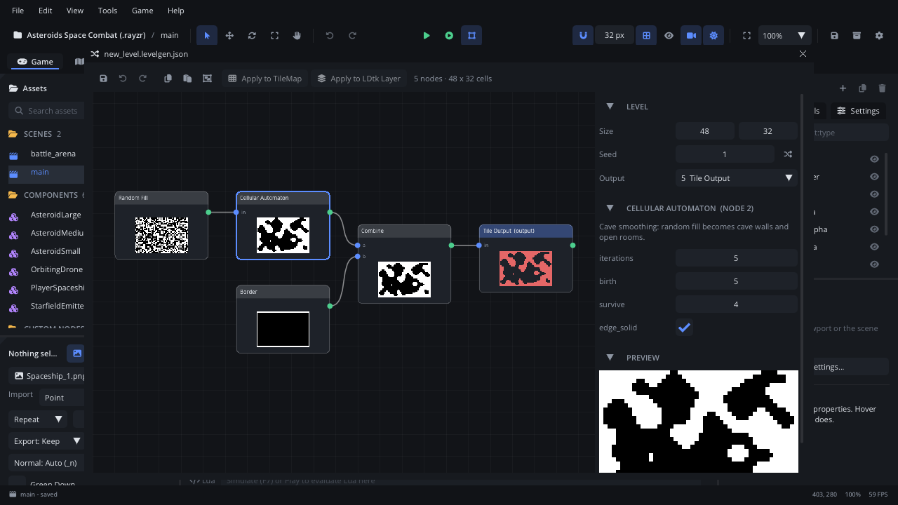

# Level Generator

The **Level Generator** window edits a procedural level: a `.levelgen.json`
graph of nodes that make grids of numbers (noise, random fill, rooms,
shapes), change them (threshold, cave smoothing, combine) and turn them
into tiles and entities. Every node shows a thumbnail of its grid, and the
previews follow each change while you work. **Apply to TileMap** writes the
level into a Tile Map in the scene; a
[Level Generator](../nodes/LevelGeneratorNode.md) node makes a new one each
time the game runs.

## When to use it

- **Making levels that change every play**: caves, dungeons, islands,
  platforms. The same generator and **seed** always give the same level,
  so a seed is a level you can share, replay or test.
- **Trying out a level quickly**: drag a value or roll a new seed and
  watch the previews, then **Apply to TileMap** and paint over the result
  by hand in the [Tile Map tab](tab-tilemap.md).
- **Placing things**: an **Entity Output** puts a component (enemies,
  pickups, the player's start) on the points a scatter node picks.
- **Filling an LDtk level**: **Apply to LDtk Layer** writes the tile output
  into an IntGrid layer picked in the
  [Level tab](../../engine/docs/level_editor.md).
- For what each node does and its parameters, read the
  [level generator guide](../../engine/docs/level_generator.md); for a
  step-by-step first level, the
  [level generator tutorial](../tutorials/levelgen.md).

## Opening it

- **Assets > + > New Level Generator** creates
  `levels/new_level.levelgen.json` (then `new_level_2`, ...) and opens it.
  It starts as a small closed cave: **Random Fill** > **Cellular
  Automaton**, a **Border**, a **Combine** and a **Tile Output**.
- **Double-click** a `.levelgen.json` in [Assets](assets.md), or
  right-click it > **Open in Level Generator**. Dragging one onto the
  viewport opens it too.
- **Go to File** (Cmd+P (Ctrl+P)) and pick a `.levelgen.json`.
- In the [Inspector](inspector.md) of a Level Generator node, the pen
  button next to the generator file: **Open it in the Level Generator**.

The window opens centred in the editor and docks like any panel. Its title
is the file's name, with ` *` while there are unsaved changes. One
generator is open at a time: opening another one while this one has
unsaved changes asks first - **Save**, **Don't Save** or **Cancel**, as a
scene tab does.

## What's in it

The toolbar runs along the top; below it the **canvas** (left) holds the
graph and the **side panel** (right) shows the level's settings, the
selected node and a large preview. Drag the edge between them to make the
canvas wider or narrower.

### The toolbar

| Control | What it does |
|---|---|
| **Save** (disk) | Saves the file. Cmd+S (Ctrl+S) while the window has focus. Lit while there are unsaved changes. |
| **Undo** / **Redo** (arrows) | Every change to the graph: nodes, links, values, the seed, pastes, frames - and **Apply to TileMap**, in the order you made them. Cmd+Z (Ctrl+Z), Cmd+Shift+Z (Ctrl+Shift+Z); while you type in a field, these keys (and Cmd+S) are the field's. Up to 100 steps; the history is lost when the window opens another file. |
| **Copy** | Copies the selected nodes and the links between them (Cmd+C (Ctrl+C)). Off when nothing is selected. |
| **Paste** | Pastes copied nodes in the middle of the canvas (Cmd+V (Ctrl+V) pastes at the mouse). |
| **Frame** (grouped squares) | Adds a comment frame around the selected nodes, or an empty one in the middle of the canvas when none are selected. |
| **Apply to TileMap** | Writes the level - tiles and entities - into the Tile Map selected in the scene. Off until you select a Tile Map. The Console says which map and seed. It is a scene change: the window's Undo takes it back, and so does the scene's (see [Tips](#tips)). |
| **Apply to LDtk Layer** | Writes the tile output into the IntGrid layer picked in the Level tab: its tiles become the IntGrid values and the auto layers draw the rest. Off until an IntGrid layer is picked. The Level tab's undo takes it back. |
| Status | `N nodes · W x H cells`. |

When a Level Generator node in the open scene makes this generator's
levels in **chunks**, a line under the toolbar says whether the graph is
chunk-safe, or lists the nodes that are not (each chunk makes its own, so
seams show). See
[Endless levels: chunks](../../engine/docs/level_generator.md#endless-levels-chunks).

### The canvas

Each node is a box: its name in the header (**(output)** after the output
node's name; output nodes have a tinted header), its inputs as dots down
the left with their names, its output as the green dot on the right, and a
thumbnail of its grid (white is 1, black 0; a tile output shows its tiles,
in their real pictures once it has a tileset). A **red** border means the
node can't be computed: the start of the error shows in place of its
thumbnail, the whole error in the side panel. An **amber** border and a
warning sign mean the node isn't chunk-safe (only when the generator is
used chunked). Links are curves from an output to the inputs reading it.

| Mouse / key | What it does |
|---|---|
| Click a node | Select it; the side panel shows it. |
| Shift+click, Cmd+click (Ctrl+click) | Add the node to the selection, or take it out. |
| Drag a node's box | Move it - with every selected node when it is one of them. |
| Drag on the empty canvas | A selection box: selects the nodes it touches (Shift or Cmd (Ctrl): adds them). A click on the empty canvas selects nothing. |
| Drag from an output (green dot) onto an input | Connect them; a link already on that input is replaced. A link that would make a loop is refused, with a warning in the Console. Linking a Wave Function Collapse node into a Tile Output turns its **tile_ids** on. |
| Right-click an input | Disconnect it. |
| Right-click the empty canvas | The add menu (below). |
| Right-click a node | The node menu (below). |
| Drag a frame's title bar | Move the frame and the nodes inside it (a node is inside when its middle is). |
| Drag a frame's bottom-right corner | Resize the frame. |
| Click a frame's title bar | Select the frame: its title and colour show in the side panel. |
| Right-click a frame | **Delete Frame**: removes the frame; the nodes in it stay. |
| Wheel | Pan up and down (a sideways wheel or trackpad: sideways). |
| Shift+wheel | Pan sideways. |
| Cmd+wheel (Ctrl+wheel) | Zoom at the mouse. |
| Middle-drag | Pan. |
| **F** (mouse over the canvas) | Frame every node. The window also frames them when it opens a file. |
| Delete or Backspace | Remove the selected frame, or else the selected nodes. |
| Cmd+C / Cmd+V / Cmd+D (Ctrl+C / Ctrl+V / Ctrl+D) | Copy, paste at the mouse, duplicate (see below). |
| Cmd+A (Ctrl+A) | Select every node. |

Node names and port names are hidden when zoomed far out, frame titles a
little further out.

#### The add menu (right-click the empty canvas)

| Item | What it does |
|---|---|
| **Search nodes** | Focused when the menu opens. Typing filters every node type by its name; **Enter** adds the first match. |
| Node types | While the search is empty, every type by group: **Generators**, **Modifiers**, **Playable**, **Output**, and **Your Own** (**Lua Script** and any types registered from Odin). Hover one for what it does; click to add it where you right-clicked. |
| **Paste** | Pastes copied nodes where you right-clicked. Off when there is nothing to paste. |
| **Add Frame** | An empty comment frame where you right-clicked. |

#### The node menu (right-click a node)

Right-clicking a node that isn't selected selects just it; right-clicking
one of several selected nodes keeps them all, and the menu acts on all of
them.

| Item | What it does |
|---|---|
| **Copy** | Copies the selected nodes and the links between them. |
| **Duplicate** | A copy of the selected nodes beside them (Cmd+D (Ctrl+D)); the clipboard is left alone. |
| **Use as Output** | Makes this node the generator's output (the **Output** field in the side panel). Off for the output itself and when several nodes are selected. |
| **Frame Selection** | A comment frame around the selected nodes. |
| **Delete** | Removes the selected nodes. |

#### Copy, paste and duplicate

A copy keeps the links between the copied nodes; links to nodes you
didn't copy are dropped. Pasted nodes get new ids and are selected. The
copy is also put on the system clipboard, so it pastes into another
generator, in a later session or in another editor. Every paste and
duplicate is one undo step.

#### Comment frames

A frame is a titled, coloured box behind nodes, to label parts of a graph
("caves", "decoration"). It moves the nodes inside it when you drag its
title bar. It changes nothing in the level.

### The side panel

#### Level

| Field | What it does |
|---|---|
| **Size** | The level's width and height in cells (1 to 4096 each). |
| **Seed** | The level's seed: the same seed gives the same level. The dice button next to it picks a new one (**A new seed**). |
| **Output** | The node whose result is the level (by default the last Tile Output); its name shows **(output)** on the canvas. Tile Outputs with a **Layer** name and Entity Outputs are written as well. |

#### Frame

Shown while a frame is selected: **Title** (press Enter or click away to
set it), **Colour** (the fill is a light tint of it) and **Delete Frame**.

#### The selected node

Its header is the node's name and id, e.g. `Cellular Automaton (node 2)`,
then what it does, its error in red when it can't be computed, and a
warning when it isn't chunk-safe. With several nodes selected, a line says
how many; the panel shows the one clicked last.

- **Parameters**: one row per parameter - a number to drag (double-click
  to type), a checkbox or a list. Hover a name's field for what it does.
  A drag is one undo step.
- **Tile Output**: **Tileset** - the image its tile numbers count in,
  `tile_w` x `tile_h` pixels each; the grid button next to it takes the
  tileset and tile size of the Tile Map selected in the scene. **Layer** -
  empty: the main Tile Map; a name: the Tile Map of that name next to it,
  so one generator can fill ground, walls and decoration.
  **Rules** - each cell takes the first rule whose range (**from** / **to**)
  holds its value, and one of its tiles: type them (`3, 4`) or **Pick**
  them from the tileset (click tiles to add or remove them); with a tileset
  that has terrains, a rule can use a terrain instead, auto-tiled. **Add
  Rule**, and the **x** to remove one. **Pattern Rules** - after the rules,
  a 3 x 3 pattern (click a cell: grey any, blue in the range, red not), a
  range, a **chance** and tiles: decorations, ledges, corners. **Add
  Pattern Rule** starts as "an empty cell with solid below". With
  **writes** set to `components`, the rules pick a component each instead
  of tiles.
- **Entity Output**: **Component** - the `.component.json` it places on
  every point of its input.
- **Height Output**: **Tileset**, **Walls** (the Tile Map that solid
  levels' edges go into), and for each level its **Map**, **Tiles** (tiles,
  or a terrain), **Cliff** face and **Solid**; **From** when `thresholds`
  is `custom`. See
  [Height layers](../../engine/docs/level_generator.md#height-layers).
- **Wave Function Collapse**: the **Sample** to paint (left button paints
  the brush, right erases; **Size**, **Eraser**, **Fill**, the tiles already
  in it and the tileset of the Tile Output it feeds to pick the brush
  from), or, with `rules` set to `wang`, its **Wang Tiles** (a tile, its
  four edge colours N / E / S / W and a weight; **Add Wang Tile**). See
  [Wave Function Collapse](../../engine/docs/level_generator.md#wave-function-collapse).
- **Lua Script**: the script file, **New** (writes
  `levels/<generator>_<node>.gen.lua` from a template and opens it in the
  Code tab), **Edit**, and **Reload** (read it again after saving it).

#### Preview

A large picture of the selected node's grid, or of the output's when no
node is selected. **Updating...** shows while a change is being computed.
Levels over 1024 x 1024 cells aren't previewed: apply one to a Tile Map to
see it.

### Node types

The add menu's groups. Each node's parameters and how to combine them are
in the [level generator guide](../../engine/docs/level_generator.md#nodes).

| Group | Nodes |
|---|---|
| **Generators** | **Constant** (one value everywhere), **Noise** (value, Perlin or Simplex), **Random Fill**, **Gradient**, **Border**, **Rectangle**, **Rooms & Corridors** (a BSP dungeon), **Walker** (winding tunnels), **Random Lines**, **Random Rectangles**, **Random Circles**, **Wave Function Collapse** (tile ids from a painted sample or Wang tiles). |
| **Modifiers** | **Threshold**, **Invert**, **Remap**, **Blur**, **Cellular Automaton** (cave smoothing), **Dilate**, **Erode**, **Combine** (two grids into one), **Scatter** and **Poisson Scatter** (points to place things on), **Surface** (empty cells against solid ones: where things stand or hang). |
| **Playable** | **Flood Fill** (what the player can reach), **Regions** (fills unreachable pockets), **Connect Regions** (corridors joining every area), **Start-to-Exit Path**, **Check** (fails a level that isn't playable enough). See [Playable levels](../../engine/docs/level_generator.md#playable-levels). |
| **Output** | **Tile Output** (tiles, or components, into a Tile Map or an LDtk layer), **Entity Output** (a component on each point), **Height Output** (height levels, each into its own Tile Map, with terrain edges and cliffs). |
| **Your Own** | **Lua Script** (a `.lua` function) and types registered from Odin. See [Your own nodes](../../engine/docs/level_generator.md#your-own-nodes). |

### Background evaluation

After each change, a worker thread computes the graph while the window
stays responsive, so you can keep dragging a value. Only the nodes the
change reaches are computed again; the others come from the last time.
Script files are read when the generator opens, when a node's script is
picked, and on **Reload**.

### Closing

Closing the window with unsaved changes asks **Save <file>?**: **Save**,
**Discard** (closes without saving; the Console says so) or **Cancel**
(Esc).

## Walkthrough

A cave written into a Tile Map:

1. In **Assets**, click **+ > New Level Generator**. The window opens on a
   small cave; each node shows its thumbnail.
2. Right-click the empty canvas, type `noise` and press **Enter**: a
   **Noise** node appears. Right-click again, type `thres`, press
   **Enter** for a **Threshold**.
3. Drag from the Noise's green dot onto the Threshold's `in` dot, then from
   the Threshold's green dot onto the Cellular Automaton's `in` dot (it
   replaces the Random Fill's link). Select the Random Fill and press
   **Delete**.
4. Click the Noise node and drag its **scale** in the side panel; click the
   Threshold and set its **value**. The previews follow.
5. Click the dice next to **Seed** a few times until you like the cave.
   Press Cmd+S (Ctrl+S) to save.
6. Add a **Tile Map** node to the scene and select it. Click the Tile
   Output node and, in the side panel, click the grid button next to
   **Tileset** to take the map's tileset and tile size; **Pick** the
   rule's tiles from it.
7. Click **Apply to TileMap**: the level is in the scene. To make a new one
   each time the game runs, add a [Level Generator](../nodes/LevelGeneratorNode.md)
   node with the Tile Map as its child and pick this file as its
   **Generator**.

## Tips

- **Apply to TileMap** is a step in both histories: Cmd+Z (Ctrl+Z) in the
  window right after it takes the level out of the map, as does the
  scene's **Edit > Undo**. If you edit the scene after applying, undo the
  apply from the scene (the window says so).
- Use the seed dice to judge a generator, not one lucky level: a good
  graph looks right on most seeds.
- Nodes that take a `seed` add it to the level's seed, so two Random Fill
  nodes with different seeds differ while the whole level still follows
  the one **Seed**.
- Select a node in the middle of the graph to see its own grid large in
  **Preview**; the red border points at the node that stops the level.
- Keep reusable parts (a decoration pass, a playability check) in a frame
  and copy them into the next generator with Cmd+C / Cmd+V (Ctrl+C /
  Ctrl+V).
- A Level Generator node's Inspector can override the generator's
  parameters for that node only, and **Generate Now** bakes a level into
  the scene - see [Level Generator](../nodes/LevelGeneratorNode.md).
- Related: [Tile Map](../nodes/TileMapNode.md), [Tile Map tab](tab-tilemap.md)
  (terrains for auto-tiling), [LDtk tab](tab-ldtk.md),
  [level generator guide](../../engine/docs/level_generator.md).
