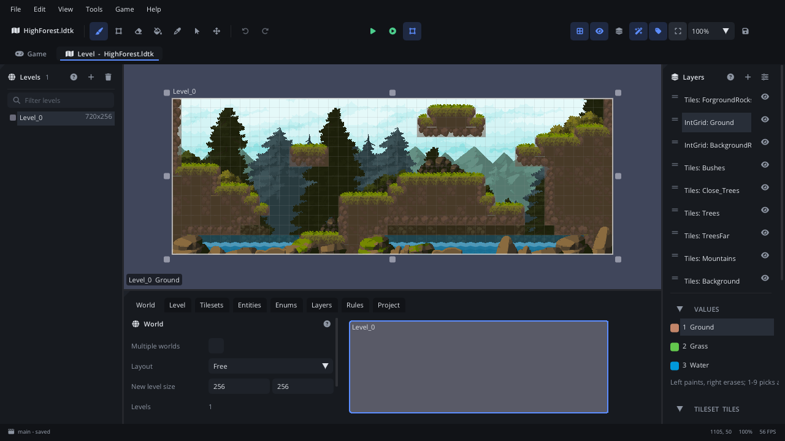

# Level tab

The **Level** tab is a level editor for LDtk projects, the second root tab
under the toolbar (next to **Game**). You paint IntGrid values and tiles,
let auto-layer rules tile the walls, place entities with fields and lay out
levels in a world. The file stays an LDtk project (`.ldtk`), so it still
opens in [LDtk](https://ldtk.io), and the game's LDtk Level nodes read it.



## When to use it

- **Building levels** for an [LDtk Level](../nodes/LdtkLevelNode.md) node:
  walls, platforms, decoration tiles, where enemies and pickups go.
- **Auto-tiling**: paint a rough collision grid and let rules choose the
  wall, floor and corner tiles.
- **Placing entities** (the player start, doors, items) and setting their
  fields, such as the door a key opens.
- **Laying out a world**: several levels side by side (free, GridVania or
  linear), with depths.
- What each entity spawns as in the game, and which IntGrid values collide,
  is set in the [LDtk tab](tab-ldtk.md) of the Game tab. For a simple tile
  grid without LDtk, use a [Tile Map](tab-tilemap.md).

## Opening it

- Click **Level** under the toolbar (**Cmd+Shift+2**; **Cmd+Shift+1** goes
  back to **Game**). Without a file open it lists the project's `.ldtk`
  files under **Project levels**, and has **New LDtk Project...**: give a
  path (`levels/world.ldtk`) and click **Create** for a level with an IntGrid
  `Collisions` layer and an `Entities` layer.
- In Assets, right-click a `.ldtk` > **Edit in Level Tab**.
- Select an LDtk Level node and click **Edit in Level Tab** in the
  Inspector: it opens at that node's level.

The tab's label shows the open file, with a dot while it has unsaved
changes.

## What's in it

```
 toolbar:  file | tools | Undo Redo | Play | view buttons, fit, zoom, Save
 +----------+------------------------------------+------------+
 | Levels   |              canvas                | Layers     |
 |          +------------------------------------+            |
 |          | Level Panel: World Level Tilesets  | palette of |
 |          | Entities Enums Layers Rules Project| the layer  |
 +----------+------------------------------------+------------+
```

The panels dock like the Game tab's: drag their edges to resize them, or
drag a panel's tab to move it. **Tab** hides them all (zen mode).

### Toolbar

| Control | What it does |
|---|---|
| File name | The open `.ldtk` (a dot: unsaved). |
| Tools | **Brush**, **Rectangle**, **Erase**, **Fill**, **Pick**, **Select**, **Move levels** (see below). |
| Undo / Redo | **Cmd+Z** / **Cmd+Shift+Z**. Every stroke, move and edit is one step. |
| Grid | Show the grid (**G**). |
| Eye | Show IntGrid values over auto tiles. |
| Layers | Single layer mode: fade the other layers (**Shift+A**). |
| Wand | Draw auto-layer tiles (**Alt+R**; off: their IntGrid values show). |
| Tag | Show level names, entity labels and field shapes (**Shift+H**). |
| Fit | Fit the level (**Home**). |
| Zoom | 50% to 400% (the mouse wheel zooms too). |
| Save | Save the level file (**Cmd+S**). |

### Canvas

The active world: the active level on top, the others dimmed. Click another
level to make it active. **Middle drag** or **Space + drag** pans, the
**wheel** zooms around the mouse. Drag the handles on the active level's
edges and corners to resize it. The line at the bottom shows the level,
the layer, the cell under the mouse and (on an IntGrid layer) its value.

### Levels

The active world's levels, each with its background colour and size. Click
one to open it; double-click to frame it. Right-click: **Open**, **Frame**,
**Rename...**, **Duplicate**, **Move up**, **Move down**, **Delete**,
**Help**. The header's **+** adds a level: click where it goes
in the canvas (**Shift+click** the **+**: right next to the active one).
The bin deletes the active level. A filter box narrows the list; with
several worlds a combo picks the world.

### Layers

The active level's layers, top first, as *Type: Name* (`IntGrid:
Collisions`). Click one to paint on it; drag its grip to reorder it (in
every level); the eye hides it in this level. Right-click for more. The
header's **+** adds a layer (type, name, grid, tileset), the sliders open
the Layers definitions tab.

Under the list is the **palette** of the active layer:

- **IntGrid**: its values; **1**-**9** pick the first nine.
- **Tiles**: the tileset. Pick one tile or drag a block. The buttons above
  it: **X** / **Y** flip (also the keys), the dice for Random mode
  (**Shift+R**), stacking (**Shift+T**), and the bookmark to save the picked
  tiles as a group (**Shift+S**).
- **Entities**: the entity types to place.
- **Auto layer**: its rule groups, and **Re-run rules**.

### Level Panel

The bottom panel's tabs:

| Tab | What's in it |
|---|---|
| **World** | The layout (Free, GridVania, linear), the world grid, a map of the levels; several worlds. |
| **Level** | The level's identifier, position, size, depth, background (colour or image) and fields. A selected entity's position, size and fields show here. |
| **Tilesets** | Tileset images, tile size, per-tile data, tags and animated tiles. |
| **Entities** | Entity definitions: size, colour, pivot, tile, fields. |
| **Enums** | Enums and their values; external enum files. |
| **Layers** | Each layer's settings and IntGrid values. |
| **Rules** | Auto-layer rules and terrains. |
| **Project** | Defaults, file options, exports, custom commands. |

### Tools and keys

The keys work while the Level tab is active and you are not typing in a
field.

| Tool | Key | On IntGrid / Tiles layers | On Entities layers |
|---|---|---|---|
| **Brush** | B | Paint (right button erases). | Place the picked entity. |
| **Rectangle** | R | Drag a rectangle to fill it (right button: erase it). | |
| **Erase** | E | Erase values and tiles. | |
| **Fill** | F | Fill the connected area of equal cells. | |
| **Pick** | I | Pick the value or tile under the mouse. | |
| **Select** | V | Select cells; drag to move them. Also: hold **Alt** with any tool. | Select entities, move, resize. |
| **Move levels** | M | Drag levels around the world. | |

| Key | What it does |
|---|---|
| Cmd+Z / Cmd+Shift+Z (or Cmd+Y) | Undo / redo |
| Cmd+S | Save |
| Cmd+A / Cmd+Shift+A | Select everything in the layer / in the level |
| Cmd+C / Cmd+X / Cmd+V | Copy / cut / paste (at the mouse) |
| Cmd+D | Duplicate the selection one cell to the right |
| Arrow keys | Move the selection one cell |
| Delete, Backspace | Delete the selection |
| Esc | Clear the selection |
| Cmd+K (or Cmd+F) | Search levels, layers, entities and definitions |
| Alt+arrow keys | Open the neighbouring level |
| PageUp / PageDown | The world depth above / below (Shift or Cmd: move the level there) |
| G, Home | Grid on / off, fit the level |
| Shift+A, Shift+H, Shift+E, Alt+R | Single layer mode, details, select empty spaces, auto-layer tiles |
| Shift+W | Fit the world (and show the World tab) |
| C, T, L, U, P | Show the Level, Tilesets, Layers, Enums or Project tab |
| Tab | Hide / show the panels |
| Cmd+R | Run the project's manual custom commands |
| **F1** | The **Level Editor Reference** at what's under the mouse |

### Help

Every button and field has a tooltip. Hover anything and press **F1**, or
click a panel's **?**, to open the **Level Editor Reference** window at
that topic (also **Help > Level Editor Reference**). **Help > Help for Level
Tab** opens this page.

## Walkthrough

A first level with walls and a player start:

1. Click **Level** under the toolbar, then **New LDtk Project...**. Keep
   `levels/world.ldtk` and click **Create**.
2. In **Layers**, click `IntGrid: Collisions`. Its value appears in the
   palette; press **B** and paint the floor and walls in the canvas.
   Right-drag erases.
3. Press **R** and drag a rectangle for a platform. Press **Cmd+Z** and
   **Cmd+Shift+Z** to see it go and come back.
4. Click `Entities` in Layers. The palette says there are no entities:
   open the Level Panel's **Entities** tab, click **Add entity** and type
   `Player` as its **Identifier**. Pick `Player` in the palette, press **B**
   and click in the canvas to place it.
5. Press **V**, drag the player to another cell, and look at its values in
   the **Level** tab.
6. Press **Cmd+S**.
7. Back in **Game** (**Cmd+Shift+1**), drag `levels/world.ldtk` from Assets
   into the viewport: an LDtk Level node shows it. Set what `Player` spawns
   as in the [LDtk tab](tab-ldtk.md).

## Tips

- Saving the file reloads it in the Game tab's LDtk Level nodes (and in a
  running game with script hot reload on).
- Leaving a file with unsaved changes asks: **Save**, **Don't Save** or
  **Cancel**.
- Keys and tools follow LDtk's, so LDtk tutorials apply.
- The full guide, with tutorials (auto-tiled caves, entities with fields,
  animated water) and the engine API:
  [Level editor](../../engine/docs/level_editor.md). Every panel, tab and
  option: [Level Editor Reference](../../engine/docs/level_editor_reference.md)
  (the same text as the F1 window).
- Related: [LDtk tab](tab-ldtk.md), [LDtk Level node](../nodes/LdtkLevelNode.md),
  [Tile Map tab](tab-tilemap.md).
