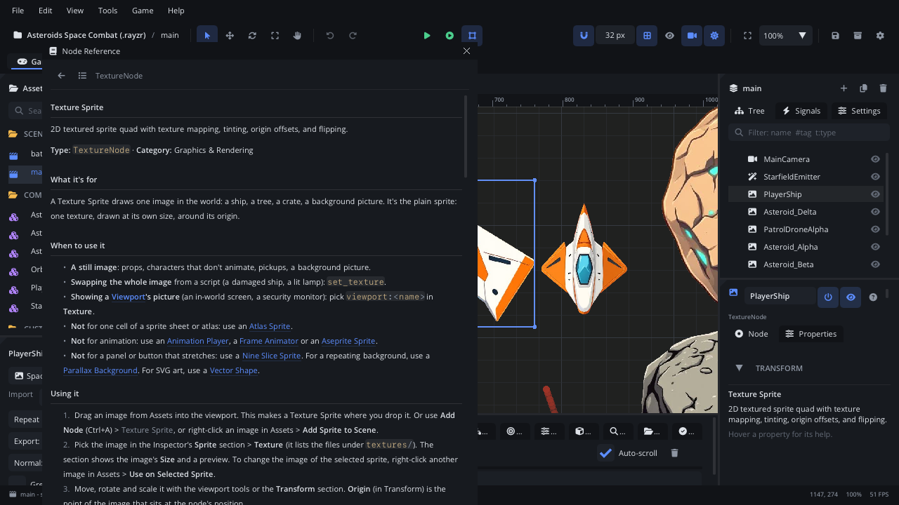

# Node Reference window

The **Node Reference** window shows the documentation inside the editor:
a page for every node type - what it's for, its properties, its Lua
methods, screenshots - and this manual's pages. It is built into the
editor, so it works offline and always matches the version you run. The
pages are the same as on the website.

## When to use it

- Look up what a node does, a property's meaning and default, or the Lua
  methods to call on it, without leaving the editor.
- Read this manual's page for the panel you're using (**F1**).
- Browse every node type by category to find the one you need.
- For the Lua API by module (Input, Scene, Save, ...), use **Help >
  Scripting Reference** instead (F1 in the Code tab opens it on the name
  at the caret); for the Level tab, its **Level Editor Reference**.

## Opening it

| From | Shows |
|---|---|
| **Shift+F1** | The selected node's type. |
| The **?** in the Inspector header | The selected node's type (its tooltip: *<Type> documentation (Shift+F1)*). |
| A node's right-click menu in the Scene panel > **Documentation** | That node's type. |
| **Help > Node Reference** | The list of every node type, by category. |
| **F1** | This manual's page for the panel with focus. |
| **Help > Help for <panel>** | The page of the panel you used last. |
| A bottom tab's right-click menu > **Help** | That tab's page. |
| **Help > Editor Manual** | The list of this manual's pages. |
| The **?** in the [Settings](settings.md) dialog's header | The Settings page (the dialog keeps F1 from reaching the manual). |

## What's in it

| Control | What it does |
|---|---|
| **Back** (arrow) | The page you were on before. |
| **Every node** (list) | The list of node types: each category's nodes with a line about each. |
| Page name | The node type (`TextureNode`), or `editor/<page>` for a manual page. |
| **Manual** | On a manual page: the list of every manual page, each with its first lines. |
| The page | Scrolls with the wheel. Links to another node or manual page open it here; web links open your browser. |
| **x** (title bar) | Closes the window. |

A node's page has:

- its description, **Type** and **Category** (as in Add Node);
- the hand-written part, for most nodes: what it's for, when to use it,
  how to use it, how it works, its signals, an example script and a
  screenshot;
- **Properties**: every Inspector property with its type, default and
  help (the same help as the Inspector's tooltips), plus a link to the
  Transform properties every node has;
- **Lua methods**: the methods to call on it, each with its parameters,
  what it returns and an example.

Opened from the Settings dialog, the window shows over the dialog; **Esc**
or its **x** closes it and leaves Settings open.

## Walkthrough

Find out how a timer works and what it can do:

1. Click a node in the Scene panel and press **Shift+F1**: its page opens.
2. Click **Every node** and find **Timer** under *Core & 2D*. Click it.
3. Read how it raises `timeout`, then its **Properties** and **Lua
   methods** (`timer_start`, `timer_set_duration` and the others).
4. Under **Lua methods**, click **Node methods**: the methods every node
   has. **Back** returns to the Timer page.
5. Click in the Inspector and press **F1**: the window shows the
   [Inspector](inspector.md) page.

## Tips

- Property help comes from the same text as the Inspector's tooltips and
  help pane, so they always agree.
- The window remembers its size and place.
- Writing a node page: see [Writing documentation](../contributing/docs.md).
- Related: [Inspector](inspector.md) (the help pane),
  [Code tab](code.md) (the Scripting Reference),
  [Toolbar and menus](toolbar-menus.md) (the Help menu).
