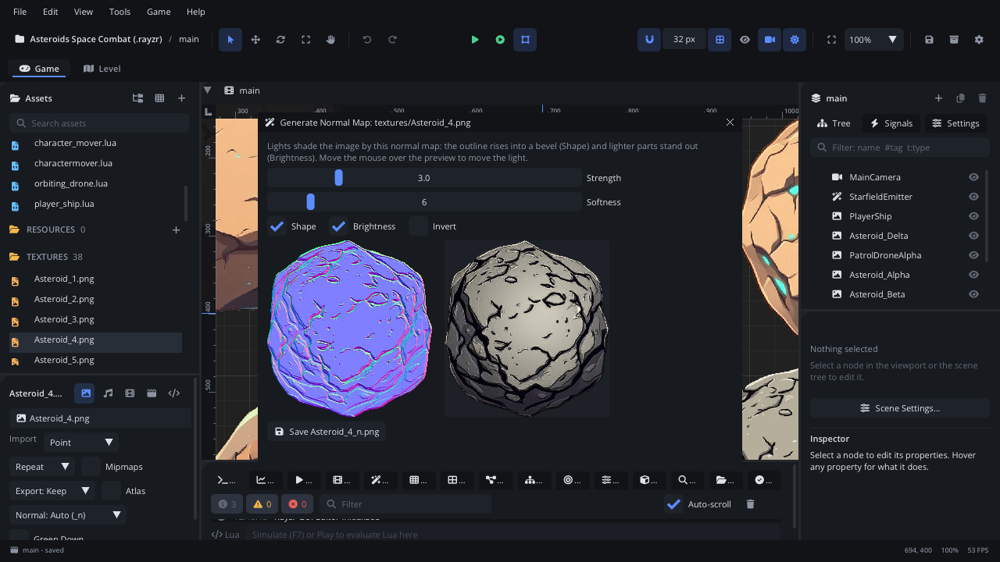

# Generate Normal Map

The **Generate Normal Map** window builds a normal map for an image, so
[lights](../nodes/LightNode.md) shade it as if it had depth: its outline
rises into a rounded bevel and its lighter parts stand out. A preview
shows the image lit by a light that follows the mouse. **Save** writes
`<image>_n.png` next to the image, which lighting finds by itself.

## When to use it

- **Lit 2D scenes without hand-made normal maps**: a ship, a rock or a
  crate that catches a moving light.
- **Painted detail that should catch the light**: rivets, bricks, scales
  (**Brightness**), or engraved, dark-lined detail (**Invert**).
- If your art tool already made a normal map, name it `<image>_n.png`
  instead, or point the image's **Normal** import setting at it (see
  [Assets](assets.md#the-preview-panel)).

## Opening it

Right-click an image in [Assets](assets.md#right-click-an-asset) >
**Generate Normal Map...**. The window's title is
*Generate Normal Map: &lt;image path&gt;*. Opening it on another image
replaces the one shown.

## What's in it

| Control | What it does |
|---|---|
| **Strength** | How steep the slopes are, 0.5 to 12 (3 to start). |
| **Softness** | How wide the bevel around the outline is, 0 to 48 pixels (6 to start). |
| **Shape** | The outline rises into a rounded bevel. |
| **Brightness** | Lighter pixels are higher: painted detail catches the light. |
| **Invert** | Darker pixels are higher instead (dark outlines, engraved detail). |
| Normal map (left) | The generated normal map, updated as you change the settings. |
| Lit preview (right) | The image lit by the normal map. Hover it: the light follows the mouse. Otherwise the light circles around. |
| **Save &lt;image&gt;_n.png** | Writes the normal map next to the image (always a PNG). *(replaces the one there)* after it means a file of that name exists and will be overwritten. The window stays open. |
| Close button (x) | Closes the window without saving. |

**Shape** and **Brightness** start on; **Invert** starts off. The settings
are not remembered: each opening starts from these values.

## Walkthrough

A normal map for an asteroid:

1. Right-click `textures/Asteroid_4.png` in Assets > **Generate Normal
   Map...**.
2. Move the mouse over the lit preview: the asteroid's edge is bevelled
   and its lighter spots stand out.
3. Drag **Strength** to about 5 for deeper bumps and **Softness** to 10 for
   a rounder edge.
4. Click **Save Asteroid_4_n.png**. The Console says it was saved; the file
   appears in Assets.
5. Put a [Light](../nodes/LightNode.md) near a sprite of the asteroid in the
   scene: it is now shaded by the light's direction.

## Tips

- The saved map is OpenGL style (green up), the default the image's import
  settings expect; leave its **Green Down** import setting off.
- To stop using the map, set the image's **Normal** import setting to
  *None*, or delete `<image>_n.png`.
- Only lit scenes use normal maps; a scene without lights looks the same.
  See [Light: Normal maps](../nodes/LightNode.md#normal-maps).
- Related: [Assets](assets.md), [Light](../nodes/LightNode.md).
