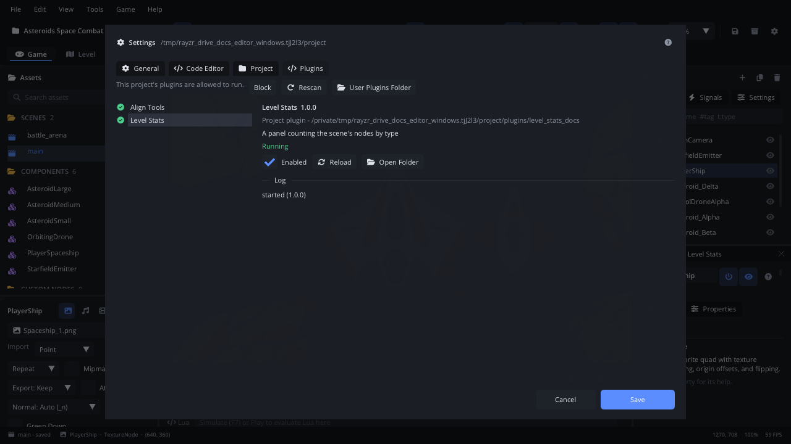

# Plugins

Editor plugins add commands, panels and automation to the editor, written
in Lua. **Settings > Plugins** is where you manage them: which run, their
state and log, reloading them, and whether this project's plugins may run
at all. **Tools > New Plugin...** starts one of your own.

## When to use it

- Add a command the editor doesn't have (align nodes your way, rename a
  batch of nodes, zip an export), with its own menu item and shortcut.
- Add a panel: level statistics, a checklist, a tool for your game's data.
- Run something when the editor does something (a scene saved, Play
  started) - or stop Play when a check fails.
- To change the game itself, write game scripts instead (the
  [Code tab](code.md)); plugins run in the editor only, never in the
  exported game.

## Where plugins live

A plugin is a folder with a `plugin.json` (name, version, description, the
main file, permissions) and its Lua files:

| Folder | Runs in |
|---|---|
| `plugins/<id>/` in the project | This project only. It's part of the project, so it travels with it (and its trust is asked, below). |
| `~/.config/rayzr_editor/plugins/<id>/` | Every project you open (**User Plugins Folder** in Settings > Plugins opens it). |

**Tools > Registry** installs community plugins into either folder
([Registry](registry.md)); [Publishing a plugin or
template](publishing.md) says how to list your own there.

## What's in it

### Project Plugins (the trust prompt)

When you open a project that has plugins nobody has allowed yet, the
editor asks first. **Project Plugins** lists each plugin, its version and
description, and whether it *runs programs* or *uses the network*:

| Control | What it does |
|---|---|
| **Allow** | Runs this project's plugins, now and every time you open it. |
| **Don't Allow** | Keeps them off. Settings > Plugins can allow them later. |

Only allow plugins from a project you trust: they are code that runs in
your editor. User plugins (your own folder) aren't asked about.

### Settings > Plugins

Changes here apply at once; there's nothing to save.

| Control | What it does |
|---|---|
| *This project's plugins are allowed / blocked / haven't been allowed yet* | With **Block** or **Allow** next to it. |
| **Rescan** | Looks for plugins again, after you add or remove a plugin folder. |
| **User Plugins Folder** | Opens the folder for plugins that run in every project. |
| The list | Every plugin, with a mark: green (running), grey (off, or waiting for this project's trust), red (stopped by an error). Click one to see it. |
| Name, version | The selected plugin, with *Project plugin* or *User plugin* and its folder, its description and its permissions. |
| State | **Running**, **Off**, *Waiting: this project's plugins aren't allowed*, or *Stopped:* and the error. |
| **Enabled** | Turns the plugin on or off (remembered in your editor settings). |
| **Reload** | Stops it and starts it again. Saving one of its files does the same. |
| **Open Folder** | Opens its folder. |
| **Log** | What it printed (`print`, `Editor.log`) and its errors. |

With no plugins the tab says where to put one.

### Tools > New Plugin...

Asks for a name and writes `plugins/<id>/plugin.json` and
`plugins/<id>/main.lua`: a command (**Tools > Say Hello (<name>)**), a
panel docked next to the Inspector and an event (`scene_saved`), to start
from. It starts the plugin (one you make is trusted),
opens `main.lua` in the Code tab and shows the panel. Edit and save:
the plugin reloads.

### What plugins add to the editor

- **Commands** in the menus (a plugin picks the menu, such as
  `Tools/Align`), in the [command palette](command-palette.md) and the
  [Keyboard Shortcuts](keyboard-shortcuts.md) window, with shortcuts you
  can rebind in Settings > Keymap.
- **Panels**, docked like the editor's own. **View > Plugins** shows or
  hides each one.
- **Events**: code that runs when a project opens, the selection changes,
  a scene is saved, an asset is imported, before Play and after an export.
  A plugin can stop Play from starting (the Console says why).

An error stops only the plugin that made it: the others and the editor
carry on.

## Walkthrough

Make a plugin and change what it does:

1. **Tools > New Plugin...**, type `Level Notes` and press Enter.
   `plugins/level_notes/main.lua` opens in the Code tab, and its panel
   shows.
2. Select a node and click **Tools > Say Hello (Level Notes)**. The
   console says `[Level Notes] Hello! Selected:` and the node's name.
3. In `main.lua`, change `"Hello! Selected: "` to `"Picked: "` and press
   **Cmd+S**. The plugin reloads; the command now prints the new text.
4. Click in the viewport and press **Cmd+S** to save the scene: the
   plugin's `scene_saved` event prints `saved` and the scene's path.
5. **File > Settings...** (Cmd+,) > **Plugins**: *Level Notes* is
   *Running*, and its **Log** shows the `saved ...` line.
6. Untick **Enabled**: the plugin stops, and its command and panel go
   away. Tick it to start it again.

## Tips

- Copy a working example into your project's `plugins/` to start from:
  aligning nodes, batch renaming, level statistics, zipping an export
  ([plugin examples](../../editor/docs/plugin_examples/)).
- Completion and hover docs for the plugin API come from
  `.rayzr/definitions/editor_api.lua`, written once the project has a
  `plugins/` folder.
- More: [Writing editor plugins](../../editor/docs/plugin_guide.md) (the
  guide and examples), the
  [editor plugin API](../../editor/definitions/editor_api.lua), and
  [Plugins: design](../../editor/docs/plugins.md).
