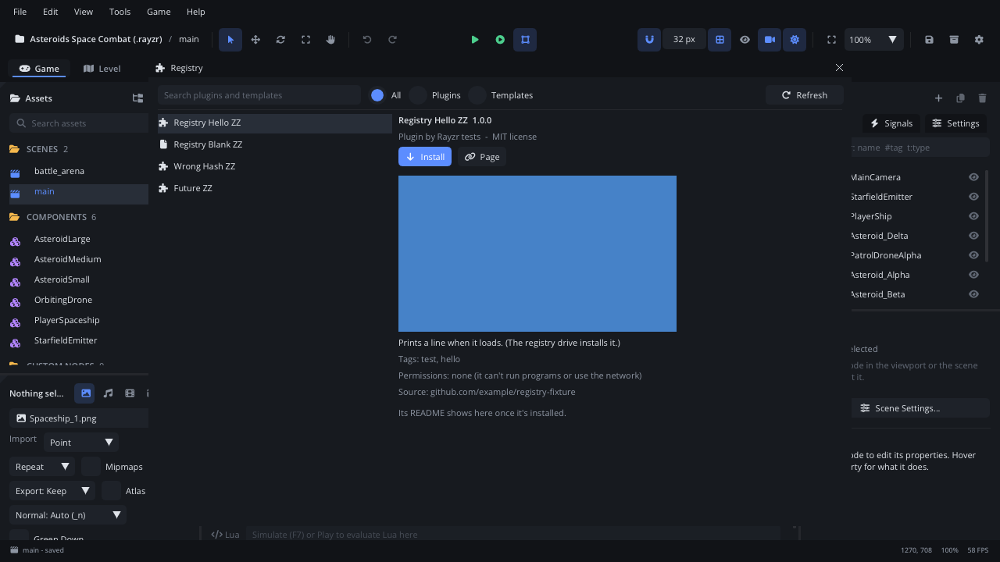
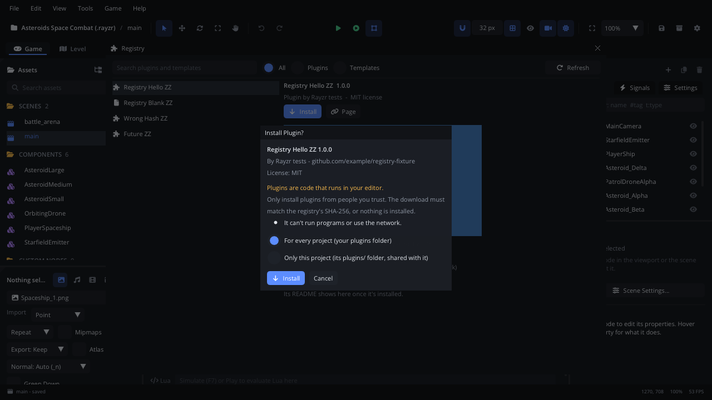

# Registry

**Tools > Registry...** lists plugins and project templates other Rayzr
users have published, and installs them. You can search the list, show
only plugins or only templates, and read about each one: its screenshot,
author, license, the permissions a plugin asks for, and its README once
it's installed. **Install**, **Update** and **Remove** are in the same
place.

## When to use it

- Add a plugin someone else wrote (a tool, a panel, an exporter) without
  copying folders by hand.
- Start a new game from a community template: install it here and it shows
  up in **Welcome > New Project**.
- Keep installed plugins and templates up to date.
- To write your own plugin, use **Tools > New Plugin...** ([Plugins](plugins.md)).
  To list yours here, see [Publishing a plugin or template](publishing.md).

## Opening it

- **Tools > Registry...**, or the command palette (**Registry...**).
- **Welcome > Browse More Templates...** opens it showing templates.
- **F1** in the window opens this page.

## What's in it

| Control | What it does |
|---|---|
| **Search** | Shows the entries whose name, id, author, description or tags have every word you type. |
| **All / Plugins / Templates** | Which kinds the list shows. |
| **Refresh** | Fetches the list again (hover it for the index's address). |
| The list | Each plugin and template. A check mark: installed; an up arrow: a newer version is out. Greyed out: it needs a newer Rayzr Editor. Hover one for its description. |
| Name, version | The selected entry, with *Plugin* or *Template*, its author and its license. |
| **Install** | Downloads and installs it. A plugin asks first (below); a template installs straight away. |
| **Update to ...** | Installs the newer version in place of the one you have (a plugin asks again). |
| **Remove** | Deletes it. Only folders the registry installed are removed, never one you made yourself. |
| **Open Folder** | Opens the folder it's installed in. |
| **Page** | Its homepage, or its GitHub repository. |
| Details | Its screenshot, description, tags, the permissions a plugin asks for, its source repository, and its README once installed. |

A message above the list says when the registry can't be reached (below).

### Installing a plugin

Plugins are Lua code that runs in your editor, so **Install** asks first.
The **Install Plugin?** dialog shows who made it, its repository and
license, and what it may do: *run programs on this computer* (the
`process` permission) or *use the network* (`network`). Then pick where it
goes:

| Choice | Where it goes |
|---|---|
| **For every project** | Your plugins folder (`~/.config/rayzr_editor/plugins/<id>/`): it runs in every project. |
| **Only this project** | The project's `plugins/<id>/`: it's part of the project, travels with it, and runs once the project's plugins are allowed (Settings > Plugins > **Allow**). |

**Install** downloads it, then checks it before anything is installed:

- the download's SHA-256 must be the one the registry lists (so the file
  is the one that was reviewed, and wasn't changed or damaged on the way);
- its `plugin.json` may not ask for a permission the registry didn't list;
- no file in it may point outside its own folder.

If any check fails, nothing is installed and the Console says why. Once
installed the plugin starts at once; **Settings > Plugins** shows it
like any other ([Plugins](plugins.md)).

### Installing a template

Templates are project files (scenes, scripts, images), not editor code, so
**Install** puts them in your templates folder
(`~/.config/rayzr_editor/templates/<id>/`) without asking. The same
SHA-256 check applies. The template then shows in **Welcome > New
Project** with the built-in ones ([Welcome](welcome.md)).

### Offline, and where the list comes from

The list is the registry's index: a file in the
[rayzr-registry](https://github.com/bcrowe306/rayzr-registry) repository
on GitHub. The editor keeps the last copy it fetched
(`~/.config/rayzr_editor/registry/`), shows it straight away and fetches a
new one when it's over an hour old, or when you click **Refresh**.

Without a connection the window shows the copy it has, with *Offline -
showing the list from* and the date; installing needs the connection.
Installed plugins and templates work offline as usual.

**Settings > General > Registry Index** reads a different index: your
studio's own, a mirror, or a local `index.json` while you test an entry of
your own ([Publishing a plugin or template](publishing.md)).

## Walkthrough

1. **Tools > Registry...** and click **Plugins**.
2. Type a word in the search box to narrow the list, and click a plugin.
3. Read its description and permissions, then click **Install**.
4. In **Install Plugin?**, keep **For every project** and click
   **Install**. The Console says *installed*, and the plugin's commands and
   panels appear.
5. Its README now shows under the details. **Settings > Plugins** lists it
   as *Running*.
6. When a newer version is out the list shows an up arrow: select it and
   click **Update to ...**.
7. **Remove** deletes it again.

## Tips

- Only install plugins from people you trust: a plugin can do anything
  the editor can do to your project's files. The registry's review and the
  SHA-256 make sure you get what was reviewed, not that it's harmless.
- An entry greyed out with *Needs Rayzr Editor ... or newer* works once you
  update the editor (**Help > Check for Updates**).
- A plugin or template you put in its folder by hand isn't touched by
  **Install** or **Remove**: rename it if you want the registry's.
