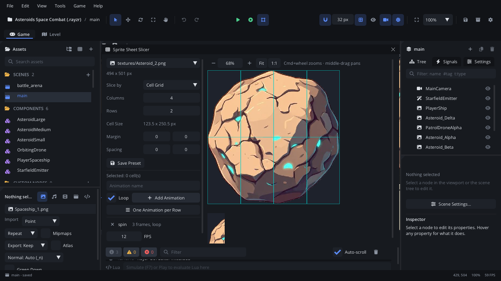

# Sprite Sheet Slicer

The **Sprite Sheet Slicer** cuts a sprite sheet into cells, lets you pick
cells in play order, and turns them into named animations for an
[Animation Player](../nodes/AnimationPlayerNode.md) - a new one, or the
selected one. It can also make an [Atlas Sprite](../nodes/AtlasSpriteNode.md)
from each picked cell, and remember a sheet's grid in its import settings.

## When to use it

- **Animations from a sheet**: a walk cycle, an idle and a jump laid out
  in rows of one image.
- **Frames in any order**: cells picked across rows, or the same cell
  twice, play in the order you picked them.
- **Single cells as sprites**: icons or props cut from a sheet, each its
  own Atlas Sprite.
- **Saving a sheet's grid** so the slicer opens it right next time.
- **Particle frames**: the cells a Particle Emitter's particles show.
- For editing the animations afterwards (range, fps, tracks), use the
  [Animation tab](tab-animation.md).

## Opening it

- **Tools > Sprite Sheet Slicer...** ([menus](toolbar-menus.md#tools-menu)).
- Right-click an image in [Assets](assets.md#right-click-an-asset) >
  **Slice Sprite Sheet...**: opens on that image.
- An Animation Player's Inspector: **Slice a Sprite Sheet...**.
- A Particle Emitter's [Particles tab](tab-particles.md#texture) > Texture:
  **Pick Frames in Sprite Slicer**.
- The [Animation tab](tab-animation.md): the **▾** next to **+** >
  **Slice a Sprite Sheet...**.

Opened without an image, the slicer shows the one it had last time, with
its picked cells and animations. Choosing an image applies its slicing
preset if it has one.

## What's in it

### Settings (left)

| Control | What it does |
|---|---|
| Texture picker | The image to slice (every image in the project). Picking one clears the picked cells and the animations not yet added. Below it: the image's size in pixels. |
| **Slice by** | *Cell Grid*: **Columns** x **Rows** share the sheet (the cell size follows, maybe fractional). *Cell Size*: cells exactly that many pixels, as many as fit; leftover pixels at the right and bottom are unused. |
| **Columns**, **Rows** | (Cell Grid) 1 to 256 each. **Cell Size** below shows the result. |
| **Cell Size** | (Cell Size) Width and height in pixels. **Columns x Rows** below shows how many whole cells fit. |
| **Margin** | Pixels left out around the sheet's edge (x, y). |
| **Spacing** | Pixels between cells (x, y). |
| **Save Preset** | Saves this grid with the image (its import settings): the slicer opens it like this next time, and [Assets' Preview](assets.md#the-preview-panel) shows **Slice**. |
| *Selected: N cell(s)* | How many cells are picked. |
| Animation name | The next animation's name. Empty: `anim1`, `anim2`... |
| **Loop** | Animations added from now on loop. |
| **Add Animation** | Makes an animation of the picked cells, in the order picked, then clears the pick and the name. Does nothing with no cells picked. |
| **One Animation per Row** | One animation per row of the grid (`row1`, `row2`...), every cell of the row. |
| **Use N Cells for &lt;emitter&gt;** / **Use All Cells for &lt;emitter&gt;** | (A Particle Emitter selected) The picked cells, in the order picked, become the emitter's frames (**Frame Source** Regions, up to 64), with this image as its texture. None picked: every cell - the grid is saved as the image's slicing preset and Frame Source becomes Slices. One undo step. The emitter's **Texture** tab has **Pick Frames in Sprite Slicer** to open the slicer on its texture. |
| **Create Atlas Sprite** / **Create Atlas Sprites (N)** | (Cells picked) An Atlas Sprite node in the scene for each picked cell, named after the image (`<image>_cell<N>` when there are several). One undo step. |
| Animation list | The animations made so far: name, frame count, *loop*. The **x** removes one. |
| **FPS** | (Animations made) The frame rate, 1 to 60, set on the player. |
| **Create Animation Player** / **Add to &lt;name&gt;** | (Animations made) Adds the animations to a new Animation Player named after the image, or - when an Animation Player is selected - to that one. The list then empties and the player is selected. |

Changing **Slice by**, the columns, rows, cell size, margin or spacing
clears the picked cells.

### The sheet (right)

The image with the cells outlined. Picked cells are tinted, with their play
order number in the corner. Above it, a zoom bar:

| Control | What it does |
|---|---|
| **-** / **+** | Zoom out / in. |
| Zoom field | The zoom in %; drag or type (5% to 3200%). |
| **Fit** | The whole sheet in the view (the default). |
| **1:1** | One screen pixel per image pixel. |

| Mouse | What it does |
|---|---|
| Click a cell | Pick it (it becomes the next frame), or unpick it if it is picked. |
| Drag across cells | Starting on a cell that isn't picked: picks every cell you cross. |
| Shift+click | Picks the range from the last clicked cell to this one. |
| Cmd+wheel (Ctrl+wheel) | Zoom around the mouse. |
| Wheel | Scroll; Shift+wheel scrolls sideways. |
| Middle-drag | Pan. |

### Preview

Under the sheet, the picked cells play at the **FPS** rate. With nothing
picked, the last animation in the list plays.

## Walkthrough

A player with `walk` and `jump` from `textures/PlayerSheet.png`:

1. Right-click `PlayerSheet.png` in Assets > **Slice Sprite Sheet...**.
2. Set **Columns** and **Rows** to the sheet's layout (double-click a field
   and type). Check the outlines sit on the frames; adjust **Margin** and
   **Spacing** if they drift. Click **Save Preset**.
3. Click the first walk frame, then Shift+click the last one. The preview
   plays them. Type `walk` in the name field and click **Add Animation**.
4. Click the jump frames one by one, in order. Name it `jump`, turn
   **Loop** off, and click **Add Animation**.
5. Set **FPS** to 10 and click **Create Animation Player**. A node named
   `PlayerSheet` appears in the scene, selected.
6. Open the [Animation tab](tab-animation.md) to fine-tune them.

## Tips

- The animations keep the cell numbers you picked, sliced with the grid
  set when you click **Create Animation Player** / **Add to**. Finish the
  grid before adding animations.
- **FPS** is the player's frame rate: adding to an existing player sets
  its FPS too.
- Margin and spacing can still be changed later in the Inspector.
- Atlas Sprites made here can be adjusted in the
  [Atlas Region Editor](atlas-region.md).
- Related: [Animation Player](../nodes/AnimationPlayerNode.md),
  [Animation tab](tab-animation.md), [Assets](assets.md),
  [Animation editing](../../engine/docs/animation_editing.md).
