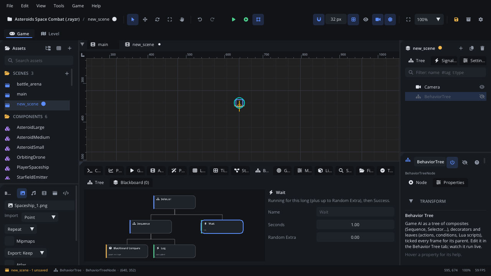

# Behavior Tree tab

The **Behavior Tree** tab edits the selected
[Behavior Tree](../nodes/BehaviorTreeNode.md) node's tree, drawn top-down
and laid out by itself: right-click a node to add children, wrap it or
change it, click it to edit its settings in the side panel. A second page
holds the tree's blackboard. While the scene runs (Simulate or Play) each
node lights up with its answer: running yellow, success green, failure red.

## When to use it

- **Building an enemy's or NPC's decisions**: flee when hurt, else attack
  when close, else patrol - a Selector of Sequences with conditions first.
- **Steps that can fail part way**: walk to the door, open it, go through.
- **Debugging AI**: watch which branch runs and which condition fails, in
  Simulate or in the running game.
- For animation states (idle, run, jump), use the
  [State Machine tab](tab-stategraph.md); for an agent that plans its own
  way to a goal, the [GOAP tab](tab-goap.md). What each tree node does is
  in [Behavior Tree](../nodes/BehaviorTreeNode.md).

## Opening it

- Select a Behavior Tree node and click the **Behavior Tree** tab in the
  bottom panel, or click **Edit in Behavior Tree Tab** in its
  [Inspector](inspector.md) (its **Tree** section also shows the node
  count and, in Simulate, the tree's answer and the running leaf).
- With **Bottom Panel Follows Selection** on ([Settings](settings.md) >
  General), selecting a Behavior Tree node switches to this tab by itself.
- **View > Bottom Panel > Behavior Tree** shows or hides the tab.
- With no tree selected it says *Select a Behavior Tree node to edit its
  tree.*

The tab has two pages: **Tree** and **Blackboard** (its label shows how
many starting values there are).

## What's in it

### Tree: the canvas

The tree is laid out automatically: each node above its children, the
children left to right in the order they run. You can't place boxes by
hand; dragging a box moves it in the tree.

A box shows:

- A coloured stripe and icon for its category: **Composite** (blue,
  sitemap), **Decorator** (purple, filter), **Action** (green, bolt),
  **Condition** (orange, question mark). A Lua leaf marked
  `behavior = "condition"` shows as a condition.
- Its name (the kind's name unless you named it).
- Under it, its settings in short: `1s` or `1-3s` (Wait), `x3`
  (Repeater), `10 ticks` (Limiter), `hp < 20` (Blackboard Compare; `G:`
  for the global blackboard), `seen = true` (Blackboard Set), the script's
  file name or *(no script)*, Move To's target or `$key`, a Subtree's tree
  or *(no tree)*, a Log message. A named node shows its kind first. These
  lines hide below 55% zoom.

An empty tree shows *An empty tree. Right-click to add its root - usually
a Selector or a Sequence.* and an **Add Root Selector** button.

Mouse and keys:

| Action | What it does |
|---|---|
| Click a box | Select it (the side panel edits it). Click empty space to deselect. |
| Drag a box onto another box | Move it (and everything under it): onto a sibling, it takes that sibling's place (after it when dragged from the left, before it from the right); onto a composite or decorator, as its last child. A leaf, or a parent that is full, refuses with *... can't take another child* in the Console (nothing to undo). The root can't be moved. |
| **Delete** / Backspace | Delete the selected node and everything under it. |
| Wheel, middle-drag | Pan. **Shift+wheel** pans sideways. |
| **Cmd+wheel** (Ctrl+wheel) | Zoom at the mouse (30% to 250%). |
| **F** (mouse over the canvas) | Frame the whole tree. It also frames by itself when nodes are added or removed and when the panel is resized. |
| Right-click empty space | On an empty tree: *Add the root* and the four category menus. Otherwise only a reminder: *Right-click a node to add to it*. |
| Right-click a box | Select it and open its menu (below). |

The node menu:

| Item | What it does |
|---|---|
| **Add Child** | Add a node under it, as its last child: **Composites**, **Decorators**, **Actions** or **Conditions** > a kind (hover one for what it does). Greyed out when the node can't take more: leaves take none, decorators one, Simple Parallel two. |
| **Wrap In** | Put a new **Decorator** or **Composite** in its place, with it as the new node's child (wrapping the root makes a new root). |
| **Change To** | Make it another kind, keeping its children: a leaf can become another **Action** or **Condition**, a composite or decorator another **Composite** or **Decorator**. Children past the new kind's limit are deleted. |
| **Move Left** / **Move Right** | Swap it with the sibling before / after it. Not on the root. |
| **Delete** (Del) | Delete it and everything under it. |

Your own Lua leaves are listed in the menus too: scripts in the project
whose class sets `X.behavior = "action"` appear at the end of
**Actions**, `"condition"` ones at the end of **Conditions** (the list is
looked for again every few seconds). **Actions** also has **Script (pick a
file)**, a Script leaf whose file you set in the side panel.

### Tree: the side panel

**Nothing selected**: a short reminder of the gestures, and *Last answer:
...* once the tree has run.

**A node selected**: its kind's icon and name, what it does, then the
settings the kind uses:

| Control | Shown for | What it does |
|---|---|---|
| **Name** | every node | The name shown on the box (empty: the kind's name, shown greyed). |
| **Weight** | a child of a Sequence / Selector Random with **Weights** on | How likely it comes early in the shuffled order (1-100). |
| **Seconds**, **Random Extra** | Wait | How long it runs, plus up to Random Extra more. |
| **Seconds** | Time Limiter, Cooldown, Delayer | The time limit, cooldown or delay. |
| **Repetitions** / **Max Ticks** | Repeater / Limiter | Whole numbers. |
| **Secondary Repeats**, **Delay Mode** | Simple Parallel | How often the second child runs (0: until the first ends); wait for its current run to end. |
| **Resume on Failure**, **Resume on Interrupt** | Sequence Random | Keep the shuffled order after a failure or an interrupt. |
| **Seed** | Sequence / Selector Random | The same seed gives the same shuffles every run (0: different each run). |
| **Weights** | Sequence / Selector Random | Its children get a **Weight**. |
| **Target Node**, **Player**, **Node**, **State Machine**, **Behavior Tree** | Move To, Play Animation, Set Property, Call Method, signals, State Machine leaves, Subtree | A node: pick it from the list or drop one from the [Scene tree](scene-tree.md). Empty means the actor for most leaves (Play Animation: the actor's Animation Player; State Machine leaves: its State Machine); Move To then goes to **Target Key**, and a Subtree needs one. |
| **Target Key**, **Animation**, **Property**, **Method**, **Signal**, **Key**, **Parameter**, **Trigger**, **State** | the leaves that use one | The name it works on. |
| **Arrive Distance**, **Speed** | Move To | When it has arrived; its speed without a Navigation Agent. |
| **Wait Until Done** | Play Animation | Run until the animation ends. |
| **Timeout** | Wait For Signal | Fail after this long (0: never). |
| **Compare** | Blackboard Compare | `==`, `!=`, `>`, `<`, `>=`, `<=`. |
| **Value**, **Argument**, **Message** | Set / Compare / Log and others | A value as text: true / false, a number, `x, y`, text; `$key` reads the blackboard. |
| **Global** | the Blackboard leaves | Use the global blackboard (shared by every tree) instead of this tree's. |
| **Script** | Script leaf | The Lua leaf: a list of the project's marked leaf scripts. Its properties appear below it, set per leaf. |
| **Live** | while running | Its last answer and how many ticks ago, or *not run yet*. |

Every change can be undone (Cmd+Z / Ctrl+Z).

### Blackboard page

The tree's **starting** blackboard: the values it has when the scene
starts. Leaves and scripts read and change them while it runs. A tree
with **Blackboard From** set (in the Inspector) uses that tree's instead.

| Control | What it does |
|---|---|
| Key, value | Edit them in place. Values: `true` / `false`, numbers, `x, y`, text. |
| **×** | Remove the value. |
| **Add Value** | Add one named `key1`, `key2`... with the value `0`. |

While running, **Live (Simulate):** lists the tree's blackboard now, then
**Global:** the global one; during Play, **Live (the game):** lists the
running game's.

## Debugging

In **Simulate** (F7) the tab shows the editor's tree; while a game started
with **Play** (F5 / F6) runs, it asks the game for the tree at the same
path four times a second. Select the Behavior Tree node in the scene tree
to watch it.

- Each box is tinted with its last answer - **running** yellow,
  **success** green, **failure** red - fading over about 30 ticks after it
  last ran; boxes that ran this tick get a coloured border.
- The link to a child that just ran takes its colour; a dot runs down the
  link to a **Running** child.
- The box's second line ends with its answer (`· running`).
- The canvas's bottom-left corner shows the tick count and the last tick's
  cost: `tick 812 · 14 µs`.
- The side panel's **Live** row and the **Blackboard** page's live values
  (above).

## Walkthrough

A guard that waits around until it is alerted:

1. Select the guard and **Add Node** (Cmd+A / Ctrl+A) > *Behavior Tree*.
   The **Behavior Tree** tab opens. Click **Add Root Selector**.
2. Right-click **Selector** > **Add Child** > **Composites** >
   **Sequence**.
3. Right-click **Sequence** > **Add Child** > **Conditions** >
   **Blackboard Compare**. In the side panel set **Key** to `alert`,
   **Compare** `==`, **Value** `true`.
4. Right-click **Sequence** > **Add Child** > **Actions** > **Log**, and
   set **Message** to `Intruder!`.
5. Right-click **Selector** > **Add Child** > **Actions** > **Wait**. Set
   **Seconds** to 1 and **Random Extra** to 1.
6. Open the **Blackboard** page, click **Add Value**, and make it `alert`
   = `false`.
7. Press **F7**. The Sequence turns red (its condition fails) and the
   Wait yellow, then green. In the guard's script,
   `self.node:get_node("BehaviorTree"):bt_blackboard():set("alert", true)`
   switches it to the Log branch.
8. Press **F7** again to stop, and save (Cmd+S / Ctrl+S).

## Tips

- Put conditions first in a Sequence: it stops at the first failure. Use
  **Selector Reactive** / **Sequence Reactive** when a higher-priority
  branch must interrupt one that is running.
- **Wrap In** > **Decorators** > **Cooldown** or **Inverter** is quicker
  than deleting and rebuilding a branch.
- **Change To** a decorator deletes all children but the first (Cmd+Z
  brings them back).
- **Delete** in the canvas removes the tree node, not the selected scene
  node, while the tab has focus. Deleting the root empties the tree.
- A Subtree leaf runs another Behavior Tree node: set that one's
  **Process Mode** to **Manual** in the Inspector.
- Related: [Behavior Tree node](../nodes/BehaviorTreeNode.md),
  [GOAP tab](tab-goap.md), [State Machine tab](tab-stategraph.md),
  [Playtesting](playtesting.md).
