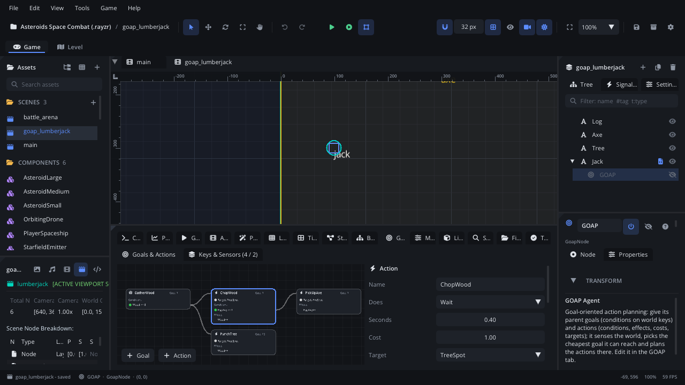

# GOAP tab

The **GOAP** tab edits the selected [GOAP Agent](../nodes/GoapNode.md):
its goals and actions as a graph - each goal a row, followed by the
actions that can meet its conditions, then the actions that meet theirs -
and, on a second page, its keys and sensors. While the scene runs
(Simulate or Play) it shows the agent's plan live: the chosen goal, the
running action and every condition's value.

## When to use it

- **Describing what an agent wants and can do**: goals such as
  `Wood >= 3`, actions with conditions, effects, costs and targets.
- **Checking a goal can be reached**: in the graph, a red dot is a
  condition that no action can meet.
- **Debugging a plan**: why it picked this goal, which action runs, which
  condition is not met, in Simulate or in the running game.
- For a fixed order of steps or simple priorities, a
  [Behavior Tree](tab-behaviortree.md) is easier to read; an action can
  run one. How planning works is in [GOAP Agent](../nodes/GoapNode.md).

## Opening it

- Select a GOAP Agent node and click the **GOAP** tab in the bottom
  panel, or click **Edit in GOAP Tab** in its [Inspector](inspector.md)
  (its **Agent** section also counts goals, actions, keys and sensors,
  and shows the goal and action in Simulate).
- With **Bottom Panel Follows Selection** on ([Settings](settings.md) >
  General), selecting a GOAP Agent switches to this tab by itself.
- **View > Bottom Panel > GOAP** shows or hides the tab.
- With no agent selected it says *Select a GOAP node to edit its goals,
  actions, keys and sensors.*

The tab has two pages: **Goals & Actions** and **Keys & Sensors** (its
label shows the counts, keys / sensors).

## What's in it

### Goals & Actions: the graph

The graph is laid out automatically, left to right:

- A **goal** box (bullseye) starts each row.
- To its right, every action whose **effects** can meet one of its
  conditions, linked from that condition's line; then, to their right,
  the actions that meet theirs (up to 6 deep; an action is not repeated
  along one path). An action that meets several conditions appears under
  each of them.
- Actions that no goal reaches go in a last row, still editable.

A box shows its name and **Cost**, then:

- **Target: *key*** for an action with a target.
- **Conditions**, each with a dot: in edit mode **green** when some
  action's effect can meet it, **red** when none can.
- **Effects** of an action: `Wood++` (Increase) or `HasAxe--` (Decrease).

When there is nothing yet it says *No goals or actions yet: add a goal
(what the agent wants) and actions (what it can do).*

Mouse and keys:

| Action | What it does |
|---|---|
| Click a box | Select it (the side panel edits it). Click empty space to deselect. |
| **+ Goal** / **+ Action** (bottom-left of the canvas) | Add a goal (`Goal1`, `Goal2`...) or an action (`Action1`...: a 1-second Wait costing 1) and select it. |
| **Delete** / Backspace | Delete the selected goal or action. |
| Wheel, middle-drag, **Space** + left-drag | Pan. **Shift+wheel** pans sideways. |
| **Cmd+wheel** (Ctrl+wheel) | Zoom at the mouse (35% to 200%). |
| **F** (mouse over the canvas) | Frame the whole graph. It also frames by itself when boxes appear or go. |
| Right-click | **Add Goal**, **Add Action**, and **Delete** (Del) when a goal or action is selected. Right-clicking a box selects it first. |

### Goals & Actions: the side panel

**Nothing selected**: a short reminder, and while running the live
**Goal**, **Action**, **State** and **Plan** (see Debugging, below).

**A goal selected** (*What the agent wants: its conditions met...*):

| Control | What it does |
|---|---|
| **Name** | Its name (what `goap_request_goal` and the signals use). |
| **Cost** | Its priority: cheaper wins. A Lua goal's `get_cost` replaces it. |
| **Script** | A Lua goal (`X.goap = "goal"`), from a list of the project's goal scripts. |
| **Conditions** | The rows below: what must hold for the goal to be reached. |

**An action selected**:

| Control | What it does |
|---|---|
| **Name** | Its name. |
| **Does** | **Script** (a Lua action, `X.goap = "action"`), **Behavior Tree** (runs one, set to Manual, until it answers), **Wait**, **Call Method** (a method of the actor's script; its answer: `"continue"`, `"completed"`, `"stop"`, true / false) or **Play Animation** (until it ends). |
| **Script** / **Tree** / **Seconds** / **Method** / **Player** + **Animation** | What **Does** needs. Tree and Player are node fields (pick, or drop from the [Scene tree](scene-tree.md)); an empty Player uses the actor's Animation Player. A Script action's properties appear further down. |
| **Cost** | What it adds to a plan's cost. |
| **Target** | A target key it goes to first (with a Navigation Agent, else straight at the agent's Move Speed), or *(none)*. |
| **In Range** | With a target: how close (px) counts as there. |
| **Requires Target** | With a target: stop when the target is lost. |
| **Move Mode** | With a target: **Move Before Performing** or **Perform While Moving**. |
| **Check Conditions** | Stop while running when its conditions stop being met. |
| **Conditions** | The rows below. |
| **Effects** | Each row: a world key, **Increase** or **Decrease**, **×** to remove. **+ Effect** adds one (the first world key, Increase). The planner links an effect to conditions on its key: `>` / `>=` want Increase, `<` / `<=` Decrease. On a key no sensor fills, completing the action adds or takes 1. |

**Conditions** (a goal's and an action's): each row is a world key, a
comparison (**>=**, **>**, **<=**, **<**) and a whole number. Right-click
the number > **Compare With a Key** to compare with another key's value
instead (pick *(none)* in that key list to go back to a number). **×**
removes the row; **+ Condition** adds `<first world key> >= 1`. Only
world keys are listed: add keys on the Keys & Sensors page first.

### Keys & Sensors page

**Keys**, in a table:

| Column | What it does |
|---|---|
| **Key** | Its name. |
| **Kind** | **World** (a whole number, used by conditions and effects) or **Target** (a position actions go to). |
| **Global** | Shared by every GOAP agent (the world's state, such as `AlarmRaised`). |
| **Start** | A world key's value when the scene starts. |
| **Live** | While running: a world key's value and how long ago a sensor set it (`3 · 0.2s`); a target's position or `null`. |
| **×** | Remove the key. |

**+ World Key** and **+ Target Key** add one (`Key1`, `Target2`...).
Scripts can set keys too (`goap_set_key` / `goap_set_target`).

**Sensors** keep keys fresh. Each one:

| Control | What it does |
|---|---|
| **Fills** | The key it sets (world or target, from the key's kind). |
| **From** | **Script** (a Lua sensor, `X.goap = "sensor"`, `sense(actor)`), **Method** (a method of the actor's script that returns the value), **Property** (a node's number property; for a target key, its position), **Nearest With Tag** (the nearest node with the tag; for a world key, how many), **Node** (a node; for a world key, 1 while it exists). |
| **Script** / **Method** / **Node** + **Property** / **Tag** / **Node** | What **From** needs. |
| **When** | **Every Frame**, **Once** or **Every Interval** (then **Interval**, in seconds). |
| **Remove Sensor** | Remove it. |

**+ Sensor** adds a Node sensor on the first key.

Every change can be undone (Cmd+Z / Ctrl+Z).

## Debugging

In **Simulate** (F7) the tab shows the editor's agent; while a game
started with **Play** (F5 / F6) runs, it asks the game for the agent at
the same path four times a second. Select the GOAP node in the scene tree
to watch it.

- The goal it picked and the actions of its plan are outlined **blue**,
  the running action **green**, and the links along the plan turn
  **cyan**. Disabled actions (`goap_disable_action`) are outlined
  **orange**.
- Each box's **Cost** is the one the planner used last (a Lua `get_cost` can change it).
- Each condition shows the key's value now, `HasAxe >= 1 (0)`, with a
  green dot when met and red when not. Effects are hidden.
- A target line shows the position, `Target: (412, 180)`, or
  `Target: null` (red when the action requires it).
- With nothing selected, the side panel lists the **Goal**, the
  **Action**, the **State** (`no_action`, `moving`, `performing`,
  `moving_and_performing`) and the **Plan** (`PickUpAxe → ChopWood`).
- The **Live** column of the Keys & Sensors page.

## Walkthrough

A lumberjack who gathers wood:

1. Select the character and **Add Node** (Cmd+A / Ctrl+A) > *GOAP Agent*.
   The **GOAP** tab opens.
2. On **Keys & Sensors**, click **+ World Key** and rename it `Wood`.
   Click **+ Target Key** and rename it `TreeSpot`.
3. Click **+ Sensor**: set **Fills** to `TreeSpot`, **From** **Node**,
   and **Node** to the tree in your scene.
4. On **Goals & Actions**, click **+ Goal**, name it `GatherWood`, click
   **+ Condition** and make it `Wood >= 3`. Its dot is red: nothing
   produces wood yet.
5. Click **+ Action**, name it `ChopWood`. Leave **Does** on **Wait**,
   **Seconds** 1. Set **Target** to `TreeSpot`, click **+ Effect** and
   pick `Wood`, **Increase**. The action appears to the right of the goal
   and the goal's dot turns green.
6. Press **F7**. The goal and ChopWood are outlined blue, ChopWood green
   while it runs; the character walks to the tree, and `Wood >= 3 (1)`
   counts up (no sensor fills `Wood`, so each chop adds 1).
7. Press **F7** again to stop, and save (Cmd+S / Ctrl+S).

## Tips

- A red dot in edit mode means no action's effect can meet that
  condition: add an action, or check the effect's direction.
- Renaming or removing a key doesn't update the conditions, effects,
  targets and sensors that use it: pick the key again in each.
- **Delete** in the canvas removes the goal or action, not the selected
  scene node, while the tab has focus.
- An action that runs a Behavior Tree needs that tree's **Process Mode**
  set to **Manual**.
- Related: [GOAP Agent](../nodes/GoapNode.md),
  [Behavior Tree tab](tab-behaviortree.md),
  [Behavior Tree](../nodes/BehaviorTreeNode.md),
  [Playtesting](playtesting.md).
