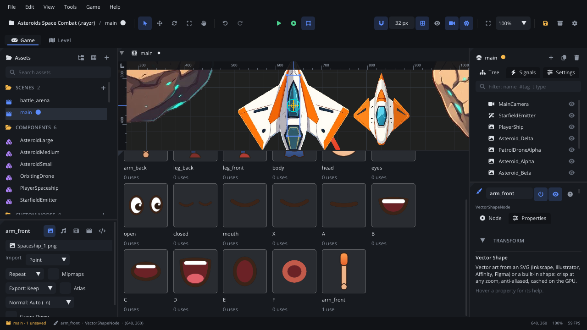

# Library tab

The **Library** tab shows the symbols in a vector file as previews. A symbol
is a named group of the SVG, such as a character's head or a prop, and each
preview shows how many Vector Shapes in the open scene draw it. Place a
symbol in the scene from here, edit it in place, or rename, duplicate or
delete it. For symbols, part swapping and drawing, read
[Vector art](../../engine/docs/vector.md).

## When to use it

- **Placing props and parts**: drag a symbol into the viewport for a Vector
  Shape that draws it. Every copy shares the art, so editing it once
  changes them all.
- **Seeing what's in a file**: a whole character or a sheet of props at a
  glance, and which parts the scene uses.
- **Tidying up**: rename a symbol (the nodes drawing it follow), duplicate
  one to make a variant, delete one you no longer need.

## What's in it

- **File**: the SVG shown. Selecting a Vector Shape shows its file; pick
  another one here.
- **The symbols**: each named group of the file, nested ones under their
  parent's name (`head/mouth`). Each preview shows the symbol's art, its
  name, and how many nodes in the open scene use it.

| Action | What it does |
|---|---|
| Drag a symbol into the viewport | Adds a Vector Shape drawing it where you drop it, and selects it. |
| Double-click a symbol | Edits it in place in [vector edit mode](vector-edit.md), on a node that shows it (the selected one, else the scene's first, else a new one in the middle of the view). |
| Right-click > **Place in the Scene** | A Vector Shape drawing it, in the middle of the view. |
| Right-click > **Edit** | The same as double-clicking it. |
| Right-click > **Rename...** | A new name. Vector Shapes in the open scene that draw it follow. |
| Right-click > **Duplicate** | A copy of the symbol beside it, with its own shapes and the groups inside it, so a swap set keeps its frames. |
| Right-click > **Delete** | Removes the symbol's group and its shapes from the file. The menu says how many nodes use it; they draw nothing until you pick another symbol, and Cmd+Z (Ctrl+Z) puts it back. |

Changes are saved into the SVG straight away and can be undone.

## Walkthrough

1. Draw a few shapes on a Vector Shape (double-click it in the viewport:
   [vector edit mode](vector-edit.md)).
2. Select them with Shift-click and press **F8**: name the symbol **Wheel**.
   A Vector Shape drawing it appears over the shapes.
3. Open the **Library** tab: Wheel is there, used by one node.
4. Drag Wheel into the viewport twice for two more wheels.
5. Double-click Wheel and draw on it: all three wheels change.

## Tips

- A file without named groups shows none. Name groups or layers in your
  vector app (Inkscape layers, Illustrator layers), or use **Convert to
  Symbol** (F8) while drawing.
- Usage counts are for the open scene only. Other scenes and components
  can use the symbol too.
- More: [Vector edit mode](vector-edit.md),
  [Vector art](../../engine/docs/vector.md),
  [Inspector](inspector.md), [viewport](viewport.md).
