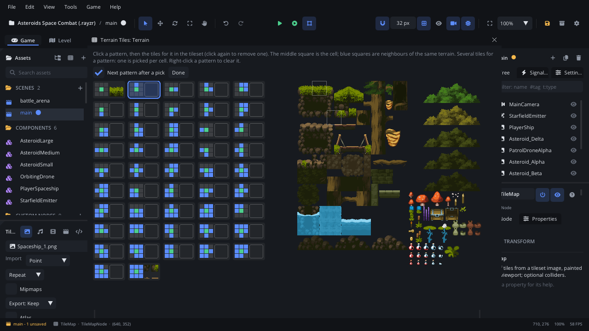

# Terrain Tiles

The **Terrain Tiles** window gives a terrain its tiles: for each pattern
of same-terrain neighbours (16 edge patterns, 47 blob patterns or 64 hex
patterns) you pick the tileset tile(s) that draw it. Once the patterns have
tiles, painting the terrain on the [Tile Map tab](tab-tilemap.md) draws
edges and corners by itself. The tiles are saved next to the tileset image
as you pick them.

## When to use it

- **Setting up auto-tiling** for a tileset: grass with its edges, a cave
  wall with its corners, water with its shore.
- **Adding variety**: give a pattern several tiles (three plain grass
  tiles) and each cell picks one of them.
- **Fixing a wrong edge**: a corner that draws the wrong tile on the map -
  find its pattern here and swap the tile.
- Terrains are also used by [Level Generator](../nodes/LevelGeneratorNode.md)
  rules; see [Procedural levels](../../engine/docs/level_generator.md).

## Opening it

Select a [Tile Map](../nodes/TileMapNode.md) node with a tileset. In the
[Tile Map tab](tab-tilemap.md#the-terrain-list-terrains-layer), switch to
the **Terrains** layer, add a terrain with **New Terrain** if there is none,
and click its **Edit Tiles** button. The window's title is
*Terrain Tiles: &lt;terrain name&gt;*. The terrain's kind (**Blob (47)**,
**Edges (16)** or **Hex (64)**) is chosen in the Tile Map tab, next to its
name.

Only one Terrain Tiles window is open at a time: **Edit Tiles** on another
terrain shows that one instead. It closes by itself if its terrain is
deleted.

## What's in it

### Top row

| Control | What it does |
|---|---|
| **Next pattern after a pick** | On (the default): after you add a tile, the next pattern is selected, so you can go through all of them clicking tiles. Removing a tile doesn't move on. |
| **Done** | Closes the window. Nothing else to do: the tiles are saved as you pick them. |
| Close button (x) | The same as **Done**. |

### Patterns (left)

Each pattern is a card: a small picture of the pattern and, beside it, its
first tile (an empty box when it has none). A number in the corner says how
many tiles it has when there are several.

- **Blob** and **Edges**: a 3 x 3 picture. The green square in the middle
  is the cell; blue squares are neighbours of the same terrain, dark ones
  are not. Edges only looks at the four sides; Blob also at the corners.
- **Hex**: a dot for the cell and six around it, one per side (clockwise
  from the right on pointy-top grids; on flat-top grids the same sides start
  at the top). Blue sides are the same terrain.

| Action | What it does |
|---|---|
| Click a card | Select the pattern (accent outline). The tileset then shows its tiles. |
| Right-click a card | Remove all of the pattern's tiles. |
| Hover | *Pattern N: M tile(s)* - N is the pattern's number in the saved file. |

### Tileset (right)

The tileset image, scaled so tiles show at about 32 px. It scrolls when it
doesn't fit.

| Action | What it does |
|---|---|
| Click a tile | Add it to the selected pattern, or remove it if the pattern already has it. |

Tiles of the selected pattern have a thick accent outline; tiles used by
another pattern of this terrain have a thin grey one. If the image can't be
loaded the panel says *Can't read the tileset image.*

## Walkthrough

A grass terrain on `textures/Tiles.png`:

1. Select a Tile Map whose tileset is `textures/Tiles.png`. In the Tile Map
   tab, pick the **Terrains** layer and click **New Terrain**. Type `Grass`
   in its name field and press Enter.
2. Click **Edit Tiles**. The **Terrain Tiles: Grass** window opens on the
   first pattern.
3. Click the last pattern (all neighbours blue: the middle of a grass area)
   and click the plain grass tile in the tileset. With only this tile, a
   painted area is already filled with grass.
4. Click the first pattern and the tile for a lone grass cell. With **Next
   pattern after a pick** on, the second pattern is now selected: click its
   tile, and so on through the edges and corners.
5. Give a pattern a second tile to vary it; click a tile again to take it
   off.
6. Click **Done**. In the Tile Map tab, click the terrain's card, then paint
   in the viewport: the edges draw themselves.

## Tips

- Start with the full pattern (every neighbour the same terrain), then the
  sides, then the corners. A Blob pattern without tiles uses the same
  pattern without its corners, then the full tile, so a half-finished
  terrain still paints something sensible.
- The terrains are kept in `<image>.tileset.json` next to the tileset image
  (`textures/Tiles.png` -> `textures/Tiles.tileset.json`), with the
  tileset's [tile animations](tile-animation.md). Every map using that image
  shares them.
- The Tile Map tab's terrain card says how many patterns have tiles
  (*12 of 47 patterns have tiles*).
- Changes here are saved at once and are not part of the scene's undo
  history.
- Related: [Tile Map tab](tab-tilemap.md), [Tile Map](../nodes/TileMapNode.md),
  [Tile Animation](tile-animation.md).
