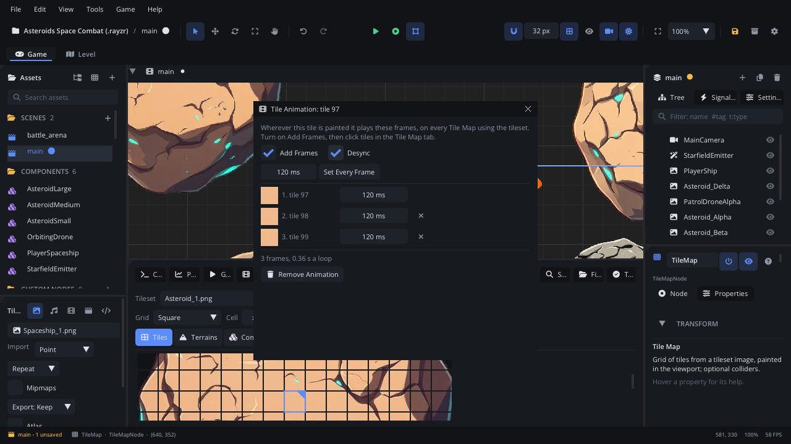

# Tile Animation

The **Tile Animation** window makes a tileset tile animated: its frames
(other tiles of the same tileset) and how long each one shows. Wherever
that tile is painted it plays the frames, on every Tile Map that uses the
tileset - water, torches, blinking lights. The animation is saved with the
tileset, next to its image.

## When to use it

- **Moving water, lava, waterfalls**: every copy changing in step.
- **Grass, candles, flags**: with **Desync**, each copy at its own point in
  the loop, so neighbours don't flicker together.
- **Changing a frame's timing**: a torch that holds one frame longer.
- For a sprite that animates on its own (a character), use an
  [Animation Player](../nodes/AnimationPlayerNode.md) instead.

## Opening it

Select a [Tile Map](../nodes/TileMapNode.md) node with a tileset. In the
[Tile Map tab](tab-tilemap.md), on the **Tiles** layer, click the tile the
animation starts on, then the **film** button after *Tile N of M* (tooltip:
*Animate the picked tile*). The window's title is *Tile Animation: tile N*.

- For a tile that isn't animated yet, the window starts with that tile as
  frame 1 and **Add Frames** turned on.
- For a tile that already is, it shows its frames.

Tiles that start an animation have an accent-coloured corner in the Tile
Map tab's tile list.

## What's in it

| Control | What it does |
|---|---|
| **Add Frames** | While on, clicking a tile in the Tile Map tab adds it as the next frame instead of picking it to paint with. The new frame takes the last frame's time. Turn it off to paint again. |
| **Desync** | Each painted copy starts at its own point in the animation. Off: all copies in step. |
| ms field + **Set Every Frame** | Type or drag a time (10 to 5000 ms, 120 to start) and click the button to give every frame that time. |
| Frame rows | Each frame: its tile's picture, *N. tile T*, and its time in ms (drag or double-click to type, 10 to 5000). |
| **x** on a frame | Remove that frame. Frame 1 has none: it is the tile the animation belongs to. |
| Summary | *N frames, S s a loop*. |
| **Remove Animation** | The tile is no longer animated; the window closes. |
| Close button (x) | Closes the window and turns **Add Frames** off. An animation with only one frame is dropped. |

The tile pictures show when the selected Tile Map uses this tileset;
otherwise only the tile numbers show.

## Walkthrough

Water that ripples, three frames:

1. Select a Tile Map using your tileset. In the Tile Map tab, click the
   first water tile.
2. Click the film button. The **Tile Animation: tile N** window opens with
   one frame and **Add Frames** on.
3. Click the second and third water tiles in the Tile Map tab. They appear
   as frames 2 and 3, at 120 ms each.
4. Type `200` in the ms field and click **Set Every Frame**.
5. Turn **Add Frames** off, click the first water tile again and paint it
   in the viewport. Close the window.

## Tips

- Everything is saved as you change it, in `<image>.tileset.json` next to
  the tileset image (with its [terrains](terrain-tiles.md)), and is not
  part of the scene's undo history.
- Paint the animation's first tile; the other frames are only frames.
- A terrain's tiles can be animated too: animate the tile the terrain uses.
- More about animated tiles and the saved format:
  [Tile Map](../nodes/TileMapNode.md).
- Related: [Tile Map tab](tab-tilemap.md), [Terrain Tiles](terrain-tiles.md).
