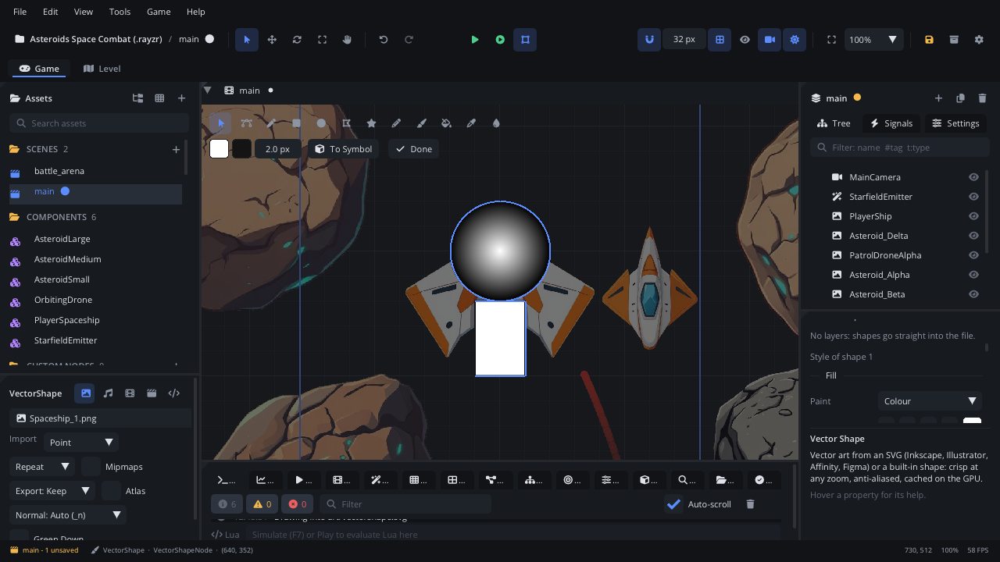

# Vector edit mode

**Vector edit mode** draws and edits a Vector Shape's art right in the
viewport, with Flash-style tools: pen, shapes, pencil and brush, paint
bucket, gradients and an eyedropper. The rest of the scene dims, the Vector
toolbar appears at the top left of the viewport, and every change is saved
into the SVG straight away. Selected shapes become symbols you can reuse
and animate. For the art itself (what's imported, symbols, part swapping,
bones), read [Vector art](../../engine/docs/vector.md).

## When to use it

- **Drawing art without leaving Rayzr**: a character, a prop, a
  background, from an empty Vector Shape.
- **Fixing imported art**: move an anchor, recolour a shape, change a
  gradient, without going back to Inkscape or Illustrator.
- **Making symbols**: turn shapes into a named part (a wheel, a head) that
  many nodes draw, and edit it once for all of them.
- For a symbol's timeline, a node's Symbol / Frame, or Explode into Parts,
  use the [Inspector](inspector.md)'s Vector section; for the file's
  symbols at a glance, the [Library tab](tab-library.md).

## Opening it

Select a **Vector Shape** node, then:

- **double-click** it in the viewport, or
- click **Edit Art** in the Inspector's **Vector** section (it reads **Done
  Drawing** while you draw), or
- double-click a symbol in the [Library tab](tab-library.md).

A Vector Shape with no file gets `art/<node name>.svg` the first time you
draw on it. The Console says `Drawing in <node>: V select, A nodes, P pen;
Esc when done`.

## What's in it

### Tools

The toolbar's first row. Press a tool's key while the mouse is over the
viewport. While you draw, the keys work on the art, not on the node:
**Delete** removes the selected shapes or anchor, **Esc** ends a pen path
(a second **Esc** leaves the mode), and the scene's own keys (Q / W / E /
R / T, F, the arrows) wait until you're done.

| Tool | Key | What it does |
|---|---|---|
| **Select** | V | Click a shape to select it, drag to move it. **Shift+click** adds or removes a shape; drag on empty space for a box (shapes wholly inside). **Delete** removes the selected shapes. |
| **Nodes** | A | The selected shape's anchors and handles. Drag an anchor; drag a handle to bend the curve (its partner follows; **Alt**: only this one). **Double-click** a segment to add an anchor, **Alt+click** an anchor to remove it, **right-click** an anchor: **Smooth**, **Symmetric**, **Corner**. |
| **Pen** | P | Click for a corner, click and drag for a smooth anchor. Click the first anchor to close the shape (it gets the fill colour). **Enter**, **Esc** or a double-click ends an open path. |
| **Rectangle** | R | Drag one out. **Shift**: a square, **Alt**: from the centre. |
| **Ellipse** | O | Drag one out. **Shift**: a circle, **Alt**: from the centre. |
| **Polygon** | | Drag one out. |
| **Star** | | Drag one out. |
| **Pencil** | Y | Draw a line freehand; it becomes a few smooth curves. |
| **Brush** | B | Paint a filled stroke in the fill colour, thinner when you move fast. |
| **Paint Bucket** | K | Click a shape to fill it, or a gap that lines close in to fill it with a new shape. |
| **Eyedropper** | I | Click a shape to copy its fill and line to the selected shape (or, with none selected, to new shapes). **Alt+click**: the colour on screen as the fill (**Alt+Shift+click**: as the line colour). |
| **Gradient** | F | Drag the selected shape's gradient ends on the canvas (a radial gradient: its centre and radius). |

Points snap to other shapes' anchors, and with the viewport's snap (the
magnet) on, to the grid and guides. Hold **Cmd** (Ctrl) to place a point
freely.

### The toolbar's second row

| Control | What it does |
|---|---|
| Two colour swatches | Fill colour and line colour of new shapes. |
| `2.0 px` | Line width of new shapes. |
| `r 0` (Rectangle) | Corner radius of new rectangles. |
| `5 sides` (Polygon) | The number of sides. |
| `5 points`, `inner 0.50` (Star) | The number of points and the inner corners' radius. |
| `size 12` (Brush) | The brush's width. |
| `smooth 50` (Pencil, Brush) | 0 keeps every wiggle; higher: fewer, smoother curves. |
| **To Symbol** | With shapes selected: Convert to Symbol (**F8**). |
| `file > symbol` | Shown while you edit one symbol. |
| **Done** | Leave the mode (**Esc**). |

### The Inspector while drawing

The Vector section adds:

- **Layers**: the file's top-level groups, top first. **+** adds one. The
  round button picks the layer new shapes go into, the eye hides a layer
  (saved hidden), the lock stops its shapes being picked, the name field
  renames it (Enter), the arrows move it up or down. With a shape selected,
  **Forward** and **Backward** change its draw order (**Cmd+]** /
  **Cmd+[**).
- The style: of the selected shape (`Style of shape N`), or of new shapes
  when nothing is selected.

### Fill and stroke

| Part | What's in it |
|---|---|
| **Fill** > **Paint** | **None**, **Colour**, **Linear gradient** or **Radial gradient**. |
| **Fill** > **Rule** | **Non-zero** or **Even-odd (holes)**: overlapping parts become holes. |
| **Stroke** > **Paint** | The same choices, for the line. |
| **Stroke** > **Width**, **Joins**, **Miter Limit**, **Caps** | The line's width; Miter, Round or Bevel corners (a miter's limit); Butt, Round or Square ends. |
| **Stroke** > **Dashes**, **Dash Offset** | Dash, gap, dash... (`8 4`); empty: a solid line. |
| **Shape** > **Opacity** | The whole shape's opacity. |

A gradient shows a **stop bar** under **Stops**: click the bar to add a
stop, drag a stop along it, right-click a stop to remove it (two stay).
**Stop Colour** sets the picked stop's colour; **Spread** (**Pad**,
**Reflect**, **Repeat**) sets what happens past the ends. Move the ends
on the canvas with the **Gradient** tool (**F**).

**Swatches** are the project's palette, saved in `project.json`: click one
for the fill, **Shift+click** for the line colour, right-click to remove
it; **+** adds the current fill colour. **In this file:** lists the colours
the file already uses (click to apply).

### Symbols

- **Convert to Symbol**: select shapes (Shift+click or a box) and press
  **F8**, or **To Symbol**. Type a **Name** and click **Convert**: the shapes
  become a named group of the file, and a Vector Shape drawing the new
  symbol is placed exactly over them.
- **Editing a symbol in place**: double-click a Vector Shape that shows one
  symbol (or the symbol in the Library tab). Only that symbol's shapes can
  be picked, new shapes go into it, and the toolbar shows `file > symbol`.
  Every node drawing it updates.
- **Make Animated Symbol** (Inspector, Vector section): the symbol's parts
  become Vector Shapes (when it has child groups), an Animation Player is
  added, and it's saved as `components/<symbol>.component.json`, linked.
  Each instance plays its own animation.
- Place, rename, duplicate and delete symbols in the
  [Library tab](tab-library.md).

### Files Rayzr can't fully draw

An SVG with parts the importer skips (text, images, filters; the
Inspector lists the warnings) asks first, in **Edit vector art**: saving
writes only what Rayzr draws.

- **Edit a Copy**: writes `<name>_edit.svg` and points the node at it; the
  original stays as it was.
- **Overwrite**: edits the file itself (a `.bak` is kept).
- **Cancel**: doesn't start drawing.

The first save of any file keeps the original beside it as `.bak`.

### Leaving the mode

Press **Esc**, click **Done** in the toolbar or **Done Drawing** in the
Inspector, or select another node. Each edit is already saved and is one
undo step (**Cmd+Z**).

## Walkthrough

A wheel, used three times:

1. Click **+** in the Scene panel, type `vector` and create a **Vector
   Shape**. In the Inspector, click **Edit Art**.
2. Press **O** and drag out a circle with **Shift** held. In the Inspector,
   set **Fill** > **Paint** to **Radial gradient**; click the stop bar to
   add a third stop and give it a darker **Stop Colour**.
3. Press **F** and drag the gradient's radius handle on the canvas.
4. Press **R** and drag a small rectangle over the circle for a spoke. Click
   **+** under **Swatches** to keep its colour for later.
5. Press **V**, drag a box round both shapes, and press **F8**. Type
   `Wheel` and press Enter: a Vector Shape drawing `Wheel` sits over them.
6. Press **Esc**. Open the [Library tab](tab-library.md) and drag `Wheel`
   into the viewport twice.
7. Click one of the wheels, double-click it, press **B** and paint a dot
   on it: all three wheels show the dot. Press **Esc**.

## Tips

- Every edit writes the SVG at once, so Inkscape, Illustrator and Affinity
  open it again with your groups and gradients.
- Lock the layer you trace over (the lock in **Layers**) so clicks go to
  the layer above.
- The Eyedropper clicked on the selected shape itself gives new shapes its
  style.
- The tutorial [Drawing and animating a vector character](../getting-started/vector-character.md)
  builds a whole character this way. More:
  [Vector art](../../engine/docs/vector.md),
  [Vector Shape](../nodes/VectorShapeNode.md), [Library tab](tab-library.md),
  [viewport](viewport.md).
