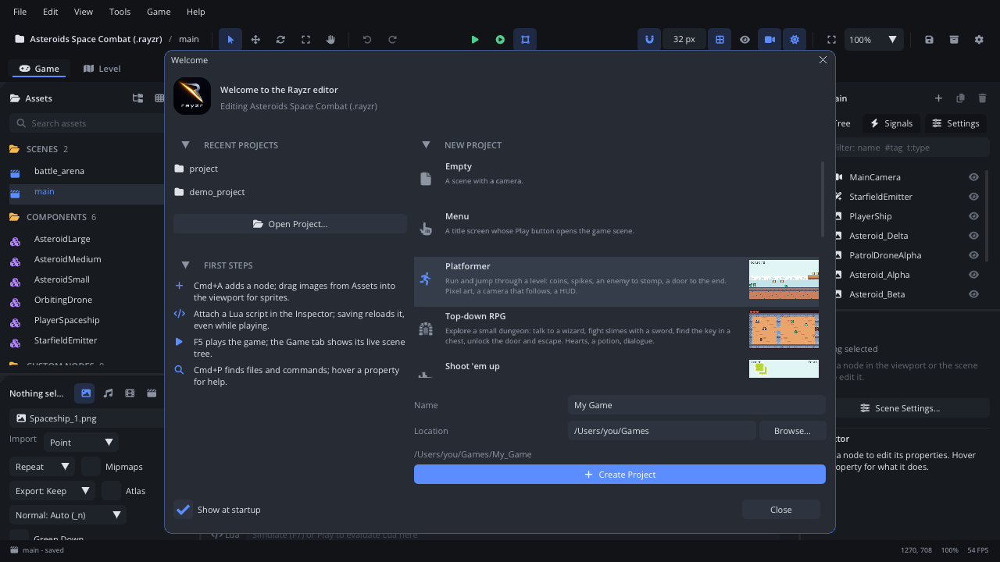

# Welcome window and workspaces

The **Welcome** window opens when the editor starts: your recent projects,
**Open Project...**, a few first steps, and **New Project** from a
template or a sample. Once a project is open, **workspaces** arrange the
editor's panels for the job at hand: level design, scripting, animation,
or a layout you saved.

## When to use it

- Start a new game from a template that already plays: a platformer, an
  RPG, a shoot 'em up, a puzzle and more.
- Open a sample to see how a complete small game is put together.
- Get back to a project you worked on.
- Switch the panel layout: a bigger viewport for building levels, the Code
  tab in the middle for scripting, a tall timeline for animating.
- To change editor or project settings, use [Settings](settings.md); for
  the menus themselves, [Toolbar and menus](toolbar-menus.md).

## Opening it

- It opens by itself when the editor starts without a project to open.
  Untick **Show at startup** at the bottom to stop that.
- **Help > Welcome** opens it any time.
- **F1** in the window opens this page.

## What's in it

The top says which project is open (*Editing ...*).

### Recent Projects and First Steps (left)

| Control | What it does |
|---|---|
| **Recent Projects** | The last ten projects you opened (*None yet.* at first). Click one to open it; hover for its folder. Also **File > Open Recent**. |
| **Open Project...** | The **Open Project** dialog: the recent projects, and a folder browser where project folders are marked *(project)*. Type a project folder or a `.rayzr` package in the path box and click **Open**. Also **File > Open Project...** (Cmd+Shift+O). |
| **First Steps** | Four pointers: Cmd+A adds a node, a script reloads when saved, F5 plays, Cmd+P finds files and commands. |

Opening a project restarts the editor on it, after asking about unsaved
scenes and scripts.

### New Project (right)

| Control | What it does |
|---|---|
| **Templates** | Click a card to pick it (hover for its description). **Empty** is a scene with a camera; **Menu** a title screen whose Play button opens the game scene. The game templates are small, complete games with pixel art, each with a README saying what's where and what to change first: **Platformer**, **Top-down RPG**, **Shoot 'em up**, **Puzzle (Sokoban)**, **Visual Novel**, **Isometric Dungeon**, **Hex Island** and **Vector Character**. See [Templates](../../templates/README.md). |
| **Samples** | Bigger projects to explore, under *Samples - complete projects to explore*: **Platformer Adventure** (a title screen, two levels, saved progress, a pause menu) and **Asteroids** (the demo, using most of the engine). |
| **Name** | The game's name (`My Game`). The project folder is the name with `_` for spaces. |
| **Location** | The folder the project goes in (where you last made or opened one). **Browse...** picks it. The full path is shown under it. |
| **Create Project** | Makes the project from the template in the new folder, names the game (and its window title), and opens it. A folder that already has a project is refused (the console says so). |

**File > New Project...** makes an *Empty* project without this window:
type the folder for it and press Enter.

**Close** (or the window's x) closes the window; the project stays open.

## Workspaces

**View > Workspaces** switches the panel layout:

| Workspace | Layout |
|---|---|
| **Default** | The usual layout. The bottom panel (Console, Game, Animation, ...) starts 100 px tall: drag its edge to resize it. |
| **Level Design** | A larger viewport. |
| **Scripting** | The [Code tab](code.md) in the middle, in front. |
| **Animation** | A tall bottom panel on the [Animation tab](tab-animation.md). |

- **Save Workspace As...** keeps the current arrangement under a name; it
  is listed in the same menu from then on, in every project (saved in
  `~/.config/rayzr_editor/workspaces/`). **Delete Workspace** removes one.
- **View > Reset Layout** goes back to Default.
- **View > Bottom Panel** lists the bottom panel's tabs with a check by
  the ones shown: click one to hide or show it (at least one stays). A
  hidden tab comes back when the selection or a command needs it (an
  AnimationPlayer selected, Find in Files).
- The bottom panel **follows the selection**: selecting an AnimationPlayer
  shows the Animation tab, a particle emitter the Particles tab, an LDtk
  level the LDtk tab; selecting something else goes back to the tab you
  had, and a tab you pick by hand stays. Turn it off in
  [Settings](settings.md) > General > Basic (**Bottom Panel Follows
  Selection**).
- A docked window alone in its space hides its tab (the panels have their
  own headers), so after closing a window docked next to another, the one
  left loses its tab. **View > Show Tab Bars** gives every docked window
  its tab, to see what is docked where; turn it off for the clean look.

The hidden tabs, Show Tab Bars and Follows Selection are saved for you in
`settings.ini` (`hidden_bottom_tabs`, `show_tab_bars`,
`auto_bottom_panel`), not in the project.

## Walkthrough

Make a platformer and set the editor up for building its level:

1. **Help > Welcome**.
2. Click the **Platformer** card.
3. Type `Cave Run` in **Name**, and pick a **Location** with **Browse...**.
4. Click **Create Project**. The editor restarts on the new `Cave_Run`
   folder.
5. Press **F5**: the game plays. Press **Shift+F5** to stop.
6. **View > Workspaces > Level Design**: the viewport grows.
7. Drag the bottom panel's edge up a little, then **View > Workspaces >
   Save Workspace As...**, type `Levels` and press Enter. **Levels** is in
   the Workspaces menu now, in every project.

## Tips

- Read the template's `README.md` (in the project folder) first: it says
  which scripts do what and what to change first.
- A recent project that was moved or deleted can't be opened: the console
  says it isn't a project.
- The Welcome window doesn't open when the editor is started on a project
  (`--project <folder>`), as it is after creating or opening one.
- Related: [Editor tour](tour.md), [Your first game](../getting-started/first-game.md),
  [Toolbar and menus](toolbar-menus.md).
