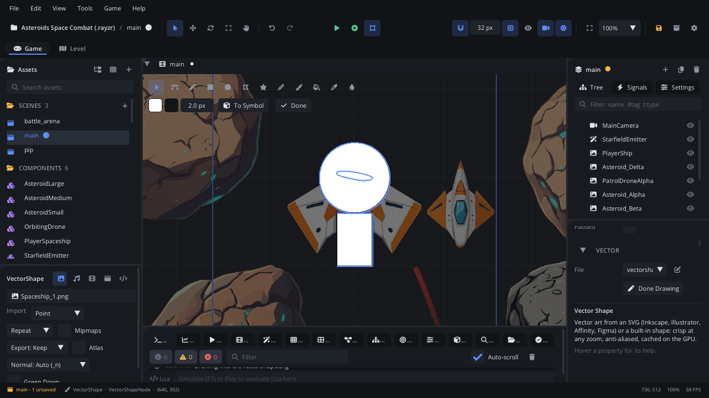
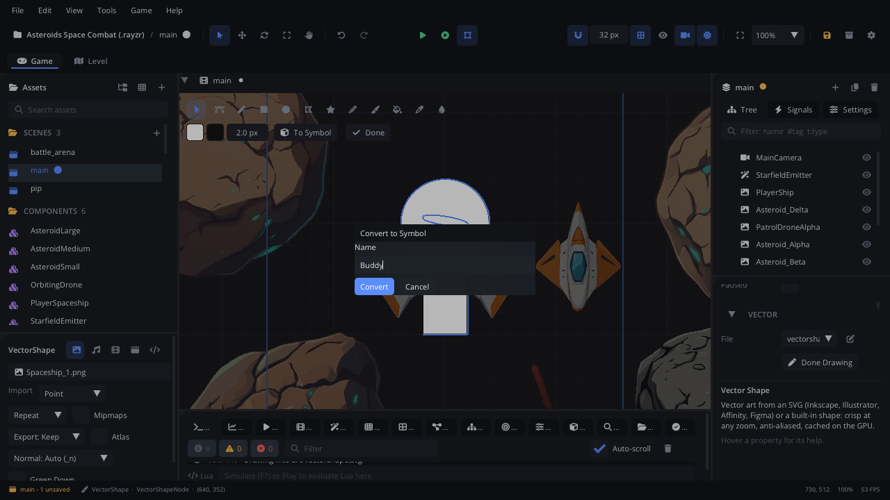
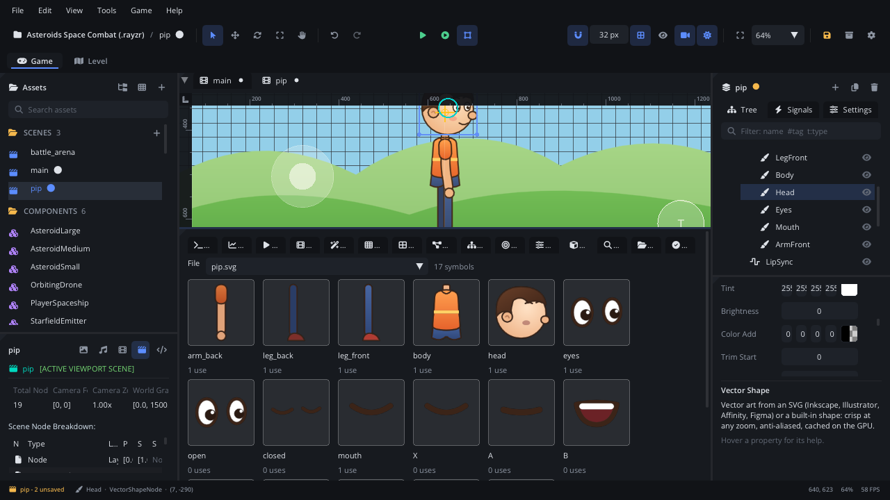
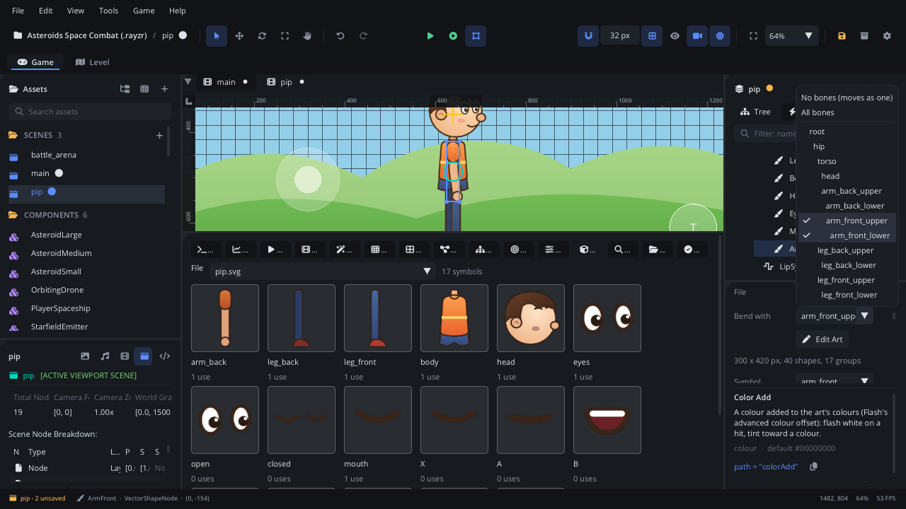
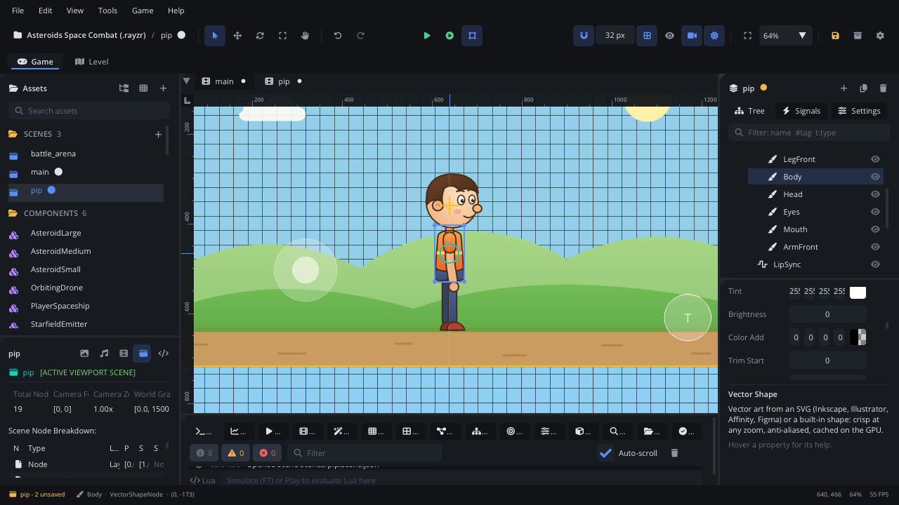
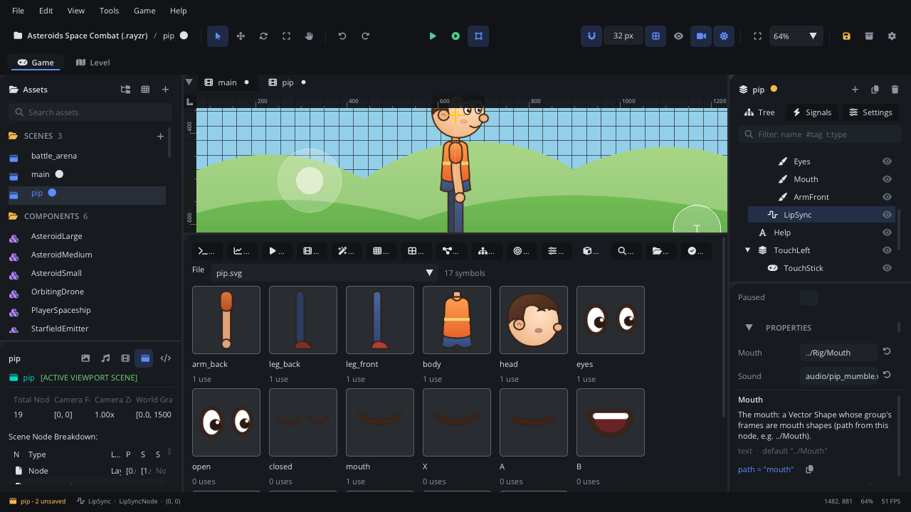
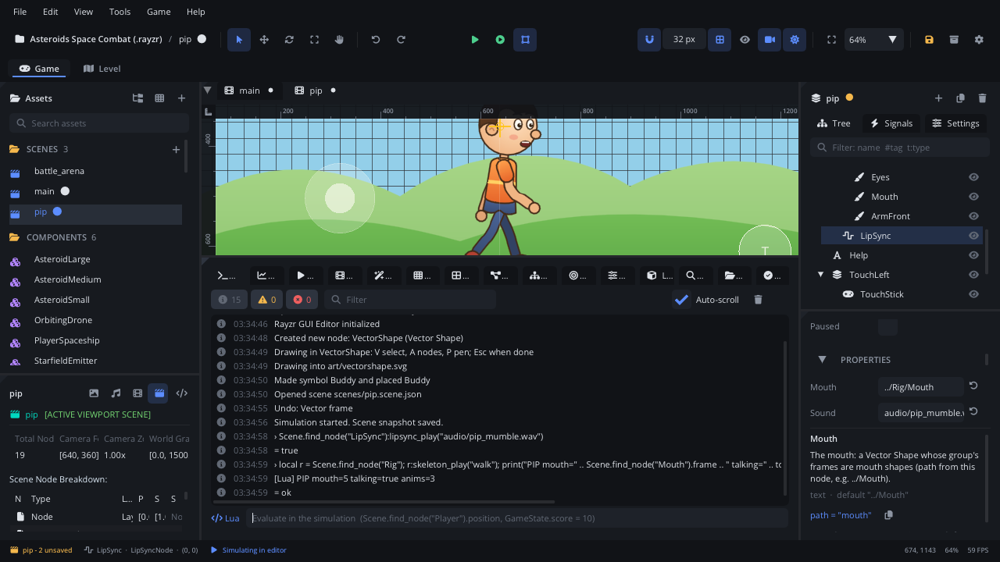

# Drawing and animating a vector character

This tutorial builds Pip, the character of the **Vector Character**
template, from nothing: drawn with the editor's vector tools, cut into
parts, put on a skeleton, animated, lip-synced to a voice and moved by a
script. It takes about an hour. To see where it ends first, make a project
from the template (**Help > Welcome > New Project > Vector Character**)
and press **F5**: A / D walk, T talks.

Vector art stays sharp at any zoom, and a character made of a few dozen
shapes costs very little to draw. The [vector art guide](../../engine/docs/vector.md)
explains everything used here in more detail.

## 1. Plan the parts

A character that moves is drawn in pieces, like a paper puppet: one piece
for each part that moves on its own. Pip has eight:

| Part | Moves with |
|---|---|
| `arm_back`, `arm_front` | the upper and lower arm bones (bent at the elbow) |
| `leg_back`, `leg_front` | the upper and lower leg bones (bent at the knee) |
| `body` | the torso |
| `head` | the head |
| `eyes` | the head; two frames, `open` and `closed` |
| `mouth` | the head; one frame per mouth shape |

Draw him **standing straight**, arms hanging down, legs together, facing
right: this is the *rest pose* the bones will be fitted to. Keep each
joint where two parts overlap (the shoulder under the sleeve, the hip under
the shorts) so nothing gaps when a part turns.

## 2. Draw the parts

1. **Add Node > Graphics & Rendering > Vector Shape**. It draws a star until
   it has art of its own.
2. Press **Edit Art** in the Inspector (or double-click the shape in the
   viewport). The rest of the scene dims and the Vector toolbar appears at
   the top of the viewport.
3. In the Inspector, under **Layers**, press **+** to add a layer and type
   its name, `body`. New shapes go into the layer whose round button is on.
   Make a layer for each part, in drawing order: `arm_back` at the bottom,
   `arm_front` on top.
4. Draw with the tools:
   - **Ellipse** (O) and **Rectangle** (R) for heads, hands and limbs (the
     toolbar's **r** field rounds a rectangle's corners).
   - **Pen** (P) for the shirt and the hair: click for corners, drag for
     curves, click the first point to close the shape.
   - **Brush** (B) for eyebrows and other strokes painted by hand.
   - **Nodes** (A) to fix a curve afterwards.
5. Colour each shape in the Inspector under **Fill** and **Stroke**: a
   colour, or a linear or radial gradient (click the stop bar to add a
   stop). Pip uses a dark outline, 3 px, on everything. Add the colours you
   use to **Swatches** to keep them the same across parts.

Drawing creates `art/<node name>.svg`; every change is saved into it, and
**Cmd+Z** undoes. Press **Esc** or **Done** when you finish.



**Or use the template's art**: copy `art/pip.svg` from a Vector Character
project into yours and drag it from **Assets** into the viewport. It is
plain SVG, so you can also draw the parts in Inkscape, Illustrator or
Affinity: one layer (or named group) per part.

## 3. Make symbols

Every named group of the file is a **symbol**: a Vector Shape can draw just
that group (the Inspector's **Symbol**). Layers are symbols already. To make
one from loose shapes, select them with the **Select** tool (Shift-click,
or drag a box round them) and press **F8** (or **To Symbol** in the
toolbar). Name it: the shapes become a group, and a Vector Shape showing it
is placed exactly over them.



The **Library** tab in the bottom panel lists the symbols of the selected
Vector Shape's file, with previews and how many nodes of the scene use
each. Drag one into the viewport to place it, double-click one to edit it
in place, right-click to rename (the nodes follow), duplicate or delete it.



## 4. Swap sets: eyes and mouths

A symbol whose child groups are alternatives shows one at a time: the
Vector Shape's **Frame**. Pip's `eyes` has two children, `open` and
`closed`; his `mouth` has seven, named after the shapes of
[Rhubarb Lip Sync](https://github.com/DanielSWolf/rhubarb-lip-sync):

| Frame | Shape | Sounds |
|---|---|---|
| `X` | at rest, closed | silence |
| `A` | closed, pressed | M, B, P |
| `B` | slightly open, teeth | most consonants |
| `C` | open | E |
| `D` | wide open | A |
| `E` | round | O |
| `F` | puckered | U, W |

To make them: draw every mouth in the `mouth` layer, over the same spot.
In the Library tab, double-click `mouth` to edit that symbol in place,
then select one mouth's shapes and press **F8**, naming it `X`; then `A`,
`B` and so on. Each becomes a child group of `mouth` (delete the extra
nodes Convert to Symbol places in the scene). The eyes are made the same
way, from `open` and `closed`.

Pick a frame in the Inspector's **Frame** list. The part's box covers all
its frames, so swapping never makes it jump. Until a frame is picked, all of
them show at once. In Inkscape, hide every frame but the first (hidden
layers are still frames) and the file looks right as a whole.


## 5. Explode into parts

Select the Vector Shape that draws the whole file and press **Explode into
Parts** in the Inspector. It is replaced by a Node holding a Vector Shape
per layer, each placed where it was drawn, with its pivot at its centre.
Rename them to taste (Pip's are `ArmBack`, `LegBack`, `LegFront`, `Body`,
`Head`, `Eyes`, `Mouth`, `ArmFront`). Set the Eyes' and the Mouth's
**Frame** to their first frame.

Now each part can be moved and turned on its own. For a few parts that is
enough: key them on the **Animation** tab. For limbs that bend, use bones.

## 6. Put the parts on a skeleton

The bones come from a **Spine** (or DragonBones) JSON file. It needs no
images: just bones and animations. Make one in Spine or write it by hand;
Pip's is `rigs/pip.json`:

```json
{
"skeleton": {"spine": "4.2.22"},
"bones": [
  {"name": "root"},
  {"name": "hip", "parent": "root", "y": 130},
  {"name": "torso", "parent": "hip", "rotation": 90, "length": 90},
  {"name": "head", "parent": "torso", "x": 90, "length": 130},
  {"name": "arm_front_upper", "parent": "torso", "x": 78, "rotation": 180, "length": 55},
  {"name": "arm_front_lower", "parent": "arm_front_upper", "x": 55, "length": 48},
  {"name": "leg_front_upper", "parent": "hip", "x": 7, "rotation": -90, "length": 62},
  {"name": "leg_front_lower", "parent": "leg_front_upper", "x": 62, "length": 52}
],
"slots": [], "skins": [{"name": "default", "attachments": {}}],
"animations": {}
}
```

Spine's y axis points **up** and its angles turn anticlockwise. A bone
points along its own x axis, and a child's `x` / `y` are measured along its
parent: the torso points up (90), the head sits 90 px along the torso, the
arms hang down (180 from the torso) and the legs too (-90 from the hip).
Each `length` reaches the next joint. Pip's root is between his feet, so
the hip is 130 px above the ground.

1. **Add Node > Animation & Effects > Skeleton** and pick the file in the
   Inspector's **File**. Tick **Show Bones**.
2. In the **Scene** panel, drag the parts onto the Skeleton, back to front.
3. Select all the parts in the Scene panel and move them together until
   the bones sit in the joints: the shoulder at the top of the arm, the elbow halfway down, the
   hip under the shorts. (The Skeleton's **Animation** must be empty here,
   so the bones stand in their rest pose.)
4. Select each part and, in the Inspector's **Vector** section, choose
   **Bend with**: the bones it follows. The body follows `torso`; the head,
   eyes and mouth follow `head`; an arm follows its upper and lower arm.
5. **Skin Smooth** sets how far round a joint (px) two bones blend: 0 keeps
   a part rigid (the body, the head), 12-14 bends an arm or a leg round a
   soft elbow or knee.



## 7. Animate: idle and walk

Animations go in the same file, as bone timelines. A rotate key is an
angle added to the bone's rest angle, a translate key an offset from its
rest position:

```json
"walk": {"bones": {
  "hip": {"translate": [{"time": 0, "y": -7}, {"time": 0.2, "y": 0}, {"time": 0.4, "y": -7},
                        {"time": 0.6, "y": 0}, {"time": 0.8, "y": -7}]},
  "leg_front_upper": {"rotate": [{"time": 0, "value": 25}, {"time": 0.2, "value": 5},
                                 {"time": 0.4, "value": -25}, {"time": 0.6, "value": 0},
                                 {"time": 0.8, "value": 25}]},
  "leg_front_lower": {"rotate": [{"time": 0, "value": -5}, {"time": 0.2, "value": -10},
                                 {"time": 0.4, "value": -15}, {"time": 0.6, "value": -55},
                                 {"time": 0.8, "value": -5}]}
}}
```

A walk is a loop of four poses: *contact* (the legs apart, the hip low),
*passing* (one leg swings past the other, the hip high), then the same with
the legs swapped. The arms swing against the legs. Pip's `idle` breathes
(the hip rises 2 px and the head nods over two seconds) and `talk` bobs the
head and lifts a hand. A key's `"curve": [cx1, cy1, cx2, cy2]` eases it
(Spine's Bezier, in time and value units).

Back in the editor, pick an **Animation** on the Skeleton to see it, and
press **Preview** to play it in the viewport. The editor reads the file
when the scene opens: after changing it, reopen the scene (the game reads
it when it starts). **Mix Time** (0.2 s) crossfades from one animation to
the next.



## 8. Lip-sync

1. Record a line (a WAV or OGG), for example `audio/hello.wav`.
2. Run it through Rhubarb Lip Sync:
   `rhubarb -f tsv audio/hello.wav -o audio/hello.tsv`. The output lists a
   time and a mouth shape per line. Keep it beside the sound with the same
   name. (The template's `audio/pip_mumble.tsv` was written by hand: a
   cartoon mumble needs no recording.)
3. **Add Node > Graphics & Rendering > Lip Sync** next to the Skeleton.
   Set **Mouth** to the mouth's path from the Lip Sync node,
   `../Rig/Mouth`, and **Sound** to the voice. Tick **Autoplay** to hear it
when the game starts.

While the voice plays, the Lip Sync node shows the Mouth frame of the cue
under the playback time; at the end the mouth rests on `X`. Frames named
otherwise can be mapped (**Mapping** `A=MBP,B=etc`). A Dialogue node's
**lipSync** makes every voiced line move the mouth.



## 9. Script it

Put the Skeleton and the Lip Sync node under a Node called `Pip` and give
it a script (`scripts/pip.lua` in the template). Add `move_left`,
`move_right` and `talk` (T) in **Project Settings > Input**.

```lua
---@class Pip : ScriptInstanceBase
local Pip = {}

Pip.properties = {
    speed = { type = "float", default = 150, label = "Walk Speed" },
    voice = { type = "string", default = "audio/pip_mumble.wav", label = "Voice" },
}

function Pip:ready()
    self.rig = self.node:get_node("Rig") ---@type SkeletonNode
    self.eyes = self.node:get_node("Rig/Eyes") ---@type VectorShapeNode
    self.lips = self.node:get_node("LipSync") ---@type LipSyncNode
    self.next_blink, self.blink_left = 1.5, 0
end

function Pip:update(dt)
    local dir = Input.get_axis("move_left", "move_right")
    if math.abs(dir) > 0.1 then
        local p = self.node.position
        self.node.position = Vec2(p.x + dir * self.speed * dt, p.y)
        self.rig.scale = Vec2(dir < 0 and -1 or 1, 1) -- face the way he walks
        self.rig:skeleton_play("walk")
    elseif self.lips:lipsync_is_playing() then
        self.rig:skeleton_play("talk")
    else
        self.rig:skeleton_play("idle")
    end
    if Input.is_action_pressed("talk") then self.lips:lipsync_play(self.voice) end

    -- Blink: swap the eyes' frame for a moment every few seconds.
    if self.blink_left > 0 then
        self.blink_left = self.blink_left - dt
        if self.blink_left <= 0 then self.eyes:vector_swap("open") end
    else
        self.next_blink = self.next_blink - dt
        if self.next_blink <= 0 then
            self.eyes:vector_swap("closed")
            self.blink_left, self.next_blink = 0.12, 2 + math.random() * 3
        end
    end
end

return Pip
```

`skeleton_play` with the animation already playing does nothing, so it is
safe to call every frame. Turning round is the rig's `scale.x`: the
skinned parts flip with it. Press **F5**.



## Where next

- Aim a bone from a script: `skeleton_set_bone_rotation("head", degrees)`
  turns Pip's head to look at the mouse.
- Give the same art to another character: duplicate Pip and change the
  parts' **Tint** and **Brightness**. The copies share the meshes.
- The [vector art guide](../../engine/docs/vector.md) covers shape tweens,
  filters (a drop shadow, an outline), warps for squash and stretch, and
  collision from the art; the [skeletal animation guide](../../engine/docs/skeletal_animation.md)
  covers IK, skins and bone attachments.
