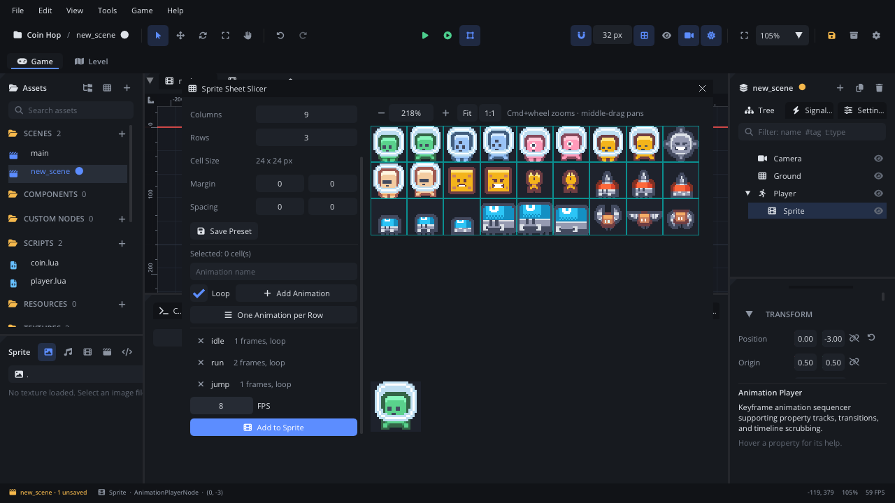
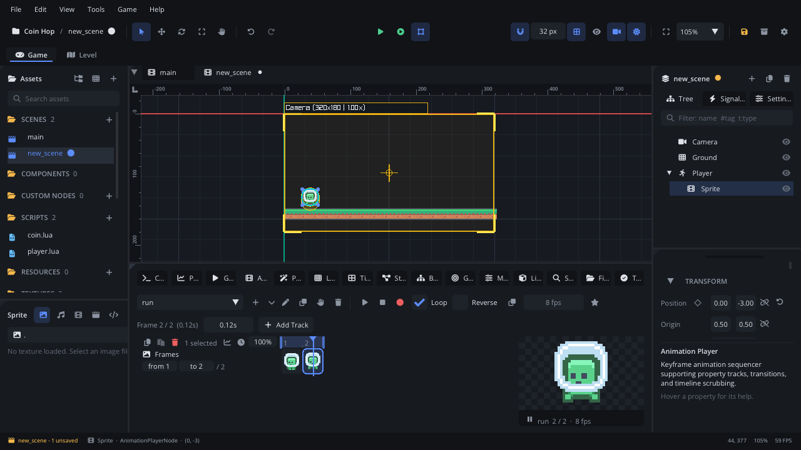
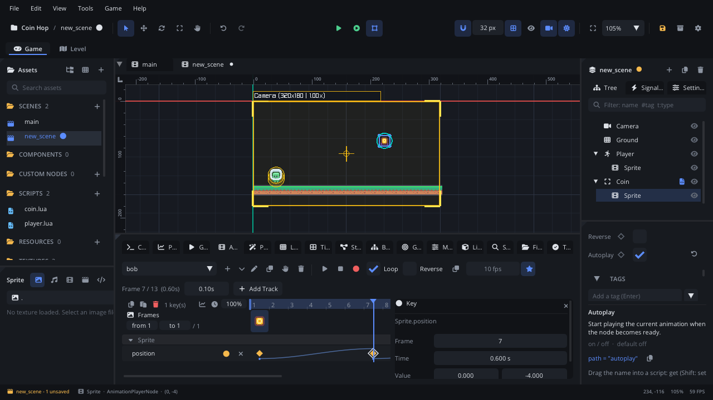
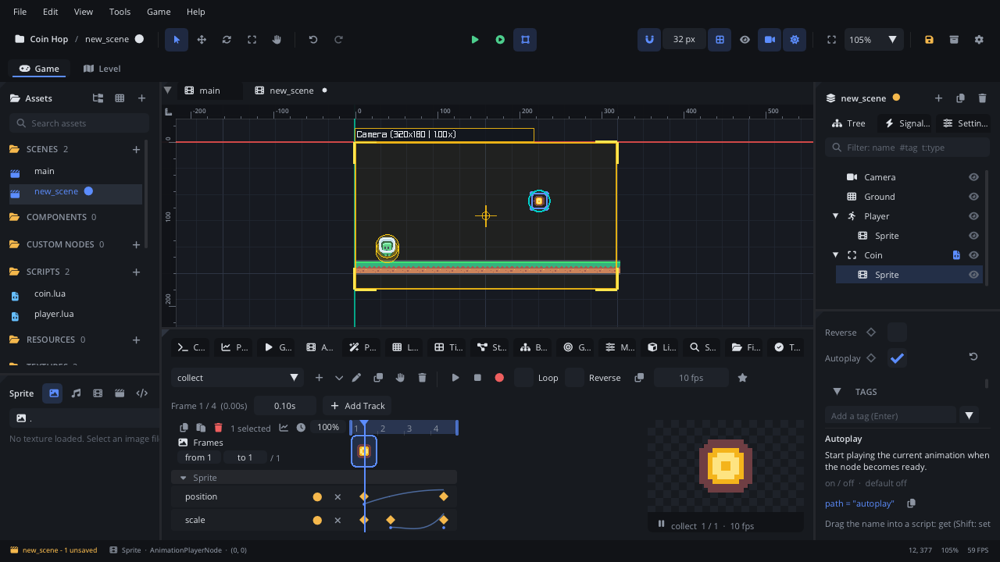
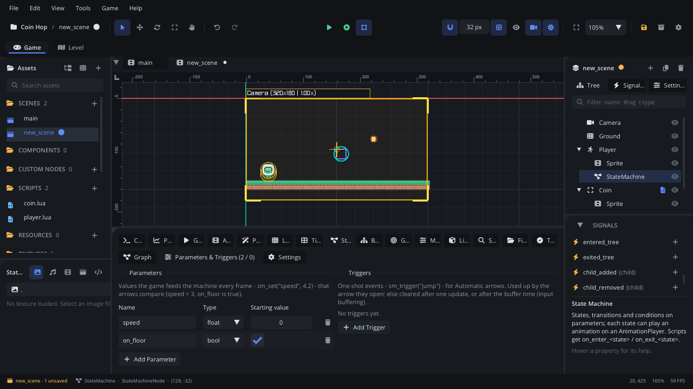
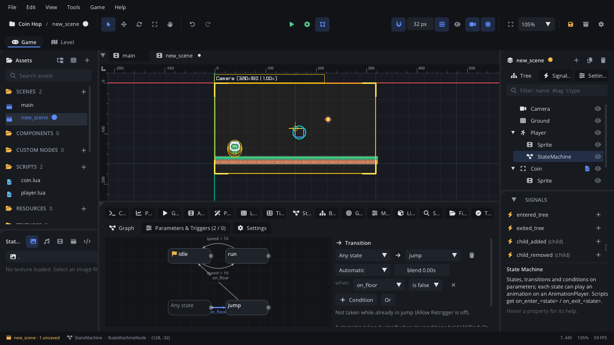
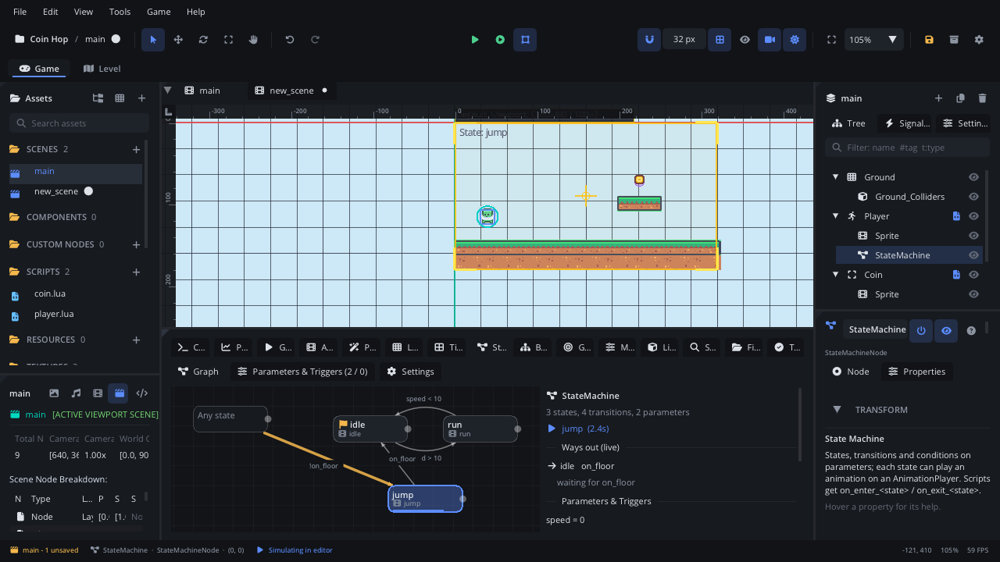
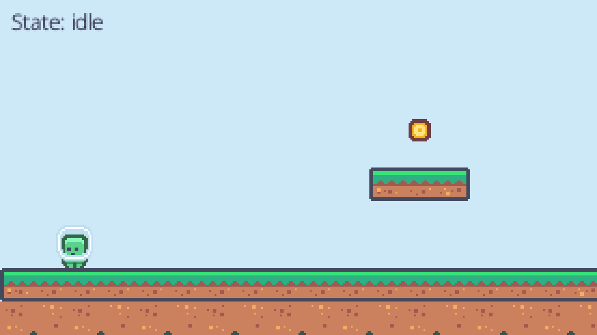

# Animation

This tutorial builds **Coin Hop**: a little astronaut that stands, runs and
jumps, and a coin that bobs in the air and pops when it's caught. On the
way it covers slicing a sprite sheet into frame animations, the
Animation Player and its timeline (property tracks, keys, easing), playing
animations from Lua and the `animation_finished` signal, and a State
Machine that picks idle, run or jump by itself. It ends with pointers to
tweens, skeletal and vector animation. It takes about thirty minutes.

[Download the finished project](animation/) to compare, or to start from
the end: unzip it and open the folder with **File > Open Project...**.

It assumes you know how to attach a script and read the Console; if not,
do [Lua scripting basics](scripting.md) first. The player is a Character
Mover, as in [Physics and collisions](physics.md), standing on a Tile Map,
as in [Tile maps and terrains](tilemaps.md).

## 1. Make a project

1. **Help > Welcome > New Project > Empty**, named `Coin Hop`.
2. Drop the finished project's `textures/characters.png` and
   `textures/tiles.png` on the editor window (Kenney's *Pixel Platformer*,
   CC0): characters of 24 x 24 pixels, tiles of 18 x 18.
3. **Project Settings** (the gear in the toolbar): **Video > Virtual
   Resolution** `320 x 180`, and **General > Physics > Gravity** `0, 900`.

## 2. The ground

1. **Add Node > Tile Map**, named `Ground`, at `0, 0`. In the **Tile Map**
   tab set **Tileset** to `tiles.png`, **Tile Size** `18, 18` and **Map
   Size** `18, 10`.
2. Pick the grass tile (tile 2) and drag along row 8 (the ninth row) from
   one side to the other. The finished project adds dirt under it and a
   small platform (tiles 1, 2, 3) with the coin over it.
3. Tick **Solid** in the Inspector, so the player stands on it.

## 3. Frames from a sprite sheet

An **Animation Player** (`AnimationPlayerNode`) holds named animations and
shows one at a time. An animation can be a list of frames - separate
images, or cells of a sprite sheet - and keyframed **tracks** (section 4).

1. **Add Node > Character Mover**, named `Player`, at `40, 130`. In its
   **Collision Shapes**, make the capsule **Radius** `6`, **Size** `12, 6`.
   Set **Control Mode** to **Script** and add the tag `player`. Its script
   comes in section 6, with the State Machine it talks to.
2. With `Player` selected, **Add Node > Animation Player**, named `Sprite`,
   at `0, -3`. Selecting it opens the **Animation** tab in the bottom panel
   (**View > Workspaces > Animation** gives it more room).
3. In the tab, click **▾** next to **+** and **Slice a Sprite Sheet...**.
   In the **Sprite Sheet Slicer** pick `textures/characters.png`, keep
   **Slice by** at **Cell Grid** and set **Columns** `9`, **Rows** `3`:
   cells of 24 x 24.
4. Click the green astronaut standing (cell 0), type `idle` in
   *Animation name* and click **Add Animation**. Then click cell 0 and
   Shift+click cell 1 (standing, then walking), name it `run`, **Add
   Animation**. Then cell 1 alone: `jump`.
5. Set **FPS** to `8` and click **Add to Sprite**. Close the slicer.



The tab's **animation picker** now lists idle, run and jump. `jump` should
play once and stop on its last frame: pick it and turn off **Loop**. Pick
`run` and press **Play** in the tab: it alternates the two frames at the
player's 8 fps. The **fps** field gives one animation its own rate
(right-click goes back to the player's), and each frame can have its own
duration (the seconds field next to *Frame n / m*).



For one looping list of images and nothing else, a
[Frame Animation](../nodes/FrameAnimationNode.md) node is simpler. For
`.aseprite` files, an [Aseprite Sprite](../nodes/AsepriteNode.md) plays
their tags as drawn.

## 4. Property tracks: a bobbing coin

Tracks animate any property of any node over time: position, scale,
rotation, colours, numbers. The coin bobs up and down with one.

1. Select `Ground` and press **Esc** (nothing selected), then **Add Node >
   Trigger Area**, named `Coin`, at `225, 72`. Make its shape a **Circle**
   of **Radius** `6`, add the tag `coin` and attach `scripts/coin.lua`
   (section 5).
2. With `Coin` selected, **Add Node > Animation Player**, named `Sprite`,
   at `0, 0`. Open the slicer again with `textures/tiles.png`,
   **Columns** `20`, **Rows** `9`. Click the coin (cell 151), name it
   `bob`, **Add Animation**; click it again, name it `collect`, **Add
   Animation**. **FPS** `10`, **Add to Sprite**, close the slicer.
3. Pick `bob`. **Add Track** > the Sprite (it is selected) > `position`.
   The track gets a first key at frame 1 with the current value (0, 0).
4. The bob goes up 4 pixels in 0.6 s and back in 0.6 s. Click the key to
   select it and press **Cmd+D** (Ctrl+D): a copy one frame later. In the
   **key inspector** on the right set its **Frame** to `7` (0.6 s at 10
   fps) and its **Value** to `0, -4`. Click it, **Cmd+D** again: **Frame**
   `13`, **Value** `0, 0`. The keys run past the coin's one frame, so they
   set the animation's length: 1.2 s.
5. Easing: click the first key, Cmd+click the second, and set **Easing**
   to `in_out_sine` - the motion slows at each end. (Right-click a key for
   the same **Easing** menu and **Edit Curve...**.)
6. Turn **Loop** on if it isn't, click the **star** (the animation
   selected when the scene loads) and tick **Autoplay** in the Inspector.
   Press **Play** in the tab to watch it; **Stop** puts the scene back.



Keys are diamonds on the track's row; a dot under one means it eases to
the next. Click a key to move the playhead there, drag keys to move them
in time, Delete removes them. While the tab edits a player, each property
in the Inspector has a **diamond** after its name: click it to key the
current value at the playhead, and **Auto-key** (the red dot) keys every
change you make. The **chart** button by the ruler swaps the rows for the
value graph, where bezier handles shape the curves.

Now `collect`, the pop when the coin is caught: pick it, turn **Loop**
off, click frame 1. **Add Track > position**: a key, Cmd+D, **Frame** `4`,
**Value** `0, -14`, and give the first key the easing `out_quad`. **Add
Track > scale**: a key (1, 1), Cmd+D for frame 2 at `1.6, 1.6` with the
easing `in_back`, Cmd+D again, **Frame** `4`, **Value** `0, 0`. In 0.3 s
the coin jumps up, swells and shrinks away.



Tracks can also call script methods, play sounds, emit particles, spawn
components or turn nodes on and off on a frame: **Add Track > Events**.
Every control is in the [Animation tab](../editor/tab-animation.md) page;
curves and events in depth in
[Animation editing](../../engine/docs/animation_editing.md).

## 5. Playing animations from Lua

`scripts/coin.lua` plays `collect` when the player touches the coin, and
removes the coin when it has finished:

```lua
-- A coin: a Trigger Area with an Animation Player child named Sprite. Its
-- "bob" animation (a position track) plays by itself (Autoplay); touching
-- the player plays "collect" (scale and position tracks), and the coin is
-- removed when that animation finishes.

---@class Coin : ScriptInstanceBase
local Coin = {}

function Coin:ready()
    self.sprite = self.node:get_node("Sprite") ---@type AnimationPlayerNode
    self.sprite:connect("animation_finished", function(name)
        if name == "collect" then self.node:destroy() end
    end)
end

---@param body Node?
function Coin:on_body_entered(body)
    if self.taken or body == nil or not body:has_tag("player") then return end
    self.taken = true
    -- Crossfade the bob's position into the collect animation over 0.1 s.
    self.sprite:animation_play("collect", 0.1)
end

return Coin
```

What a script can do with an Animation Player:

| Call | Does |
|---|---|
| `animation_play(name, blend)` | Plays `name`. With `blend` (seconds) the property tracks both animations share crossfade; the frames switch at once. Naming the animation already playing changes nothing, so calling it every frame is fine; `animation_play()` with no name restarts the current one. |
| `animation_stop()` / `animation_pause()` / `animation_resume()` | Stop (frozen on the current frame), pause, go on. |
| `animation_reset()` | Back to the first frame. |
| `animation_get_current()` | The current animation's name. |
| `animation_set_fps(fps)` | The player's frames per second. |

Its signals: `animation_finished` (a non-looping animation reached its
end; the value is its name) and `animation_event` (a *Call Script
Methods* key fired; the value is the method's name). Connect them from a
script as above, or in the Inspector's **Signals** section.

## 6. A State Machine: idle, run, jump

The player could pick its animation in `update` (`if not on_floor then
play("jump") ...`), but with more states that grows into a tangle. A
**State Machine** does it from a graph: each state plays an animation, and
arrows with conditions say when to change.

1. Select `Player` and **Add Node > State Machine**: it goes under the
   player, next to `Sprite`. The **State Machine** tab opens.
2. **Settings** page: **Animation Player** says *Auto*, the `Sprite` next
   to it. Click **Add a State per Animation**: idle, run and jump. idle,
   the first, is the **Initial State** (the flag).
3. **Parameters & Triggers** page: **Add Parameter**, name it `speed`,
   type **float**. **Add Parameter** again: `on_floor`, a **bool**; tick
   its **Starting value**.



4. **Graph** page. Drag from `idle`'s dot (on its right edge) onto `run`:
   an arrow. Select it and set **Mode** to **Automatic** (taken by itself;
   **Manual** arrows wait for a script's `sm_transition`), **+ Condition**,
   `speed` **>** `10`, and **blend** `0.1` (seconds of crossfade).
5. From `run` onto `idle`: Automatic, `speed` **<** `10`, blend `0.1`.
6. From the **Any state** box onto `jump`: Automatic, `on_floor` **is
   false**. Any-state arrows fire from every state - in the air means
   jump, whatever the player was doing.
7. From `jump` onto `idle`: Automatic, `on_floor` **is true**. (Landing
   while running goes to idle, then at once to run.)



The machine only needs the two values every frame. Attach
`scripts/player.lua` to `Player`, and add a **Text** node named `Info`
(at `6, 4`, **Origin** `0, 0`, font size `16`) for it to show the state in:

```lua
-- The player: a Character Mover (Control Mode "Script") that runs with
-- A / D or the arrows and jumps with Space. It doesn't pick animations
-- itself: it tells the State Machine how fast it goes and whether it is on
-- the floor, and the machine's arrows choose idle, run or jump.

---@class Player : ScriptInstanceBase
local Player = {}

Player.properties = {
    --- Running speed, in pixels per second.
    speed = { type = "float", default = 90, min = 0, max = 400, label = "Speed" },
    --- Upward speed of a jump, in pixels per second.
    jump_speed = { type = "float", default = 280, min = 0, max = 1000, label = "Jump Speed" },
}

function Player:ready()
    self.sprite = self.node:get_node("Sprite") ---@type AnimationPlayerNode
    self.machine = self.node:get_node("StateMachine") ---@type StateMachineNode
    self.info = Scene.find_node("Info") ---@type TextNode
end

---@param dt number
function Player:update(dt)
    local node = self.node
    local vx, vy = node:character_get_velocity()
    local _, gy = node:character_get_gravity()
    vy = vy + gy * dt

    vx = Input.get_axis("move_left", "move_right") * self.speed
    if Input.is_action_pressed("jump") and node:character_is_on_floor() then
        vy = -self.jump_speed
    end
    node:character_set_velocity(vx, vy)
    node:character_move_and_slide()

    -- What the machine's conditions compare.
    self.machine:sm_set("speed", math.abs(vx))
    self.machine:sm_set("on_floor", node:character_is_on_floor())

    -- Face the way we run: a negative x scale mirrors the sprite.
    if vx ~= 0 then self.sprite:set_scale(vx < 0 and -1 or 1, 1) end

    self.info.text = "State: " .. self.machine:sm_state()
end

return Player
```

Press **F7** (Simulate) with the State Machine
selected: the current state lights up and the side panel's **Ways out**
says what each arrow waits for. Here the player was lifted off the floor
from the Console's Lua line:



More a machine can do: **triggers** (one-shot events such as an attack
button, `sm_trigger("attack")`, with a buffer time for input buffering),
guards (a minimum time in a state), child machines, and script callbacks
`on_enter_<state>` / `on_update_<state>` / `on_exit_<state>` (right-click
a state > **Add Script Callbacks**). `sm_state()` names the current state,
`sm_transition("hurt")` changes it from a script, and the machine emits
`state_changed`. See the [State Machine tab](../editor/tab-stategraph.md)
and the [State machines guide](../../engine/docs/state_machine.md).

Press **F5**: run with A / D, jump with Space, and catch the coin from
the platform.



## 7. Other ways to animate

- **Tweens**, for one-off motion decided in code - a button that grows, a
  door that slides, a hit flash - without keys:
  `Tween.to(node, "scale", {1.2, 1.2}, 0.2, "out_back")`, with loops,
  yoyo, delays and `on_complete`. See [Tween](../lua/Tween.md); the
  [UI and HUD](ui.md) tutorial pulses its title with one.
- **Skeletal animation**: characters made of parts moved by bones, from
  Spine or DragonBones exports, on a [Skeleton](../nodes/SkeletonNode.md)
  node. See [Skeletal animation](../../engine/docs/skeletal_animation.md).
- **Vector animation**: draw a character with the editor's vector tools,
  put it on bones and animate it on the same timeline:
  [Drawing and animating a vector character](../getting-started/vector-character.md).
- Small repeating motion with no keys at all: an
  [Oscillator](../nodes/OscillatorNode.md) swings a property in a wave.

## Where next

- The finished project is in the [download](animation/).
- Every control of the timeline: [Animation tab](../editor/tab-animation.md);
  the nodes: [Animation Player](../nodes/AnimationPlayerNode.md),
  [State Machine](../nodes/StateMachineNode.md).
- A HUD with a health bar, a score and a pause menu:
  [UI and HUD](ui.md).
