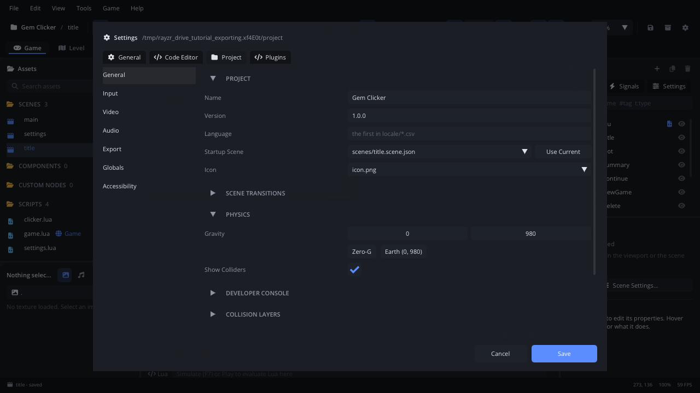
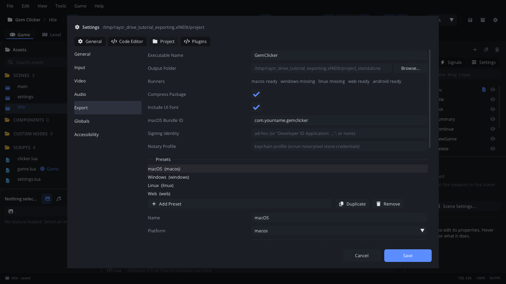
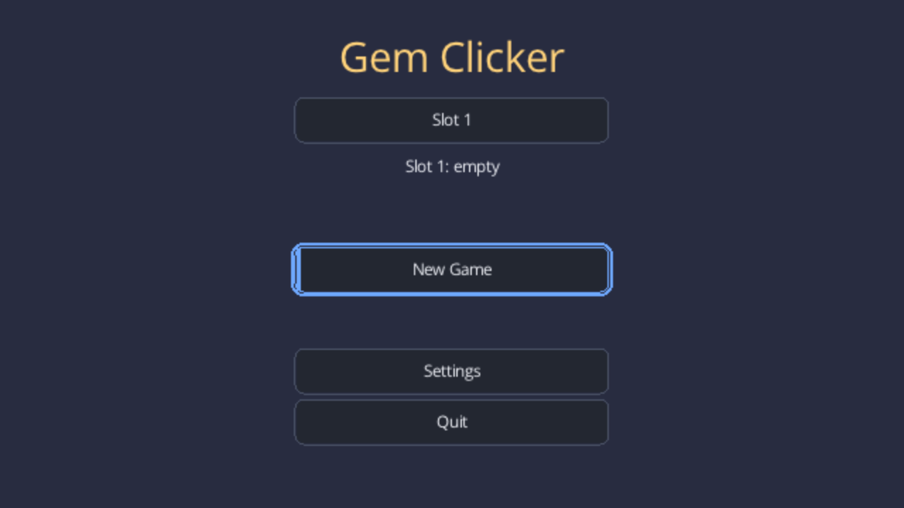
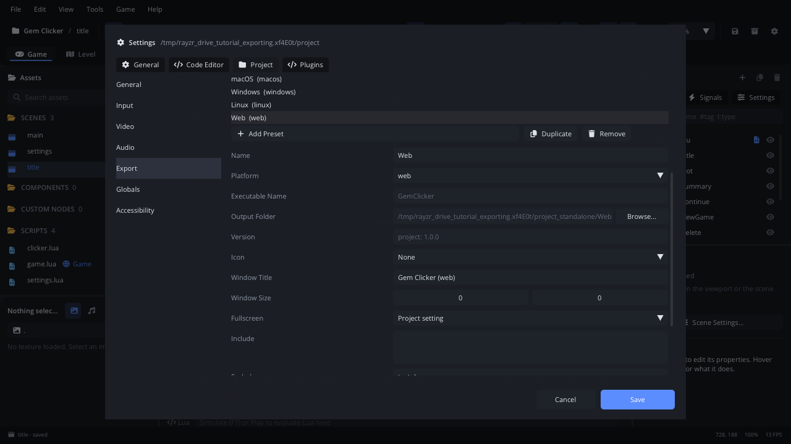
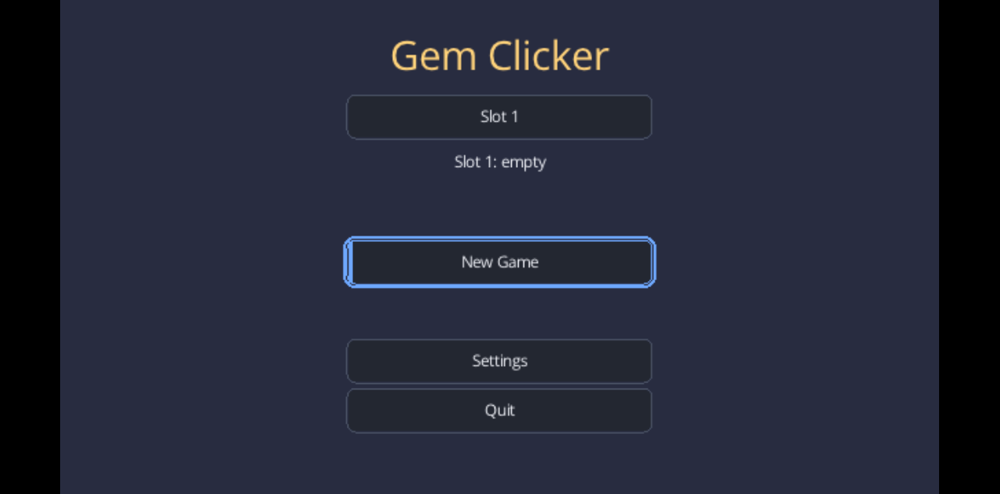

# Exporting your game

This tutorial turns **Gem Clicker**, the game from
[Saving and loading](saving.md), into games other people can run: a macOS
app, a Windows program, a Linux program and AppImage, a web page and an
Android app. On the way it covers the project settings an export uses
(name, version, icon, window, startup scene), the Export settings and
export presets, what goes into an export, testing an exported game,
putting a web export online, signing for Android, and the warnings
unsigned games get on macOS and Windows. It takes about twenty minutes.
Every control used here is listed in the editor manual's
[Export](../editor/export.md) page.

[Download the finished project](exporting/) to compare, or to start from
the end: unzip it and open the folder with **File > Open Project...**. It
is Gem Clicker with its export settings filled in. Any project works for
the steps below.

## 1. What an export is

Your game is data: scenes, scripts, images, sounds and `project.json`. An
export packs it into one file, `game.rayzr`, and puts it next to a **game
runner** - the engine, built for one platform - with nothing else to
install. No compiler is needed: the runners come with the editor
(`runners/<platform>/` beside it).

**File > Export** has three items:

| Item | Does |
|---|---|
| **.rayzr Package** | Asks for a folder and writes `<project>.rayzr` there: the whole project in one file, for a runner you already have. The toolbar's box icon does the same. |
| **Standalone Game** | Exports every preset (section 4) with the settings in Project Settings > **Export**. |
| **Open Web Export in Browser** | Serves the last web export on `http://127.0.0.1:8765/` and opens it in your browser. |

## 2. The project settings an export uses

**Project Settings** (the gear in the toolbar) > **General**:

1. **Name** `Gem Clicker`: the game's name (the macOS app's), and the
   name of the folder its saves go in - change it after release and
   players lose their saves (see [Saving and loading](saving.md)).
2. **Version** `1.0.0`: the version the app reports (on macOS, in
   Finder's Get Info).
3. **Startup Scene** `scenes/title.scene.json`: where the exported game
   starts.
4. **Icon**: `icon.png`, a 512 x 512 PNG (512 x 512 or 1024 x 1024 works
   best). It becomes the window's icon (Windows and Linux), the macOS
   app's, the Windows program's (when exported on Windows), the
   AppImage's, and `favicon.png` in a web export. Without one, exports
   get Rayzr's icon.



**Video** has the window: **Window Title**, **Window Size** (`1280 x 720`
here), **Fullscreen**, and the **Virtual Resolution** the game is drawn
at. A player's own fullscreen choice is a setting your game saves, as Gem
Clicker's settings screen does.

## 3. The Export settings

**Project Settings > Export**:

| Option | Gem Clicker | What it does |
|---|---|---|
| **Executable Name** | `GemClicker` | The program's name: `GemClicker.app`, `GemClicker.exe`. Default: the project name without spaces. |
| **Output Folder** | (empty) | Where exports go. Default: `<project>_standalone` next to the project folder. |
| **Runners** | | Which platforms' runners are *ready*, *missing*, or (this computer's) *built on export*. |
| **Compress Package** | on | Compresses `game.rayzr`. |
| **Include UI Font** | on | Ships the font the UI widgets draw with. |
| **macOS Bundle ID** | `com.yourname.gemclicker` | The app's identifier on macOS: your own reverse domain and the game. |
| **Signing Identity** | (empty) | macOS code signing; empty is *ad-hoc* (section 7). |
| **Notary Profile** | (empty) | With a Developer ID: the app is notarized after export. |

Without presets, **Targets** ticks the platforms to export: **macos**,
**windows**, **linux**, **web**, **android**, one export each.

## 4. Export presets

A **preset** is one export with its own settings: a platform, and
optionally another executable name, output folder, version, icon, window
title, window size, fullscreen, files to include or leave out, the debug
runner. A demo build or a debug build is just another preset.

1. Under **Presets**, **Use Presets** turns the ticked targets into
   presets. **Add Preset** adds one for **macos**, **windows**, **linux**
   or **web**; **Duplicate** and **Remove** do what they say.
2. Gem Clicker has four: `macOS`, `Windows`, `Linux` and `Web`. Click one
   to edit it.
3. In each, **Exclude** `tests/`: the game's tests (section 10 of
   [Saving and loading](saving.md)) are for you, not the players.
4. In `Web`, **Window Title** `Gem Clicker (web)`: on the web it is the
   page's title.



**What goes into `game.rayzr`**: every file in the project folder, except
hidden files and folders (`.rayzr/`, the editor's own; `.luarc.json`;
`.DS_Store`) and what the preset's **Exclude** patterns match (`*.psd`,
`raw/`, `levels/test_*`, one per line). **Include** works the other way:
when it has patterns, only matching files go in. `project.json` always
goes in, with the preset's changes. Textures set to QOI or an atlas in
their import settings are converted on the way.

## 5. Export, and what you get

**Save and Export This Preset** saves the settings and exports the
selected preset; **Save and Export All** (at the bottom) exports every
preset. The Console says what was written:
`Exported macOS (macos): <project>_standalone/macOS/GemClicker.app`.
A preset whose runner is missing is skipped with a warning.

| Platform | The preset's folder |
|---|---|
| macOS | `GemClicker.app`, signed (ad-hoc unless you set an identity). |
| Windows | `GemClicker.exe`, one file with the game and the font inside it; exported on Windows, it gets the icon and version too. With **Single File** off: `GemClicker.exe`, `game.rayzr` and `fonts/`. |
| Linux | `GemClicker`, one executable with the game inside (for stores and archives), and `GemClicker.AppDir`; exported on Linux with `appimagetool` installed, a `GemClicker-x86_64.AppImage` too. |
| Web | `index.html`, `index.js`, `index.wasm`, `odin.js`, `game.rayzr`, `fonts/` and `favicon.png`. |
| Android | `GemClicker.apk` and `GemClicker.aab` (section 9). |

`THIRD_PARTY_NOTICES.txt` is in every folder, because the engine's
libraries' licenses ask for it: ship it with the game.

Each platform's runner is built on that platform
(`scripts/build_runners.sh` in Rayzr's source). Editor releases ship them
all, so one computer exports for every platform; the **Runners** row says
which you have.

There's no command-line export: exports are made in the editor.
`.rayzr` packages are made there too, and a runner plays one from the
command line (`runners/<platform>/runner game.rayzr`, the runner beside
the editor), or from **Assets > Packages** >
right-click > **Run Game From Package**.

## 6. Test the export

Run the exported game as a player would, and read its log:

1. Run it from a terminal, so the log shows. On macOS:
   ```sh
   <project>_standalone/macOS/GemClicker.app/Contents/MacOS/GemClicker --user-data /tmp/gemclicker-test
   ```
   On Windows, `GemClicker.exe --user-data %TEMP%\gemclicker-test`; on
   Linux, `./GemClicker --user-data /tmp/gemclicker-test`.
2. `--user-data <folder>` keeps this run's saves in that folder, away from
   your own: a new folder is a player's very first run.
3. Read the log for `[ERROR]` and warnings, and play: New Game, mine a
   few gems, quit, run it again with the same folder and Continue.
4. A preset with **Debug** ticked uses the debug runner: debug info, and a
   console window on Windows.

A crash writes a report to the save folder's `crashes/` (see
[crash reports](../../engine/docs/crash_reports.md)).



## 7. Signed and unsigned games

Operating systems warn about programs from developers they don't know.

**macOS**: the export signs the app *ad-hoc* - it runs on your Mac. On
another Mac, Gatekeeper refuses to open it at first: right-click the app
and choose **Open**, then **Open** again. To hand it out without that, you
need an Apple Developer ID: set **Signing Identity** to it
(`Developer ID Application: ...`) and **Notary Profile** to a keychain
profile made with `xcrun notarytool store-credentials`; the export then
notarizes and staples the app.

**Windows**: exports aren't code-signed, so SmartScreen may warn about an
unknown publisher: players choose **More info > Run anyway**. Say so on
your download page.

The Rayzr editor itself is the same: until 1.0, builds aren't notarized
or signed yet and show these warnings (see
[Installation](../getting-started/installation.md)); 1.0 releases will be
signed. Your exported games are signed only as you set up above.

## 8. Put a web export online

Select the `Web` preset and **Save and Export This Preset**.



Browsers don't run WebAssembly from a `file://` page, so double-clicking
`index.html` doesn't work. **File > Export > Open Web Export in Browser**
serves the folder and opens it; any static web server works too
(`python3 -m http.server` in the folder).



To publish on **itch.io**: zip the folder's *contents* (not the folder),
upload it as an HTML project and tick "This file will be played in the
browser". GitHub Pages or your own site serve the folder as it is.

On the web:

- The page shows **Click to play** first: browsers only allow sound after
  a click or a key.
- Saves go to the browser's storage, per site; they survive reloads.
  They're written when your game calls `Save.flush()` and when the tab is
  hidden - a tab is closed, never quit, and a browser can drop a closing
  tab's last write - which is why Gem Clicker autosaves.
- `Engine.quit()` does nothing and returns `false` (with a warning): a
  page can't close itself. Use the result to do something else there:
  `if not Engine.quit() then Scene.change_scene("scenes/title.scene.json") end`.

More: [web export](../../engine/docs/web_export.md).

## 9. Android

Exporting for Android needs the Android SDK (build-tools 34, the
android-34 platform) and Java 17 on the computer that exports; the editor
finds them through `ANDROID_HOME` or Android Studio. Tick **android**
among the Targets (a project without presets) and set:

- **Android Package**: the app's id, `com.yourname.gemclicker`. Choose it
  once: Google Play won't take a changed id for the same app.
- **Version Code**: a whole number that goes up with every upload to
  Google Play (players see the project's **Version**).
- **Keystore** and **Key Alias**: empty signs with the *debug key* - fine
  for your own phone, refused by Google Play. For a release, make a
  keystore once and keep it safe (every update must be signed with it):
  ```sh
  keytool -genkeypair -keystore gemclicker.jks -alias gemclicker -keyalg RSA -keysize 2048 -validity 10000
  ```
  Set **Keystore** to its path and **Key Alias** to `gemclicker`, and put
  its password in the `RAYZR_ANDROID_KEYSTORE_PASSWORD` environment
  variable before starting the editor. It is never saved in the project.

The export writes an `.apk` to install on a phone (`adb install`) and an
`.aab` to upload to Google Play (the first Android export downloads
bundletool, the tool that makes the `.aab`, once). On the phone, fingers
work as the mouse, so Gem Clicker's buttons and gem work by touch. More,
including testing on an emulator: [Android export](../../engine/docs/android_export.md).

## Where next

- The finished project is in the [download](exporting/).
- Every Export option: [Settings](../editor/settings.md) (Project >
  Export); presets, runners and what each platform's export writes:
  [Export](../editor/export.md).
- [Web export](../../engine/docs/web_export.md),
  [Android export](../../engine/docs/android_export.md),
  [crash reports](../../engine/docs/crash_reports.md).
- That's the last tutorial: back to the [list](index.md).
