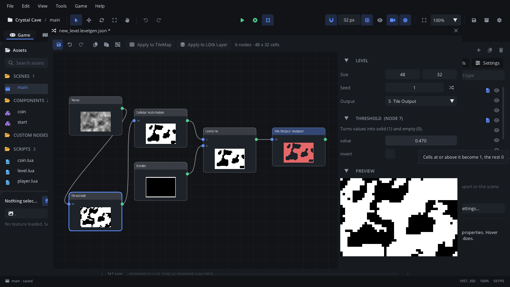
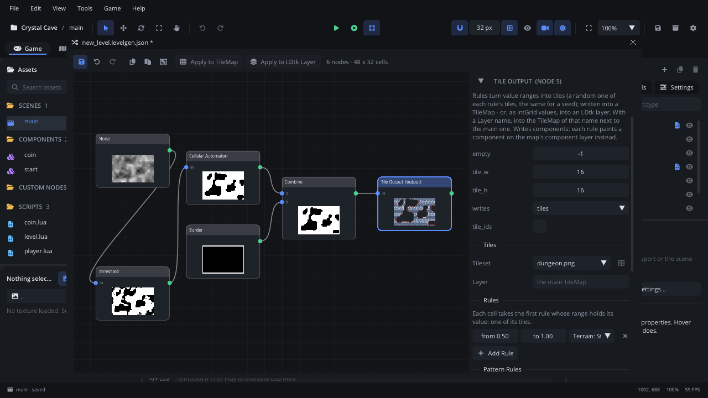
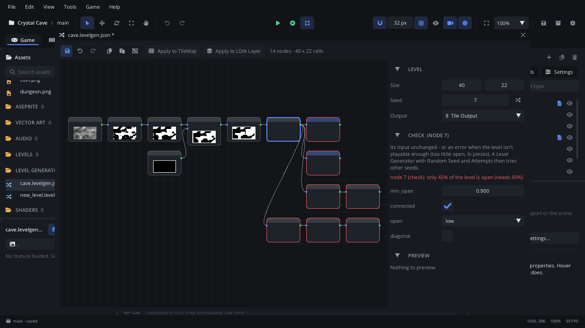
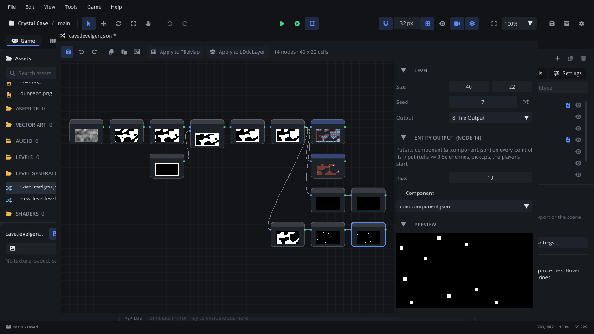
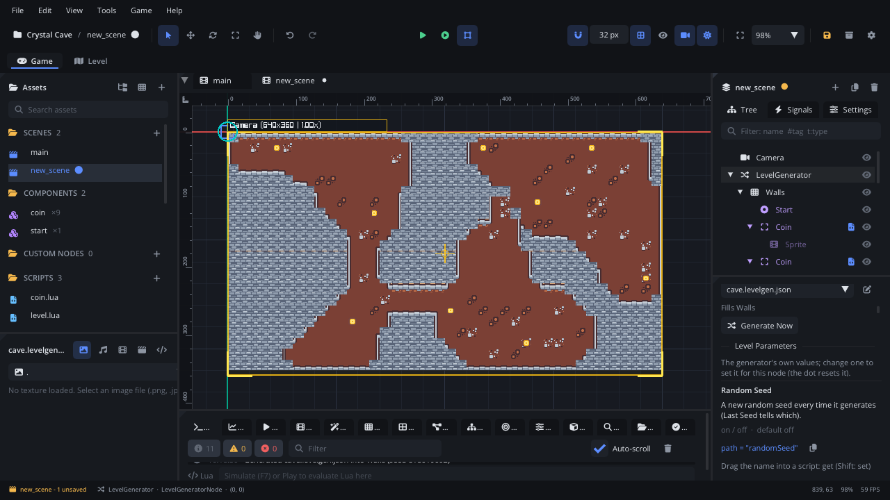
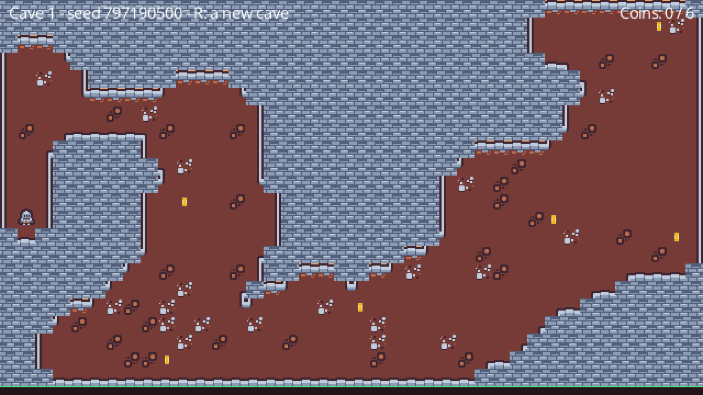

# The level generator

This tutorial builds **Crystal Cave**: a cave made when the game starts -
a different one each time - with coins on its floor and the player put at
its start. **R** digs a new cave. On the way it covers the **Level
Generator** window, a noise -> threshold -> cave-smoothing graph and its
previews, tile outputs with a tileset and a terrain, the **Level
Generator** node, fixed and random seeds, making sure a level is playable,
placing things with an entity output, and generating from Lua. It takes
about thirty minutes.

[Download the finished project](levelgen/) to compare, or to start from
the end: unzip it and open the folder with **File > Open Project...**.

It follows on from [Tile maps and terrains](tilemaps.md): the cave is
written into Tile Maps, and its walls use that tutorial's Stone terrain.
The whole reference is the
[level generator guide](../../engine/docs/level_generator.md).

## 1. Make a project

1. **Help > Welcome > New Project > Empty**, named `Crystal Cave`.
2. Copy the finished project's `textures/` folder into your project's:
   `dungeon.png` with its `dungeon.tileset.json` (the Stone terrain made in
   [Tile maps and terrains](tilemaps.md#4-terrains-tiles-that-pick-themselves))
   and `coin.png` (Kenney's CC0 art).
3. **Project Settings**: **Video > Virtual Resolution** `640 x 360` (the
   cave is 40 x 22 tiles of 16 px), **General > Physics > Gravity** `0, 0`.

## 2. A generator

A generator is a `.levelgen.json` file: a graph of nodes, each making or
changing a grid of numbers the size of the level - usually 0 (empty) to 1
(solid). Generators (noise, random fill, shapes) make grids, modifiers
(threshold, cave smoothing, combine) change them, and a **Tile Output**
turns the numbers into tiles. The same generator and **seed** always make
the same level.

**Assets > + > New Level Generator** creates `levels/new_level.levelgen.json`
and opens it in the **Level Generator** window (double-click any
`.levelgen.json` to open it). It starts as a small cave:

| Node | What it does here |
|---|---|
| **Random Fill** | Each cell 1 (rock) with a chance of 0.48, else 0 |
| **Cellular Automaton** | Smooths the scattered rock into cave walls and open rooms |
| **Border** | 1 along the level's edge |
| **Combine** (`max`) | Rock where either is rock: the cave, closed all round |
| **Tile Output** | A tile on every cell from 0.5 to 1 |

Each node shows a thumbnail of its grid (white is 1); select one to see its
parameters and a large preview in the side panel. The previews follow
every change.

## 3. Noise and a threshold

Random fill is speckled; **noise** gives smooth blobs, and a **threshold**
turns them into rock and air - bigger rooms, smoother walls.

1. Select **Random Fill** and press **Delete**.
2. Right-click the empty canvas: the add menu (type to search) - add
   **Noise**, then **Threshold**.
3. Drag from the Noise's output (the green dot on its right) onto the
   Threshold's input (the dot on its left), and from the Threshold's
   output onto the Cellular Automaton's input. (Right-click an input to
   disconnect it.)
4. Select Noise: **scale** `6` (the size of the blobs, in cells). Select
   Threshold: **value** `0.47` - noise from 0.47 up becomes rock (1), the
   rest open (0). Select the Cellular Automaton: **iterations** `3` (each
   one smooths the walls a little more).



The side panel's **Level** section holds the **Size** (cells), the
**Seed** (the shuffle button picks a new one) and the **Output**. Set the
size to `40, 22`. On the canvas the wheel pans, Ctrl/Cmd+wheel zooms and
**F** frames everything.

## 4. Tiles and a terrain

Select the **Tile Output**:

1. **Tileset**: `dungeon.png`, and **tile_w** / **tile_h** `16`: the
   previews now draw real tiles.
2. Its rule - **from 0.50 to 1.00** - says which cells get tiles: the rock.
   Instead of tiles, pick the **Terrain: Stone** in the rule's list: rock
   cells become the Stone terrain and each takes the tile for its pattern
   of neighbours - cave walls with edges and corners.
3. **Save** (Ctrl/Cmd+S).



A rule can also list tiles (`3, 4`: one of them per cell, the same for a
seed) or **Pick** them from the tileset, and **Add Rule** adds ranges.
With a **Layer** name an output fills another Tile Map: the finished
generator has a second Tile Output, layer `Floor`, whose rule from 0 to
0.5 puts dirt (with a few rocky tiles) on the open cells.

## 5. A level you can play

Random caves leave pockets you can't reach. The finished generator
(`levels/cave.levelgen.json`) adds two nodes between the Combine and the
outputs, wired the same way:

| Node | What it does |
|---|---|
| **Connect Regions** | Joins every open area into one with the shortest corridors (**min_size** `12`: smaller pockets are filled) |
| **Check** | Its input unchanged - or an **error** when less than **min_open** (`0.35`) of the level is open, or the open cells are in more than one piece |

A refused level shows as a red border on the nodes it reaches, and the
error in the side panel:



In the game, a **Level Generator** node with **Random Seed** then tries
other seeds - **Attempts** in all - until one passes (section 7). Other
nodes for playable levels - **Regions**, **Flood Fill**, **Start-to-Exit
Path** - are in the guide's
[Playable levels](../../engine/docs/level_generator.md#playable-levels).

## 6. Coins and a start point: entity outputs

An **Entity Output** puts a component (a `.component.json`) on every
point of its input - every cell of 0.5 or more.

- **The start**: **Start-to-Exit Path** with **placement** `farthest` and
  **output** `start` gives one cell, at one end of the longest way across
  the cave; an Entity Output puts `components/start.component.json` there
  - a plain node tagged `start`.
- **The coins**: **Invert** of the Check (1 on the open cells) into a
  **Poisson Scatter** (**radius** `7`: evenly spaced points, at least 7
  cells apart) into an Entity Output with **max** `10` and
  `components/coin.component.json` - a Trigger Area with a spinning coin
  and `scripts/coin.lua`.



To make the two components, build each in a scene and right-click it in
the Scene tree > **Save as Component** (or copy the download's
`components/` and `scripts/` folders): `Start`, a **Node** with the tag
`start`; `Coin`, a **Trigger Area** with a **Circle** shape of **Radius**
`6`, the tag `coin`, an **Animation Player** of `coin.png`'s two frames
and `scripts/coin.lua`.

The placed components become children of the Tile Map at their cells'
centres, tagged `levelgen`; generating again replaces them.
`scripts/coin.lua`:

```lua
-- A coin (components/coin.component.json): a Trigger Area the level
-- generator's Entity Output places on the cave floor.

---@class Coin : ScriptInstanceBase
local Coin = {}

---@param body Node?
function Coin:on_body_entered(body)
    if body == nil or not body:has_tag("player") then return end
    Events.emit("coin_collected", 1)
    self.node:destroy()
end

return Coin
```

## 7. The Level Generator node

1. In `scenes/main.scene.json`: **Add Node > Level Generator**, named
   `Generator`, at `0, 0`.
2. Under it, two **Tile Maps** at `0, 0`, both with the tileset
   `dungeon.png` and **Tile Size** `16, 16`: `Walls` first (the main map -
   the generator fills its first Tile Map child), with **Solid** ticked,
   then `Floor` (the Floor layer's map), with a **Z Index** of `-1`.
3. Select the Generator. In its **Level Generator** section pick
   `levels/cave.levelgen.json`; *Fills Walls* confirms the map.
4. **Generate Now** writes a level into the maps in the editor, to see it
   or paint over it (Cmd+Z takes it back). The game makes its own when the
   scene starts (**Generate On Ready**).



Its properties:

| Property | |
|---|---|
| **Seed** | The same seed makes the same level; 0: the generator file's own seed. |
| **Random Seed** | With **Seed** 0: a new level every time. **Last Seed** says which one was made - show it, save it, and `levelgen_generate(seed)` makes that level again. |
| **Attempts** | With Random Seed: how many seeds it tries when the generator refuses a level (the Check) before it gives up with `generation_failed` (10). |
| **Background** | Makes the level on a worker thread while the game keeps running (a loading screen stays smooth). |
| **Generate On Ready** | Make a level when the scene starts. |

For Crystal Cave: **Seed** `0`, **Random Seed** on. To test one cave again
and again, set a **Seed** (`7`, say): every run, and every **Generate
Now**, makes that cave. The **Level Parameters** list below lets this node
change a generator node's value without touching the file (denser caves on
a later level).

## 8. Generating from Lua

The rest is a script on the Generator. A Level Generator raises:

| Event | Value | When |
|---|---|---|
| `generation_progress` | 0 to 1 | While a level is made (each 1% or more; 1 when it is in) - for a loading bar. The node's `progress` holds the same. |
| `generated` | the seed | The level is in: tiles, colliders, components, entities. |
| `generation_failed` | why | No level (with Random Seed: none in **Attempts** tries). |

`levelgen_generate()` makes a new level (with Random Seed: a new seed),
`levelgen_generate(seed)` that one. Add the **Player** (a Character Mover
as in [Tile maps and terrains](tilemaps.md#6-the-player), tag `player`,
with a script that walks it), two **Text** nodes `Info` and `Coins` on
Layer8, and attach `scripts/level.lua` to the Generator:

```lua
-- The level: on the Level Generator node. Each time a cave is in it puts
-- the player on the start point and counts the coins; R makes a new cave
-- (Random Seed is on, so each one is different).

---@class Level : ScriptInstanceBase
local Level = {}

function Level:ready()
    self.player = Scene.find_node("Player")
    self.info = Scene.find_node("Info") ---@type TextNode
    self.coins = Scene.find_node("Coins") ---@type TextNode
    self.caves = 0
    self.got = 0
    Events.connect("coin_collected", function(value)
        self.got = self.got + value
        self:show_coins()
    end)
end

-- generation_progress: 0 to 1 while a cave is made.
---@param p number
function Level:on_generation_progress(p)
    self.info.text = string.format("Digging... %d%%", math.floor(p * 100))
end

-- generated: the cave is in (tiles, colliders, coins, the start point).
---@param seed integer
function Level:on_generated(seed)
    self.caves = self.caves + 1
    self.info.text = string.format("Cave %d - seed %d - R: a new cave", self.caves, seed)
    -- The last cave's coins and start point are removed at the end of this
    -- frame: use the new ones in the next update.
    self.new_cave = true
end

-- start_cave: the player on the start point, the coins counted.
function Level:start_cave()
    local start = Scene.find_by_tag("start")[1]
    if start then
        -- (Its position is in the Walls map, which sits at 0, 0 like the
        -- generator: so it is a world position too.)
        self.player.position = start.position
    end
    self.got = 0
    self.total = #Scene.find_by_tag("coin")
    self:show_coins()
end

-- generation_failed: no playable cave in Attempts tries.
---@param why string
function Level:on_generation_failed(why)
    self.info.text = "No cave: " .. why
end

function Level:show_coins()
    self.coins.text = string.format("Coins: %d / %d", self.got, self.total or 0)
end

---@param dt number
function Level:update(dt)
    if self.new_cave then
        self.new_cave = false
        self:start_cave()
    end
    if Input.is_key_pressed("R") and not self.node:levelgen_is_generating() then
        self.node:levelgen_generate() -- no seed: a new random one
    end
end

return Level
```

`on_generated` and the others are the events' handlers by name (as
`on_body_entered` is a Trigger Area's); `self.node:connect("generated",
function(seed) ... end)` works too, from any script. Press **F5**: a cave,
the knight at its start, coins to collect; **R** digs another.



A **loading bar** for a big level: turn on **Background**, and show
`progress` (or the `generation_progress` value) in a bar while the game
runs on. The `LevelGen` module makes levels without a node:
`LevelGen.generate(file, tilemap, seed)` into any Tile Map,
`LevelGen.values(file, seed)` the numbers alone, `LevelGen.entities(file,
seed)` the placements, to spawn yourself.

## Where next

- The finished project is in the [download](levelgen/).
- Every node and parameter: [the guide's Nodes](../../engine/docs/level_generator.md#nodes)
  (shapes, rooms and corridors, walkers, scatter, surface, pattern rules
  for decoration) and the [Level Generator node](../nodes/LevelGeneratorNode.md).
- Tiles from a painted sample instead of from numbers:
  [Wave Function Collapse](../../engine/docs/level_generator.md#wave-function-collapse).
- A level that never ends, made a chunk at a time around the camera:
  [Endless levels](../../engine/docs/level_generator.md#endless-levels-chunks).
- Plateaus and cliffs from a height map, each level its own Tile Map:
  [Height layers](../../engine/docs/level_generator.md#height-layers).
- Your own nodes in Lua or Odin:
  [Your own nodes](../../engine/docs/level_generator.md#your-own-nodes).
