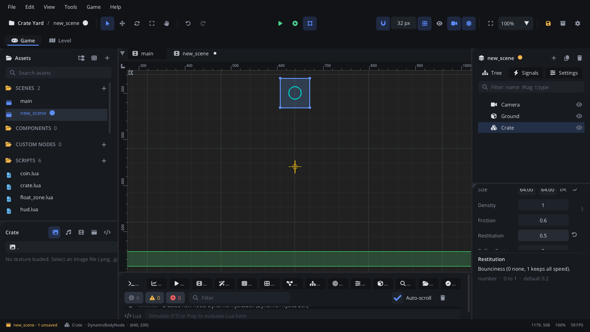
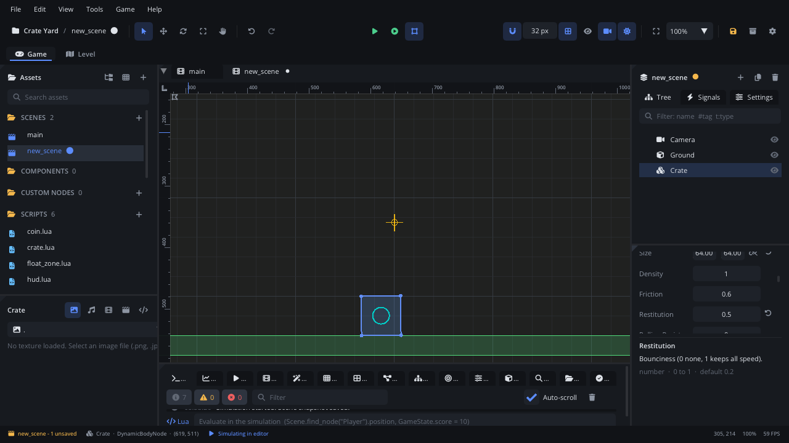
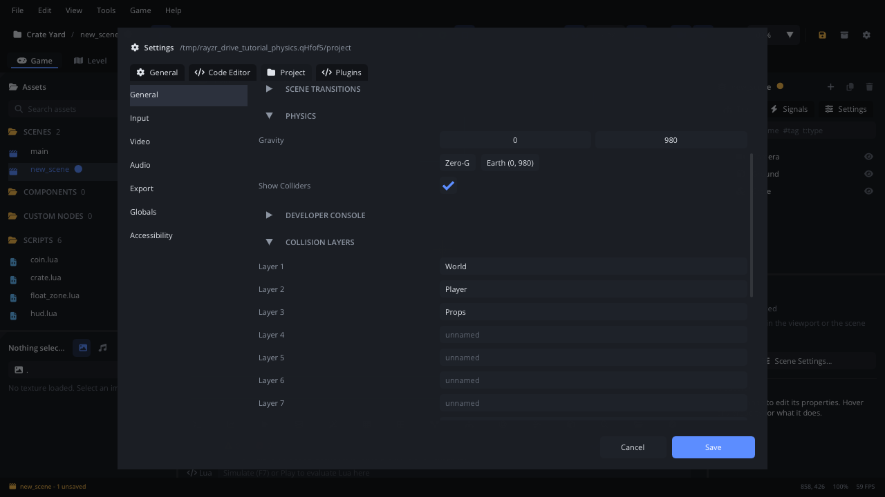
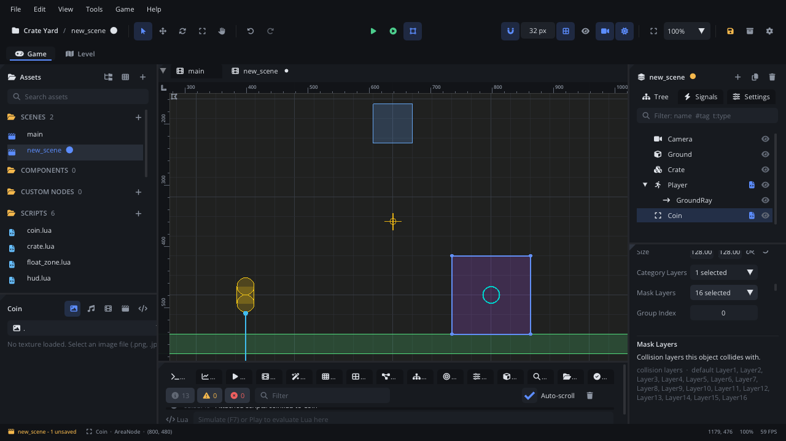
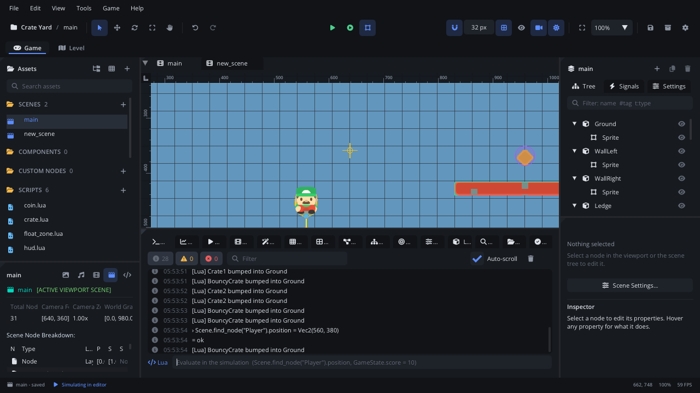
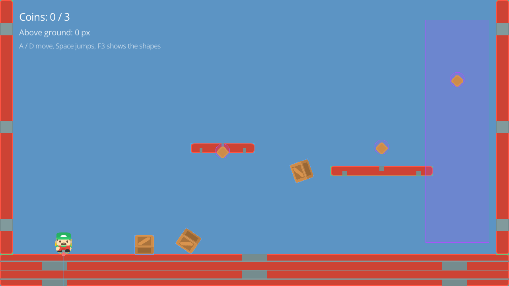

# Physics and collisions

This tutorial builds **Crate Yard**: a walled yard where crates fall and
tumble, a lift goes up and down, a ledge can be jumped through from below,
coins wait to be collected and a tall zone makes you float. You run and
jump with a Character Mover. On the way it covers the three kinds of body,
collision shapes, layers and masks, gravity, Trigger Areas, raycasts,
debug drawing and collision events in Lua. It takes about forty minutes.

[Download the finished project](physics/) to compare, or to start from
the end: unzip it and open the folder with **File > Open Project...**.

It assumes you know how to attach a script and print to the Console; if
not, do [Lua scripting basics](scripting.md) first. The physics is
[Box2D](https://box2d.org), in pixels: positions and sizes in px, speeds in
px/s, +y down.

## 1. Make a project

1. **Help > Welcome > New Project > Empty**, named `Crate Yard`.
2. Drop the four images of the finished project's `textures/` folder on
   the editor window (`player.png`, `crate.png`, `wall.png`, `coin.png`,
   Kenney's CC0 art), or use your own.

## 2. The three kinds of body

| Add Node name | Type | Moved by | For |
|---|---|---|---|
| **Static Platform** | `StaticBodyNode` | nothing: it stays put | floors, walls, ledges |
| **Dynamic Physics Box** | `DynamicBodyNode` | the simulation: gravity, collisions, forces | crates, balls, debris |
| **Kinematic Platform** | `KinematicBodyNode` | you: a velocity or its position | lifts, moving platforms, doors |

A fourth node collides like a body but is moved by a script: the
**Character Mover**, for the player (section 5).

1. **Add Node > Static Platform**, named `Ground`, at `640, 680`. It starts
   with a 256 x 32 box.
2. **Add Node > Dynamic Physics Box** (select nothing first, so it isn't a
   child of the Ground), named `Crate`, at `640, 200`. It starts with a
   64 x 64 box.



## 3. Collision shapes

A body collides through its **Collision Shapes** (an Inspector section):
circles, capsules, boxes, rounded boxes, polygons, segments and chains.
One body may have several; together they are the body.

- Size them with the fields (Ground: **Size** `1280, 80`), or press **Edit
  in Viewport** (or **Edit Shapes** over the viewport) and drag the
  handles.
- Each shape has a material: **Density** (mass = density x area in px²),
  **Friction** (0 ice, 1 rubber) and **Restitution** (bounciness, 0 to 1).
  Give the Crate a **Restitution** of `0.5`.
- The shape only collides; to see something, add a child that draws -
  a **Texture Sprite** with `crate.png` under the Crate (scale `0.75` to
  fit 48 px - and make the box 48 x 48), a **Nine Slice Sprite** with
  `wall.png` and the Ground's size under the Ground (its **Origin** at the
  centre, `0.5, 0.5`, so it lines up with the shape).

Press **F7** (**Game > Simulate in Editor**): the crate falls, bounces and
settles on the ground. Press F7 again to stop; everything goes back to
where it was.



The finished scene adds walls left and right (`WallLeft` at `16, 320` and
`WallRight` at `1264, 320`, boxes of 32 x 640), three crates and a
**Ledge**: a Static Platform at `960, 430` with **One Way** ticked, so you
can jump up through it and land on top.

## 4. Gravity, and naming the layers

Gravity is the project's: **Project Settings** (the gear in the toolbar)
**> General > Physics > Gravity**, in px/s² - `0, 980` is roughly Earth's
at one pixel per centimetre. Each body scales it with its **Gravity
Scale** (0 floats, negative rises). Scripts read and change it with
`Physics.get_gravity()` and `Physics.set_gravity(0, 300)`.

Below it, **Collision Layers** names the 16 layers. Name the first three
`World`, `Player` and `Props`, and **Save**.



Every shape is *on* some layers, its **Category Layers**, and collides
with the layers in its **Mask Layers**. Two shapes collide only when each
one's mask has a layer the other is on. New shapes are on `World` and
collide with everything. In Crate Yard:

| Node | Category Layers | Mask Layers |
|---|---|---|
| Ground, walls, Ledge, Lift | World | (all) |
| Crates | Props | (all) |
| Player (the Character Mover's own **Category Layers** / **Mask Layers**) | Player | World, Props |
| Coins and the float zone (Trigger Areas) | - | Player |

So the coins notice the player and nothing else: a crate tumbling through
a coin doesn't collect it. Scripts can change layers too:
`self.node:set_collision_layer("Props")`,
`self.node:set_collision_mask("World", "Player")`.

## 5. A character that runs and jumps

1. **Add Node > Character Mover**, named `Player`, at `160, 600`. It
   starts with a capsule shape (a Character Mover always collides as
   capsules); make it **Radius** `20`, **Size** `40, 12`, **Offset**
   `0, 4`, and add a Texture Sprite child with `player.png`.
2. Set **Control Mode** to **Script**: the script moves it.
3. In **Tags**, add `player` (the coins look for it).
4. Set its layers as in the table above.
5. Attach `scripts/player.lua`:

```lua
-- The player: a Character Mover (Control Mode "Script") that runs with
-- A / D or the arrows and jumps with Space (the built-in move_left,
-- move_right and jump actions).

---@class Player : ScriptInstanceBase
local Player = {}

Player.properties = {
    --- Running speed, in pixels per second.
    speed = { type = "float", default = 260, min = 0, max = 1000, label = "Speed" },
    --- Upward speed of a jump, in pixels per second.
    jump_speed = { type = "float", default = 560, min = 0, max = 2000, label = "Jump Speed" },
}

---@param dt number
function Player:update(dt)
    local node = self.node
    local vx, vy = node:character_get_velocity()
    -- Gravity: the project's (Project Settings > General > Physics) x this node's Gravity Scale.
    local _, gy = node:character_get_gravity()
    vy = vy + gy * dt

    vx = Input.get_axis("move_left", "move_right") * self.speed
    if Input.is_action_pressed("jump") and node:character_is_on_floor() then
        vy = -self.jump_speed
    end

    node:character_set_velocity(vx, vy)
    node:character_move_and_slide()
end

return Player
```

The script owns the velocity: it adds gravity itself, sets the speed from
the input, and `character_move_and_slide()` moves the character by it,
sliding along what it touches and stopping at walls. After the move,
`character_is_on_floor()`, `character_is_on_wall()` and
`character_is_on_ceiling()` say what it touched. Press **F5**: A / D run,
Space jumps.

**New Script...** on a Character Mover offers a fuller **Platformer
Character** template (acceleration, coyote time, jump buffering, a shorter
jump when you let go early, wall jumps) and a **Top-Down Character**.

## 6. A lift: a Kinematic Platform

**Add Node > Kinematic Platform**, named `Lift`, at `560, 520`, a 160 x 24
box. Forces and collisions don't move a kinematic body; it moves exactly
as told, pushes crates out of the way and carries the player standing on
it. Give it `scripts/lift.lua`:

```lua
-- A lift: a Kinematic Platform that goes up and down. It moves exactly as
-- told and carries the player standing on it.

---@class Lift : ScriptInstanceBase
local Lift = {}

Lift.properties = {
    --- Pixels per second.
    speed = { type = "float", default = 90, label = "Speed" },
    --- Seconds each way.
    period = { type = "float", default = 2, min = 0.1, label = "Period" },
}

function Lift:ready()
    self.time = 0
end

---@param dt number
function Lift:update(dt)
    self.time = self.time + dt
    local up = math.floor(self.time / self.period) % 2 == 0
    self.node:set_linear_velocity(0, up and -self.speed or self.speed)
end

return Lift
```

A dynamic body has the same `set_linear_velocity`, plus
`apply_impulse(ix, iy)` and `apply_force(fx, fy)`. Bodies are heavy in
pixel units (a 48 x 48 crate at density 1 weighs 2304), so scale by the
mass: `crate:apply_impulse(0, -crate:get_mass() * 300)` throws it up at
300 px/s.

## 7. Collision events in Lua

Bodies raise `collision_started` when they start touching another body and
`collision_ended` when they stop; the value is the other node. A script
on the body handles them as `on_collision_started(other)`. Give each crate
`scripts/crate.lua`:

```lua
-- A crate: a Dynamic Physics Box. Gravity and collisions move it; it
-- reports what it bumps into.

---@class Crate : ScriptInstanceBase
local Crate = {}

function Crate:ready()
    self.bumps = 0
end

-- collision_started: it started touching another body.
---@param other Node?
function Crate:on_collision_started(other)
    if other == nil then return end
    self.bumps = self.bumps + 1
    print(self.node.name .. " bumped into " .. other.name)
end

return Crate
```

Simulate and watch the Console: `Crate1 bumped into Ground`. Only pairs
with a dynamic body make contacts - a static body and a kinematic one
never "touch" - and a Character Mover's own moves don't raise them (it
reports what it hit through `character_is_on_floor()` and the like).

## 8. Triggers: a Trigger Area

A **Trigger Area** (`AreaNode`) collides with nothing; it notices bodies
going in and out. It raises `body_entered` and `body_exited` with the
body (or nil, if the body was destroyed).

1. **Add Node > Trigger Area**, named `Coin1`, at `560, 380` (just above
   the lift's top). Make its shape a **Circle** of **Radius** `18`, with
   only `Player` in its **Mask Layers**, and add a Texture Sprite child
   with `coin.png`.
2. In **Tags**, add `coin`. Duplicate it (**Cmd+D**) twice for `Coin2` at
   `960, 370` (above the ledge) and `Coin3` at `1150, 200`.
3. Attach `scripts/coin.lua`:

```lua
-- A coin: a Trigger Area. Its shape's Mask Layers hold only "Player", so
-- crates rolling through don't collect it.

---@class Coin : ScriptInstanceBase
local Coin = {}

-- body_entered: a body started overlapping the area.
---@param body Node?
function Coin:on_body_entered(body)
    if body == nil or not body:has_tag("player") then return end
    Events.emit("coin_collected", 1)
    self.node:destroy()
end

return Coin
```



The coin raises a global event and removes itself; the HUD (next section)
counts. For leaving, a tall `FloatZone` Trigger Area at `1150, 330` (a box
of 160 x 560, mask `Player`) uses both events to lighten the player
inside it:

```lua
-- A zone of low gravity: a Trigger Area that lightens the player inside it.

---@class FloatZone : ScriptInstanceBase
local FloatZone = {}

FloatZone.properties = {
    --- The player's gravity multiplier inside the zone.
    gravity_scale = { type = "float", default = 0.3, min = 0, max = 2, label = "Gravity Scale" },
}

---@param body Node?
function FloatZone:on_body_entered(body)
    if body and body:has_tag("player") then
        ---@cast body CharacterMoverNode
        body:character_set_gravity_scale(self.gravity_scale)
        print("Floating")
    end
end

---@param body Node?
function FloatZone:on_body_exited(body)
    if body and body:has_tag("player") then
        ---@cast body CharacterMoverNode
        body:character_set_gravity_scale(1)
        print("Landed back in normal gravity")
    end
end

return FloatZone
```

`---@cast body CharacterMoverNode` tells the Code tab what the body is once
it's known to be the player (a Character Mover): `body` is any node until
then, and `character_set_gravity_scale` would be reported as unknown.

An area also answers at any time: `area_is_overlapping()`,
`area_get_overlap_count()`, `area_get_overlapping_nodes()`. Turn
**Monitoring** off (or `area_set_monitoring(false)`) to make it ignore
everything for a while - a hitbox that's only on during an attack.

## 9. Raycasts

A ray answers "what's along this line?". Select the Player and **Add Node
> Raycast Sensor**: a child that casts every frame from its position. Name
it `GroundRay`, put it at `0, 30` (the player's feet) and set
**Direction** `0, 1` (down) and **Length** `600`. **Exclude Parent** (on)
keeps it from hitting the player itself; its **Mask Layers** choose what it
hits, and Trigger Areas are skipped unless **Collide With Sensors** is on.

The HUD reads it. Make a node `HUD` with two Text children, `Coins` and
`Height`, and `scripts/hud.lua`:

```lua
-- The HUD: counts coins (the "coin_collected" event), shows how high the
-- player is above the ground (its GroundRay) and toggles the collision
-- shapes with F3.

---@class Hud : ScriptInstanceBase
local Hud = {}

function Hud:ready()
    self.coins = 0
    self.total = #Scene.find_by_tag("coin")
    self.ray = Scene.find_node("GroundRay") ---@type RaycastNode
    self.height = self.node:get_child("Height")
    self.count = self.node:get_child("Coins")
    Events.connect("coin_collected", function(value)
        self.coins = self.coins + value
        self:refresh()
    end)
    self:refresh()
end

function Hud:refresh()
    self.count.text = string.format("Coins: %d / %d", self.coins, self.total)
end

---@param dt number
function Hud:update(dt)
    if self.ray and self.ray:raycast_is_colliding() then
        local _, hy = self.ray:raycast_get_hit_point()
        local _, ry = self.ray:get_global_position()
        self.height.text = string.format("Above ground: %d px", math.floor(hy - ry))
    end
    if Input.is_key_pressed("F3") then
        Physics.set_debug_draw(not Physics.is_debug_draw())
    end
end

return Hud
```

`raycast_get_hit_node()`, `raycast_get_hit_normal()` and
`raycast_get_hit_fraction()` tell more about the hit, and the ray raises
`hit_started` / `hit_ended` when what it hits changes. For a one-off check
between two points, no node is needed:

```lua
local hit = Physics.raycast(x, y, x, y + 64)
if hit and hit.node then print("Below me: " .. hit.node.name) end
```

## 10. Seeing the shapes

- In the editor, **View > Bounds & Colliders** draws every shape in its
  body's **Debug Color**, a ray in red up to its hit, an area pink while
  something is inside.
- In the game: **Game > Show Colliders in Game**, the same as **Project
  Settings > General > Physics > Show Colliders**; from a script,
  `Physics.set_debug_draw(true)` - the HUD toggles it with F3.





## Where next

- The finished project is in the [download](physics/).
- Each body's page in the node reference has more: [Static Platform](../nodes/StaticBodyNode.md),
  [Dynamic Physics Box](../nodes/DynamicBodyNode.md),
  [Kinematic Platform](../nodes/KinematicBodyNode.md),
  [Character Mover](../nodes/CharacterMoverNode.md),
  [Trigger Area](../nodes/AreaNode.md) and [Raycast Sensor](../nodes/RaycastNode.md).
- Joints (hinges, springs, ropes) join bodies: [Joint](../nodes/JointNode.md).
- Templates use all of this: the **Platformer** template's player, coins,
  enemies and spikes ([templates](../../templates/README.md)).
