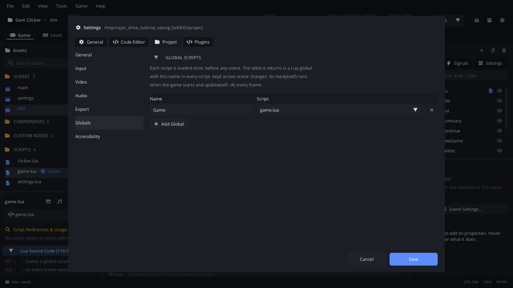
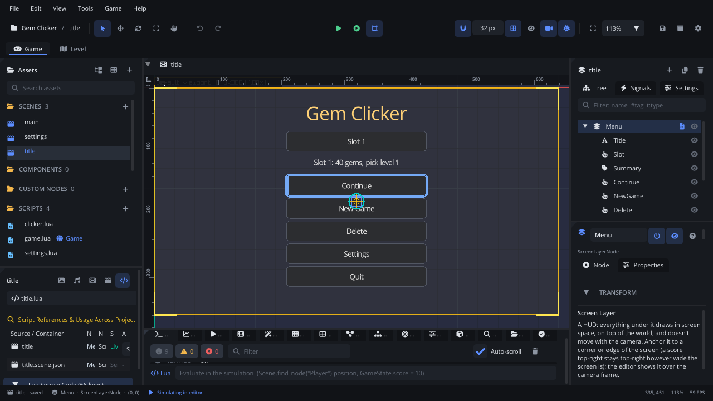
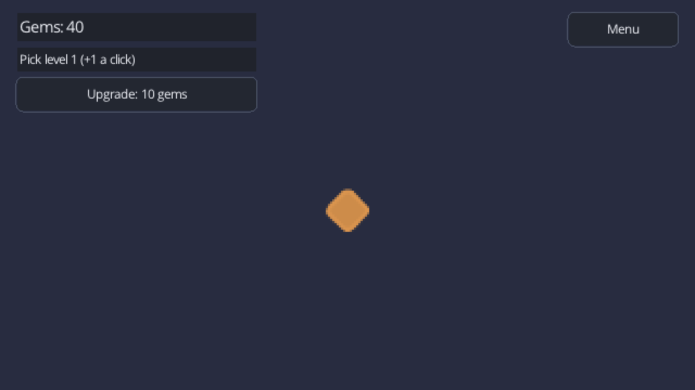
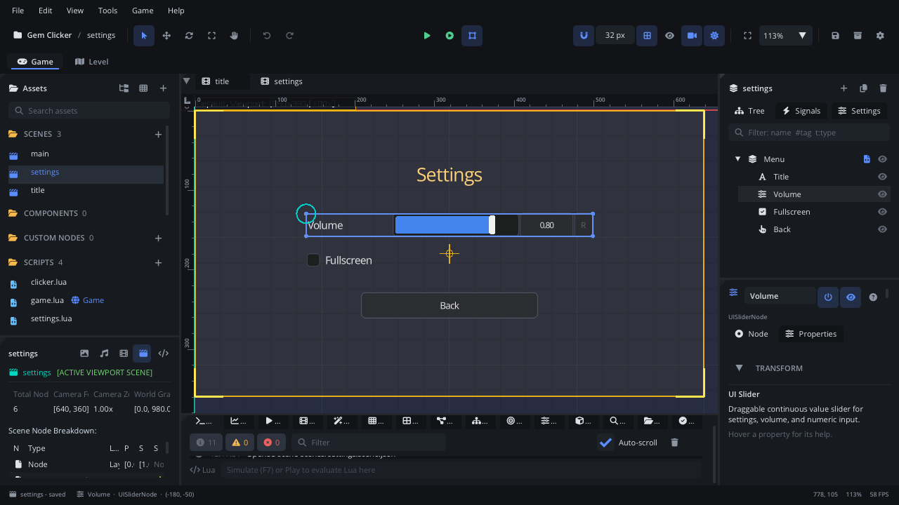
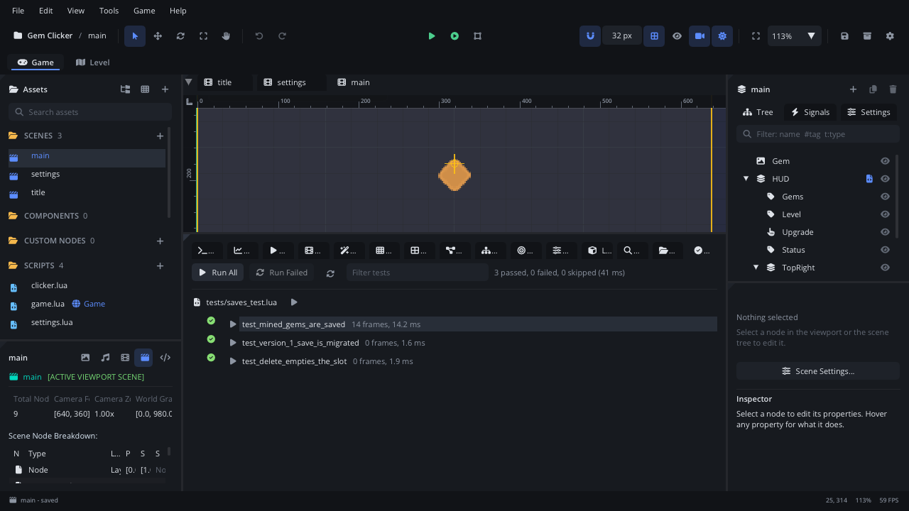

# Saving and loading

This tutorial builds **Gem Clicker**: click a gem to mine gems, spend them
on a better pick, and come back to it later. The title screen has three
save slots with **Continue**, **New Game** and **Delete**, and a settings
screen keeps the volume and fullscreen. On the way it covers the `Save`
module, where save files live on each platform, saving a table and loading
it with defaults, save slots, settings kept apart from the saved games,
autosaving and saving on quit, versioning your save data, deleting a save,
and testing saves without touching your own. It takes about thirty
minutes.

[Download the finished project](saving/) to compare, or to start from the
end: unzip it and open the folder with **File > Open Project...**.

It assumes you know how to attach a script and build a menu of UI nodes;
if not, do [Lua scripting basics](scripting.md) and [UI and HUD](ui.md)
first.

## 1. Make a project and the screens

1. **Help > Welcome > New Project > Empty**, named `Gem Clicker`.
2. Drop the finished project's `textures/gem.png` on the editor window
   (Kenney's *Sokoban* pack, CC0).
3. **Project Settings** (the gear in the toolbar): **Video > Virtual
   Resolution** `640 x 360`.

The screens are UI you know from [UI and HUD](ui.md): copy the finished
project's `scenes/` (empty its scripts' attachments if you want to write
them yourself) or build them:

- `scenes/title.scene.json`: a **Screen Layer** `Menu` (**Anchor**
  **Center**) with a **Text** `Title` and the UI Buttons `Slot`,
  `Continue`, `NewGame`, `Delete`, `Settings` and `Quit` in a column, and a
  **UI Label** `Summary` under `Slot`. `scripts/title.lua` goes on `Menu`.
- `scenes/settings.scene.json`: a centred Screen Layer `Menu` with a
  **UI Slider** `Volume` (**Label** `Volume`, **Min Value** `0`, **Max
  Value** `1`), a **UI Checkbox** `Fullscreen` and a UI Button `Back`;
  `scripts/settings.lua` on `Menu`.
- `scenes/main.scene.json`: a **Texture** `Gem` (`gem.png`, **Scale**
  `2, 2`) in the middle, and a Screen Layer `HUD` (**TopLeft**) with the UI
  Labels `Gems`, `Level` and `Status`, a UI Button `Upgrade`, and a Screen
  Layer `TopRight` holding a UI Button `Menu`. Untick **Keyboard Focus** on
  both buttons, so Space mines the gem instead of pressing the last button
  clicked. `scripts/clicker.lua` goes on `HUD`.

**Project Settings > General > Startup Scene**: `scenes/title.scene.json`.

## 2. The Save module

[`Save`](../lua/Save.md) keeps plain values - booleans, numbers, strings
and tables of those - under string keys, and writes them as a JSON file:

| Call | Does |
|---|---|
| `Save.set(key, value)` | Stores a value; `nil` removes the key. |
| `Save.get(key, default)` | The stored value, or `default` when the key isn't set (the default isn't stored). |
| `Save.has(key)`, `Save.keys()` | Whether a key is set; every key. |
| `Save.delete(key)`, `Save.clear()` | Removes one key; every key. |
| `Save.flush()` | Writes the file now; `false` (and an error in the log) when it couldn't. |
| `Save.slot(name)` | Switches to another file, `<name>.json` (writing the current one first); returns the slot in use. `Save.slot()` only tells it. The default slot is `save`. |
| `Save.get_path()` | The current slot's file. |

Two rules make it simple to use:

- **Tables are live.** A table you got from `Save.get` (or stored with
  `Save.set`) *is* the save data: change a field and the change is saved
  too, with no `Save.set` again.
- **It's written when the game quits** - its window closed or
  `Engine.quit()` - and whenever you call `Save.flush()`. The file is read
  the first time you use `Save`. Writes go to a temporary file first, so a
  crash mid-write keeps the old save.

Where the files go:

| Where the game runs | Save files |
|---|---|
| macOS | `~/Library/Application Support/<Name>/` |
| Windows | `%APPDATA%\<Name>\` |
| Linux | `~/.local/share/<Name>/` |
| The web | The browser's storage (IndexedDB), per site; it survives reloads. |
| Android | The app's own storage; removed with the app. |

`<Name>` is the project's **Name** (Project Settings > General), so
renaming the game moves its saves to a new folder: settle on the name
before you ship. The editor's **Simulate** and **Play** use the same
folder as the game. **Game > Save Data > Open Folder** opens it, and
**Game > Save Data > Delete Save Files** deletes its save files, for a
fresh start. Accessibility settings (`accessibility.json`) and input
bindings are saved beside them by the engine.

## 3. A global script that owns the saves

Every screen needs the saves, so they live in one **global script**: a
script loaded once, before any scene, whose table every script reaches by
its name.

1. In Assets, the Scripts section's **+** makes a new script: name it
   `game.lua` and give it the code below.
2. Right-click `game.lua` > **Make Global**. Assets shows a globe and the
   name `Game` after it, and **Project Settings > Globals** lists it:
   every script can now say `Game:new_game(1)`.



The data is in two kinds of file: `settings.json` for the player's
settings, and `slot_1.json` to `slot_3.json`, one saved game each under
the key `game`. `scripts/game.lua`:

```lua
-- Game: a global script (Project Settings > Project > Globals, named Game),
-- so every scene reaches it as `Game`. It owns the save data, in the
-- player's user-data folder:
--   settings.json         the player's settings: volume, fullscreen, last slot
--   slot_1.json ... 3     one saved game each, under the key "game"

---@class GameGlobal
local Game = {}

--- The save data's own version: raise it when the data changes shape, and
--- teach migrate() the step from the version before.
Game.SAVE_VERSION = 2
--- How many save slots the title screen offers.
Game.SLOTS = 3

local DEFAULT_SETTINGS = { volume = 0.8, fullscreen = false, last_slot = 1 }

-- A new game's data.
local function fresh_game()
    return { version = Game.SAVE_VERSION, gems = 0, total = 0, level = 1, unlocked = {}, play_time = 0 }
end

-- Brings a game saved by an older version up to date, one step at a time.
local function migrate(data)
    local version = data.version or 1
    if version < 2 then
        -- Version 1 called the gems "score" and had no pick levels or trophies.
        data.gems = data.score or 0
        data.total = data.gems
        data.score = nil
        data.level = 1
        data.unlocked = {}
        data.play_time = data.play_time or 0
    end
    -- (The next change: if version < 3 then ... end)
    data.version = Game.SAVE_VERSION
    return data
end

function Game:ready()
    -- The settings have a file of their own: they belong to the player, not
    -- to one saved game.
    Save.slot("settings")
    self.settings = Save.get("settings", {})
    for key, value in pairs(DEFAULT_SETTINGS) do
        if self.settings[key] == nil then self.settings[key] = value end
    end
    self.slot = self.settings.last_slot
    self.data = nil -- the game being played: a table from Save.get
    self:apply_settings()
end

-- Puts the settings into effect.
function Game:apply_settings()
    Audio.set_bus_volume("master", self.settings.volume)
    if Engine.is_fullscreen() ~= self.settings.fullscreen then
        Engine.set_fullscreen(self.settings.fullscreen)
    end
end

-- Writes settings.json, then goes back to the slot that was in use.
function Game:save_settings()
    local current = Save.slot()
    Save.slot("settings")
    Save.set("settings", self.settings)
    Save.flush()
    Save.slot(current)
end

-- Switches to save slot n (slot_<n>.json) and returns its game: nil when
-- the slot is empty.
---@param n integer
---@return table?
function Game:open_slot(n)
    self.slot = n
    Save.slot("slot_" .. n)
    local data = Save.get("game")
    if data == nil then return nil end
    return migrate(data)
end

-- Starts a new game in slot n, over whatever was there.
---@param n integer
function Game:new_game(n)
    self:remember_slot(n)
    self:open_slot(n)
    self.data = fresh_game()
    Save.set("game", self.data)
    Save.flush()
end

-- Carries on the game saved in slot n.
---@param n integer
function Game:continue_game(n)
    self:remember_slot(n)
    self.data = self:open_slot(n)
end

-- Empties slot n.
---@param n integer
function Game:delete_slot(n)
    self:open_slot(n)
    Save.delete("game")
    Save.flush()
    self.data = nil
end

-- The title screen starts at the slot played last.
---@param n integer
function Game:remember_slot(n)
    self.settings.last_slot = n
    self:save_settings()
end

return Game
```

## 4. Loading at the start, with defaults

`Game:ready()` runs when the game starts, before the first scene. It reads
the settings with `Save.get("settings", {})`: on the very first run there
is no file and no key, so it gets the empty default. The loop then fills
in every setting that's missing from `DEFAULT_SETTINGS`. That also covers
a settings file from an older version of your game that didn't have a
setting yet: it gets the default, the rest stay as the player left them.

A saved game is a single table under one key, `game`, so a new field is
one line in `fresh_game()`, and the whole game is loaded by one
`Save.get("game")`. Keep it plain data: numbers, strings, booleans and
tables of those. Functions and nodes can't be saved (they're written as
`null`, with a warning); to point at a node in a scene, save its
`node.uid` and find it again with `Scene.find_by_uid`.

## 5. Save slots

A slot is just another file: `Save.slot("slot_2")` writes the slot in use
and switches to `slot_2.json`. `Game:open_slot(n)` switches and returns
the slot's game, or `nil` when it has none. The title screen shows one
slot at a time; the `Slot` button goes to the next.

`scripts/title.lua`, on the title screen's `Menu`:

```lua
-- The title screen: pick a save slot, then Continue it, start a New Game in
-- it or Delete it. Settings opens the settings screen; Quit closes the game.

---@class Title : ScriptInstanceBase
local Title = {}

function Title:ready()
    local menu = self.node
    self.slot_button = menu:get_node("Slot") ---@type UIButtonNode
    self.summary = menu:get_node("Summary") ---@type UILabelNode
    self.continue = menu:get_node("Continue") ---@type UIButtonNode
    self.new_game = menu:get_node("NewGame") ---@type UIButtonNode
    self.delete = menu:get_node("Delete") ---@type UIButtonNode

    -- The slot button goes 1, 2, 3, 1...
    self.slot_button:connect("clicked", function() self:show(Game.slot % Game.SLOTS + 1) end)
    self.continue:connect("clicked", function()
        Game:continue_game(Game.slot)
        self:play()
    end)
    self.new_game:connect("clicked", function()
        Game:new_game(Game.slot)
        self:play()
    end)
    self.delete:connect("clicked", function() self:delete_slot() end)
    menu:get_node("Settings"):connect("clicked", function()
        Scene.change_scene("scenes/settings.scene.json")
    end)
    menu:get_node("Quit"):connect("clicked", function() Engine.quit() end)
    self:show(Game.slot)
end

-- Shows slot n: what's saved in it, and Continue / Delete only when there is something.
---@param n integer
function Title:show(n)
    local data = Game:open_slot(n)
    self.confirm = false
    self.slot_button:set_text("Slot " .. n)
    self.delete:set_text("Delete")
    if data then
        self.summary:set_text(string.format("Slot %d: %d gems, pick level %d", n, data.gems, data.level))
    else
        self.summary:set_text(string.format("Slot %d: empty", n))
    end
    self.continue:set_enabled(data ~= nil)
    self.delete:set_enabled(data ~= nil)
    if data then self.continue:ui_focus() else self.new_game:ui_focus() end
end

-- Delete asks first: the first click only changes its text.
function Title:delete_slot()
    if not self.confirm then
        self.confirm = true
        self.delete:set_text("Really delete?")
        return
    end
    Game:delete_slot(Game.slot)
    self:show(Game.slot)
end

function Title:play()
    Scene.change_scene("scenes/main.scene.json", { transition = "fade", duration = 0.3 })
end

return Title
```

Try it without playing: Simulate (**F7**) the title scene. It says
`Slot 1: empty`, and Continue and Delete are hidden (`set_enabled(false)`).
On the Console's Lua line,
`Game:new_game(1); Game.data.gems = 40; Save.flush(); Scene.find_node("Menu"):get_script():show(1)`
saves a game with 40 gems and shows the slot again.



An empty slot is "no `game` key", not "no file": `Save.slot` writes the
slot it leaves even if you only looked at it, so `slot_2.json` may exist
holding `{}`.

## 6. Saving the game: autosave, and on quit

`Game.data` is the table from `Save.get("game")` - live save data - and
the game changes it directly. Nothing has to be "saved" on quit: when the
window closes or `Engine.quit()` runs, the engine writes the slot in use,
`Game.data` included. Two moments still call `Save.flush()`:

- **An autosave** every few seconds, so a crash, a phone that closes the
  app in the background, or a closed browser tab loses little. On the web
  this is the only saving there is: a page is closed, not quit, so nothing
  is written then.
- **Leaving for the title screen** (`Menu`), a natural checkpoint.

`scripts/clicker.lua`, on `HUD`:

```lua
-- The game: click the gem (or press Space) to mine gems, spend them on a
-- better pick. Everything worth keeping is in Game.data - the table from
-- Save.get - so it is saved when the game quits; an autosave writes it
-- every few seconds too, and Menu writes it before going back.

---@class Clicker : ScriptInstanceBase
local Clicker = {}

Clicker.properties = {
    --- Seconds between autosaves.
    autosave_every = { type = "float", default = 10, min = 1, max = 300, label = "Autosave Every" },
}

function Clicker:ready()
    -- Played straight from the editor (F6), no slot was picked: the last one.
    if Game.data == nil then Game:continue_game(Game.slot) end
    if Game.data == nil then Game:new_game(Game.slot) end
    self.data = Game.data

    self.gem = Scene.find_node("Gem")
    self.gems = self.node:get_node("Gems") ---@type UILabelNode
    self.level = self.node:get_node("Level") ---@type UILabelNode
    self.upgrade = self.node:get_node("Upgrade") ---@type UIButtonNode
    self.status = self.node:get_node("Status") ---@type UILabelNode
    self.upgrade:connect("clicked", function() self:buy_upgrade() end)
    self.node:get_node("TopRight/Menu"):connect("clicked", function()
        Save.flush()
        Game.data = nil
        Scene.change_scene("scenes/title.scene.json")
    end)
    self.since_save = 0
    self:refresh()
end

---@param dt number
function Clicker:update(dt)
    local data = self.data
    data.play_time = data.play_time + dt

    -- A click on the gem, or Space, mines it.
    local mined = Input.is_key_pressed("SPACE")
    if Input.is_mouse_button_pressed("LEFT") then
        local mx, my = Camera.screen_to_world(Input.get_mouse_position())
        if Vec2(mx, my):distance(self.gem.position) < 64 then mined = true end
    end
    if mined then self:mine() end

    -- Autosave: a crash, or a closed browser tab, loses a few seconds at most.
    self.since_save = self.since_save + dt
    if self.since_save >= self.autosave_every then
        self.since_save = 0
        Save.flush()
        self.status:set_text("Saved")
    end
end

function Clicker:mine()
    local data = self.data
    data.gems = data.gems + data.level
    data.total = data.total + data.level
    -- Something to unlock: a trophy at 100 gems mined.
    if data.total >= 100 and not data.unlocked.hundred then
        data.unlocked.hundred = true
        self.status:set_text("Trophy: 100 gems mined!")
    end
    self:refresh()
end

function Clicker:buy_upgrade()
    local data = self.data
    local cost = 10 * data.level
    if data.gems < cost then
        self.status:set_text("Not enough gems")
        return
    end
    data.gems = data.gems - cost
    data.level = data.level + 1
    self:refresh()
end

function Clicker:refresh()
    local data = self.data
    self.gems:set_text("Gems: " .. data.gems)
    self.level:set_text("Pick level " .. data.level .. " (+" .. data.level .. " a click)")
    self.upgrade:set_text("Upgrade: " .. 10 * data.level .. " gems")
end

return Clicker
```

A saved game in `slot_1.json` looks like this:

```json
{"game": {"version": 2, "gems": 40, "total": 40, "level": 1, "unlocked": {}, "play_time": 12.5}}
```

Press **F6** with the main scene open: Play uses the same save folder as
Simulate, so it carries on slot 1's 40 gems.



There is no "the game is quitting" callback to save in, and none is
needed with live tables. When the game quits, the scene is taken down
first - every node's `on_exited_tree`, then the scripts' `on_destroy` -
and the save file is written after: a `Save.set` there is kept.

## 7. Settings, saved separately

Settings belong to the player, not to a saved game: deleting slot 2 must
not reset the volume, and a new game must not bring back the old one.
They have their own slot, `settings`, which `Game:save_settings()` switches
to, writes and switches back from.

`scripts/settings.lua`, on the settings screen's `Menu`:

```lua
-- The settings screen: a volume slider and a fullscreen checkbox. Changes
-- apply at once; Back writes them to settings.json.

---@class Settings : ScriptInstanceBase
local Settings = {}

function Settings:ready()
    local settings = Game.settings
    local volume = self.node:get_node("Volume") ---@type UISliderNode
    local fullscreen = self.node:get_node("Fullscreen") ---@type UICheckboxNode
    -- Show the saved values (setting them from a script raises no value_changed).
    volume:set_property("value", settings.volume)
    fullscreen:set_property("checked", settings.fullscreen)

    volume:connect("value_changed", function(value)
        settings.volume = value
        Game:apply_settings()
    end)
    fullscreen:connect("value_changed", function(on)
        settings.fullscreen = on
        Game:apply_settings()
    end)
    self.node:get_node("Back"):connect("clicked", function()
        Game:save_settings()
        Scene.change_scene("scenes/title.scene.json")
    end)
    volume:ui_focus()
end

return Settings
```

A slider raises `value_changed` many times during a drag, so the changes
only apply there; **Back** writes the file once. `Engine.set_fullscreen`
does nothing in Simulate (it warns once): try the checkbox with Play.



## 8. Versioning your save data

Your game will change after people have saves: a field renamed, a new
one, a different shape. Every saved game carries a `version` field, and
`migrate()` brings an older one up to date the moment it's loaded, one
step at a time:

- Version 1 of Gem Clicker saved `{version = 1, score = 42}`. Version 2
  calls it `gems` and adds `level`, `total` and `unlocked`, so
  `if version < 2 then ... end` moves `score` to `gems` and fills in the
  rest. A save without a `version` counts as version 1.
- The next change raises `Game.SAVE_VERSION` to 3 and adds an
  `if version < 3 then ... end` after it. A version 1 save then goes
  through both steps.
- The migrated table is the live save data, so the next write saves it in
  the new shape.
- A save with a *higher* version than the game knows came from a newer
  build: refuse it, or load it read-only, rather than guess.

This is separate from the `"format"` numbers in the files the editor
writes - scenes, components, `project.json` (see
[Compatibility](../../engine/docs/compatibility.md)). Rayzr migrates those
by itself; your save data is your game's own JSON, and only your scripts
know what it means, so they version it.

## 9. Deleting a save

`Game:delete_slot(n)` switches to the slot, `Save.delete("game")` and
`Save.flush()`: the file stays, empty, and the title screen shows the slot
as empty. (`Save.clear()` would remove every key in the slot.) The title
screen's **Delete** asks first - a lost save is the one thing players
don't forgive - by turning into **Really delete?** for a second click.

## 10. Testing saves

Your own saves and the ones tests make must never meet:

- **Game tests** (the **Tests** tab, files `tests/*_test.lua`, see
  [Test](../lua/Test.md)) run the game with a save folder of their own,
  emptied before each run of the tab. A run's tests share it, so each test
  empties the slots first.
- **The runner and the editor** both take `--user-data <folder>`: save
  data (and accessibility settings and bindings) go there instead of the
  player's folder. Start the editor with it to keep Simulate's and Play's
  saves away from your real ones; the exported game takes it too (see
  [Exporting your game](exporting.md)), which is how to try "the first
  run" without deleting anything.

`tests/saves_test.lua` in the finished project checks that mined gems
reach the file, that a version 1 save is migrated, and that Delete empties
a slot. Reading a slot "as the next run would" means switching away and
back: that reads the file again.

```lua
-- Tests for the saves (the editor's Tests tab runs them). The tests run
-- with a save folder of their own, shared by the whole run, so each test
-- empties the slots first.

local function empty_slots()
    for n = 1, Game.SLOTS do Game:delete_slot(n) end
end

-- Reads slot n back from its file, as the next run would: switching to
-- another slot and back reads the file again.
local function reread(n)
    Game:open_slot(n % Game.SLOTS + 1)
    return Game:open_slot(n)
end

function test_mined_gems_are_saved()
    empty_slots()
    Game:new_game(1)
    Test.load_scene("scenes/main.scene.json")
    for _ = 1, 3 do
        Test.press_key("SPACE")
        Test.step(4)
    end
    Test.expect_eq(Game.data.gems, 3, "three gems mined")
    Save.flush()
    local saved = reread(1)
    Test.require(saved ~= nil, "slot 1 has a game")
    Test.expect_eq(saved.gems, 3, "the file has the three gems")
end

function test_version_1_save_is_migrated()
    empty_slots()
    Save.slot("slot_1")
    Save.set("game", { version = 1, score = 42 })
    Save.flush()
    local data = reread(1)
    Test.require(data ~= nil, "slot 1 has a game")
    Test.expect_eq(data.gems, 42, "score became gems")
    Test.expect_eq(data.level, 1, "pick level 1")
    Test.expect_eq(data.version, Game.SAVE_VERSION, "the current version")
    Test.expect(data.score == nil, "no score left")
end

function test_delete_empties_the_slot()
    empty_slots()
    Game:new_game(2)
    Game:delete_slot(2)
    Test.expect(reread(2) == nil, "slot 2 is empty")
end
```

Open the **Tests** tab and press **Run All**.



Press **F5**: New Game, mine a few gems, quit, and play again - slot 1
says how many you have, and Continue carries on.

## Where next

- The finished project is in the [download](saving/).
- Every call: [Save](../lua/Save.md); the player's other saved settings:
  [Accessibility](../lua/Accessibility.md) and
  [input rebinding](../../engine/docs/input_rebinding.md).
- Global scripts: [Settings](../editor/settings.md) (Project > Globals).
- Ship it: [Exporting your game](exporting.md).
