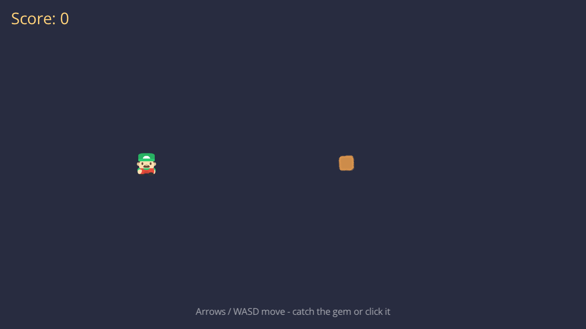
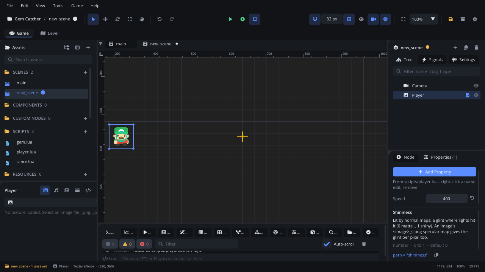
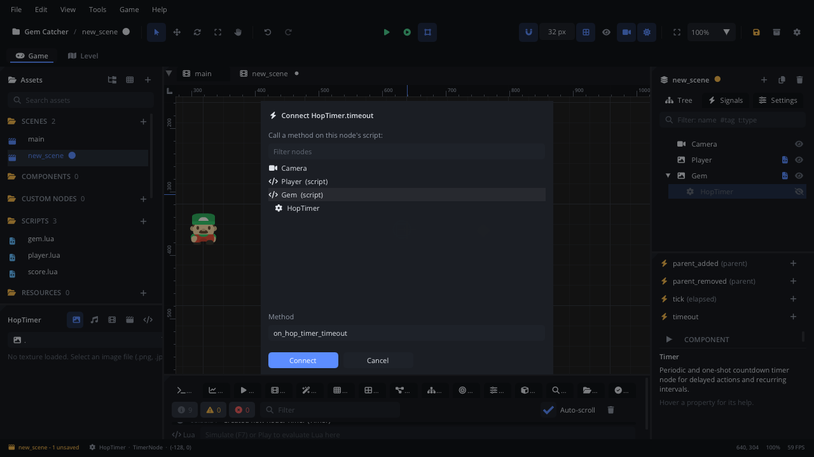
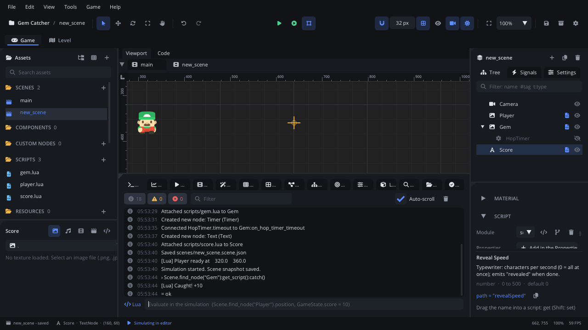
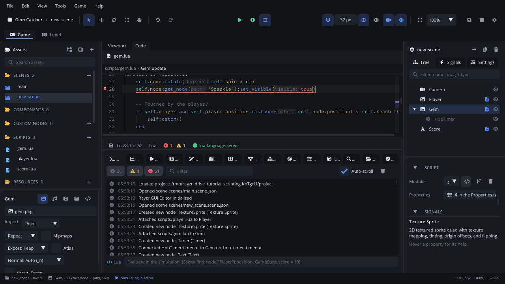

# Lua scripting basics

This tutorial writes the three scripts of **Gem Catcher**: a player you
move with the keyboard, a gem that spins, hops somewhere new every two
seconds and is caught when you touch it or click it, and a score that
counts the catches. On the way it covers everything a script does most
days: lifecycle methods, Inspector properties, input, moving nodes, events,
finding nodes, timers, printing, hot reload and errors. It takes about
forty minutes.

[Download the finished project](scripting/) to compare, or to start from
the end: unzip it and open the folder with **File > Open Project...**.



## 1. Make a project

1. In the **Welcome** window (**Help > Welcome**), under **New Project**,
   pick **Empty**, name it `Gem Catcher` and click **Create Project**.
2. Add two images: drop `player.png` and `gem.png` on the editor window
   (they go to `textures/`). The finished project's `textures/` folder has
   the ones used here - Kenney's CC0 art - but any small PNGs work.

Scripts are Lua 5.4 files in the project's `scripts/` folder. A script is
attached to a node and gives that node behaviour; a node has at most one.

## 2. Attach a script to a node

1. **Add Node** (the **+** in the Scene panel, or **Cmd+A** - Ctrl+A on
   Windows and Linux) > **Texture Sprite**. In the Inspector, pick `textures/player.png` as its image,
   rename it `Player` (the name field at the top) and set its **Position**
   to `320, 360`.
2. In the Inspector's **Script** section press **New Script...**, name it
   `player`, keep the **Empty** template and press **Create**. The editor
   writes `scripts/player.lua`, attaches it, and opens it in the **Code**
   tab (with completion and hover docs for the whole API).

To attach a script that already exists, pick it in the **Script** section,
or drag it from **Assets** onto the node.

Replace the file with this and save (**Cmd+S**, or Ctrl+S):

```lua
-- The player: moves with the arrow keys or WASD (the built-in move_left,
-- move_right, move_up and move_down actions: Project Settings > Input).

---@class Player : ScriptInstanceBase
local Player = {}

Player.properties = {
    --- How fast the player moves, in pixels per second.
    speed = { type = "float", default = 300, min = 0, max = 1000, label = "Speed" },
}

function Player:ready()
    print("Player ready at", self.node:get_position())
end

---@param dt number
function Player:update(dt)
    -- -1 to 1 on each axis: left/right and up/down.
    local x, y = Input.get_vector("move_left", "move_right", "move_up", "move_down")
    self.node:translate(x * self.speed * dt, y * self.speed * dt)

    -- Stay on the screen.
    local w, h = Engine.get_virtual_size()
    local px, py = self.node:get_position()
    self.node:set_position(math.max(32, math.min(w - 32, px)), math.max(32, math.min(h - 32, py)))
end

return Player
```

The shape of every script:

- The file returns a table (`Player`). Each node using the script gets its
  own instance of it, `self`; `self.node` is the node.
- **`ready()`** runs once, when the node enters the running scene. Set
  things up here.
- **`update(dt)`** runs every frame; `dt` is the time since the last frame,
  in seconds. Multiply speeds by it and the game runs the same at any
  frame rate.
- `on_destroy()` (not used here) runs just before the node goes away, and
  `on_draw()` lets a script draw shapes of its own.

## 3. Properties in the Inspector

Every entry of `Player.properties` becomes a field of `self`
(`self.speed`) and a row in the Inspector, on its **Properties** tab. The
value you type there is saved with the scene, for that node only; the
script keeps the default.

Select the Player, open the Inspector's **Properties** tab and set
**Speed** to `400`.



A property can be a `float`, `int`, `bool`, `string`, `color`, `vector2`,
an `enum` (a list of choices), an asset (`texture`, `audio`, `scene`...) or
a `node`, among others; `min` / `max` limit a number, `label` names the
row and the `---` comment above it is its help. The
[scripting guide](../../engine/SCRIPTING.md#script-format--exported-properties)
lists them all.

Node properties read and write the same way: `self.node.position`,
`self.node.rotation`, `self.node.visible`, a Text's `text`. Hover a
property in the Inspector to see its name for scripts.

## 4. Input and moving a node

The player's `update` asks for **actions**, not keys:
`Input.get_vector("move_left", "move_right", "move_up", "move_down")`
returns a direction from -1 to 1 on each axis. A new project's built-in
actions are already bound to the arrow keys, WASD and a gamepad's left
stick; **Project Settings** (the gear in the toolbar) **> Input** rebinds
them or adds your own. The other getters:

| Call | True / returns |
|---|---|
| `Input.is_action_pressed("jump")` | the frame the action is pressed |
| `Input.is_action_down("jump")` | every frame while it's held |
| `Input.is_action_released("jump")` | the frame it's let go |
| `Input.get_axis("move_left", "move_right")` | -1 to 1 along one axis |
| `Input.is_key_pressed("F3")`, `Input.is_mouse_button_pressed("LEFT")` | a key or mouse button directly |
| `Input.get_mouse_position()` | the mouse, in screen pixels |

Moving a node is changing its position: `translate(dx, dy)` moves it by an
offset, `set_position(x, y)` puts it somewhere, `rotate(degrees)` turns it.
Positions are in pixels from the parent's origin, +y down.

Press **F5** to play: the arrows move the player. Close the game window
(or **Shift+F5**) to stop.

## 5. The gem: a timer and a signal

1. Select nothing (**Esc**), then add another **Texture Sprite** with
   `textures/gem.png`, named `Gem`, at `760, 360`.
2. With the Gem selected, **Add Node > Timer**: the timer becomes its child.
   Rename it `HopTimer` and, in the Inspector's **Timer** section, set
   **Duration (s)** to `2` and tick **Auto Start** and **Loop**.
3. Make `scripts/gem.lua` with **New Script...** on the Gem, and replace it
   with this:

```lua
-- The gem: spins, hops to a new place when its HopTimer runs out, and is
-- caught when the player touches it or you click it. Catching it raises
-- the custom event "caught" (the score listens to it).

---@class Gem : ScriptInstanceBase
local Gem = {}

Gem.properties = {
    --- Points for catching it.
    points = { type = "int", default = 10, min = 1, max = 100, label = "Points" },
    --- How close the player (or a click) has to come, in pixels.
    reach = { type = "float", default = 48, min = 8, max = 200, label = "Reach" },
    --- How fast it spins, in degrees per second.
    spin = { type = "float", default = 90, label = "Spin" },
    --- The node that catches it by touching it.
    player = { type = "node", label = "Player" },
}

function Gem:ready()
    -- Without a Player set in the Inspector, look it up by name.
    if not self.player then self.player = Scene.find_node("Player") end
    self.timer = self.node:get_child("HopTimer") ---@type TimerNode
end

---@param dt number
function Gem:update(dt)
    self.node:rotate(self.spin * dt)

    -- Touched by the player?
    if self.player and self.player.position:distance(self.node.position) < self.reach then
        self:catch()
    end

    -- Clicked? (Mouse positions are on the screen: turn them into world ones.)
    if Input.is_mouse_button_pressed("LEFT") then
        local mx, my = Camera.screen_to_world(Input.get_mouse_position())
        if Vec2(mx, my):distance(self.node.position) < self.reach then
            self:catch()
        end
    end
end

function Gem:catch()
    print("Caught! +" .. self.points)
    self.node:emit("caught", self.points)
    self:hop()
end

-- Moves the gem somewhere else on the screen and restarts the countdown.
function Gem:hop()
    local w, h = Engine.get_virtual_size()
    self.node:set_position(math.random(64, w - 64), math.random(64, h - 64))
    if self.timer then self.timer:timer_start() end
end

return Gem
```

Now connect the timer to the script, the editor's way:

4. Select **HopTimer**. The Inspector's **Signals** section lists the
   events it raises; press **+** next to `timeout`.
5. In the dialog pick **Gem** (the node whose script gets called) and press
   **Connect**. The method name is made for you, `on_hop_timer_timeout`.



The editor saves the connection with the scene and writes the handler
into `gem.lua`, before `return Gem`. Make it hop:

```lua
---Signal: HopTimer.timeout - The timer's duration elapsed
function Gem:on_hop_timer_timeout()
    self:hop()
end
```

Every two seconds the timer raises `timeout` and the Gem hops. What the
script used on the way:

- **Finding nodes**: `self.node:get_child("HopTimer")` finds a child by
  name, `self.node:get_node("../Player")` by a path from this node, and
  `Scene.find_node("Player")` anywhere in the scene. `Scene.find_by_tag("coin")`
  returns every node with a tag (the Inspector's **Tags** section).
- **A node property**: `player` is a `node` property. Set it in the
  Inspector (pick the Player, or drag it from the Scene tree onto the
  field) and `self.player` is that node; left empty, `ready` finds it by
  name.
- **Timers from code**: `timer_start()`, `timer_stop()`,
  `timer_set_duration(seconds)`, `timer_set_loop(true)`.
- **Vectors**: `self.node.position` is a `Vec2`, with `distance`,
  `length`, `normalized`, `+`, `-`, `*`.

## 6. Events: emit your own, connect to them

`self.node:emit("caught", self.points)` raises a custom event on the Gem.
Anything can listen with `connect`. Add a **Text** node (select nothing
first), name it `Score`, put it at the top left, and give it
`scripts/score.lua`:

```lua
-- The score: listens to the gem's "caught" event and shows the total.

---@class Score : ScriptInstanceBase
local Score = {}

function Score:ready()
    self.score = 0
    local gem = Scene.find_node("Gem")
    if gem then
        gem:connect("caught", function(points)
            self.score = self.score + points
            self:refresh()
        end)
    end
    self:refresh()
end

function Score:refresh()
    self.node.text = "Score: " .. self.score
end

return Score
```

There are three ways to handle an event:

| Where | How |
|---|---|
| The node's own script | a method named `on_<event>`: an Area's script gets `on_body_entered(body)`, a Timer's `on_timeout()` |
| Any script, in code | `node:connect("event", function(value, source) ... end)`; it returns an id for `node:disconnect(id)`, and ends by itself when either node goes |
| Any script, in the editor | the Inspector's **Signals** section, as for HopTimer |

For events that belong to no node - "the level is over", "the score
changed" - use the event bus: `Events.emit("score_changed", 30)` anywhere,
`Events.connect("score_changed", function(value) ... end)` anywhere else.
The [events guide](../../engine/docs/events.md) has more.

Play: walk into the gem, or click it, and the score goes up.

## 7. Print, and the Console

`print(...)` (or `Log.info`, `Log.warn`, `Log.error`) writes a line to the
**Console**, the first tab of the bottom panel: from the game you started
with Play, and from **Game > Simulate in Editor** (**F7**), which runs the
scene's scripts inside the editor.

Simulate, then open the Console: `Player ready at 320.0 360.0` is there.
The **Lua** line under the log runs code in the simulation (or in the
running game): type

```lua
Scene.find_node("Gem"):get_script():catch()
```

and press Enter. `get_script()` is a node's script instance, so you can
call its methods and read its fields; the Console shows `Caught! +10` and
the score changes.



## 8. Hot reload

Scripts reload while the game runs (Play or Simulate): change a script,
save, and the running game uses the new code at once. Each node keeps its
state - `self.score`, the property values - and only the functions change.

While simulating, add a line to `Gem:catch()`:

```lua
function Gem:catch()
    print("Caught! +" .. self.points)
    print("Hot reloaded")
    ...
```

Save, catch the gem again from the Lua line: both lines print, and the
score carries on from where it was. A new property appears with its
default; if the new code has an error, the old code keeps running.

## 9. When something goes wrong

Script errors - a failing `ready`, `update` or event handler, a syntax
error on reload - show in three places:

- the **Console**, in red, with the file, the line and the call stack
  (click it to open that line);
- the **Code** tab, as a red squiggle on that line (hover it for the
  message); a warning, like `get_node` finding nothing, is yellow;
- the Console tab's label, which shows how many errors there are.

Try it: in `Gem:update`, add `self.node:get_node("Sparkle"):set_visible(true)`
and save while simulating. There is no Sparkle node, so `get_node`
returns nil (a warning) and calling `set_visible` on nil fails (an error),
every frame:



Delete the line and save: the errors stop at once. To stop at a line and
look around, click its line number in the Code tab (a breakpoint), then
Play; the [scripting guide](../../engine/SCRIPTING.md#debugging) explains
stepping and watches.

## Where next

- The finished project is in the [download](scripting/); it's the same as
  above, with a help line at the bottom.
- [Physics and collisions](physics.md) adds bodies, a character that runs
  and jumps, and triggers.
- The [scripting guide](../../engine/SCRIPTING.md) and the
  [Lua API reference](../../engine/definitions/engine_api.lua) cover every
  module and node method.
