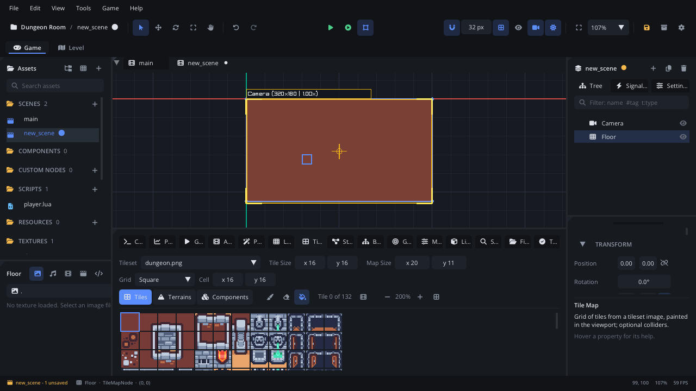
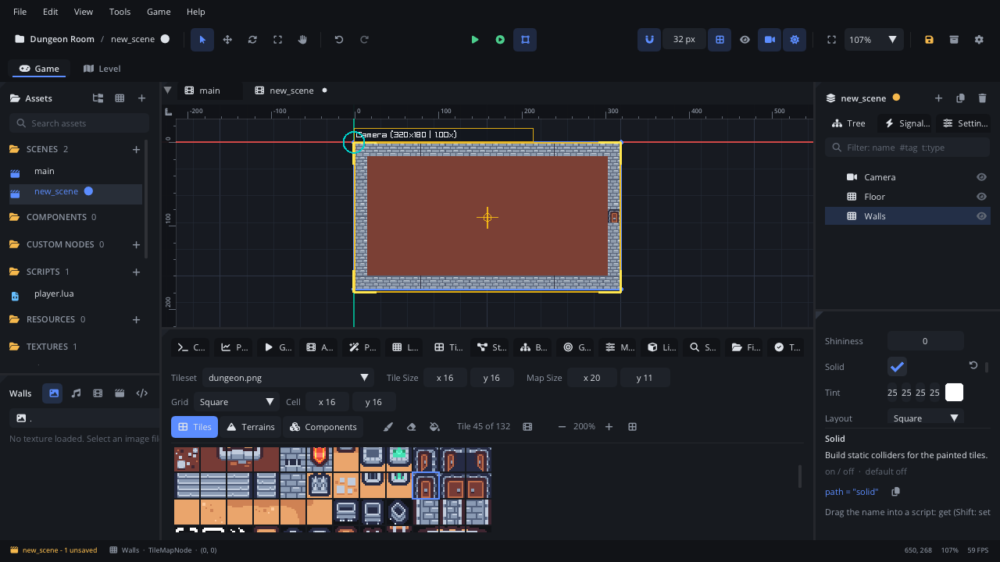
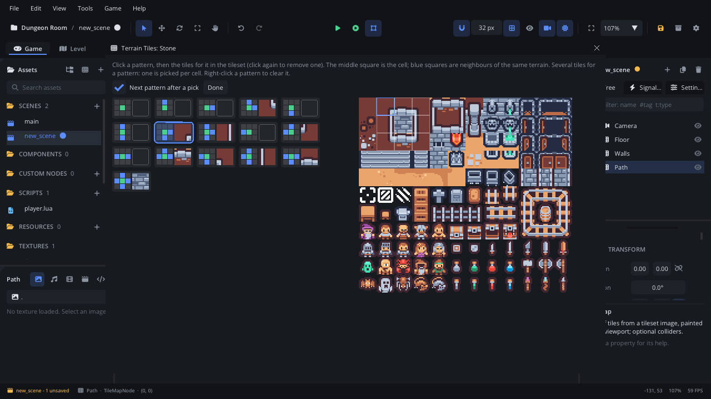
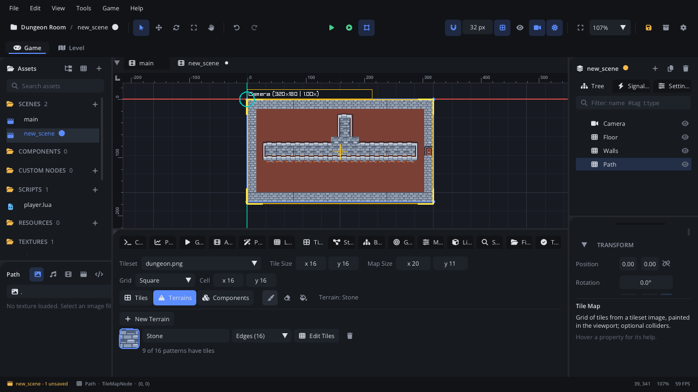
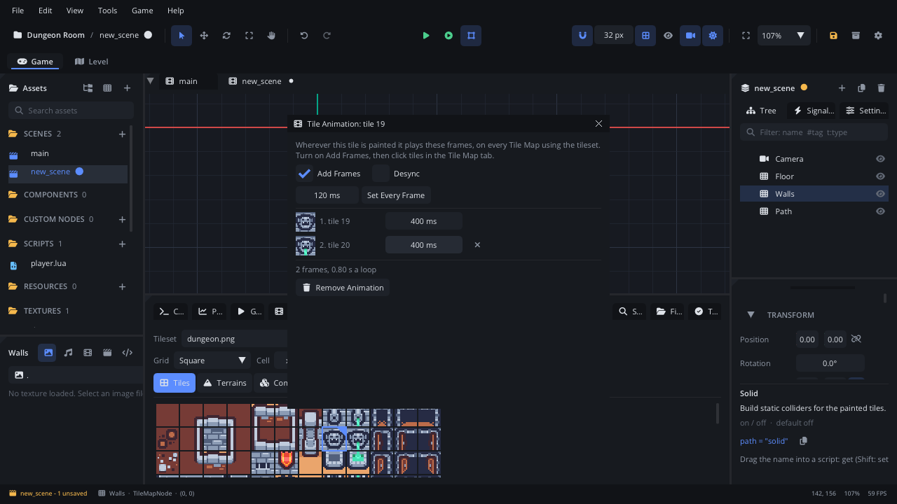
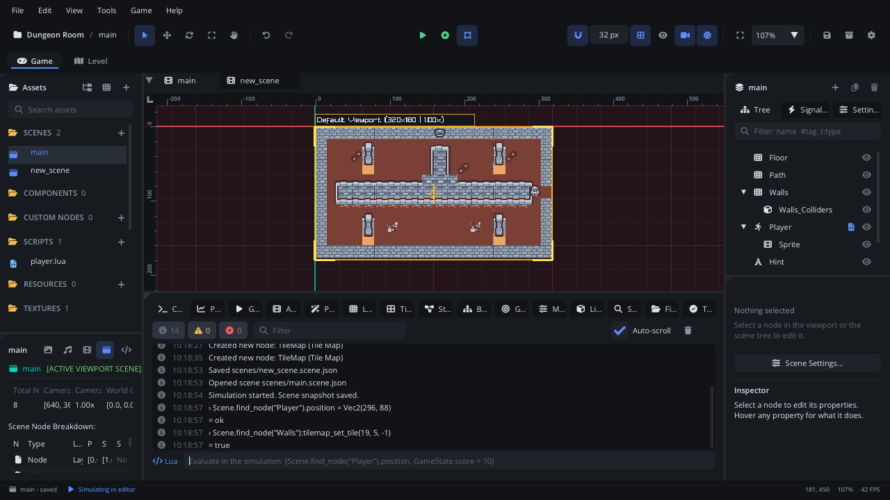
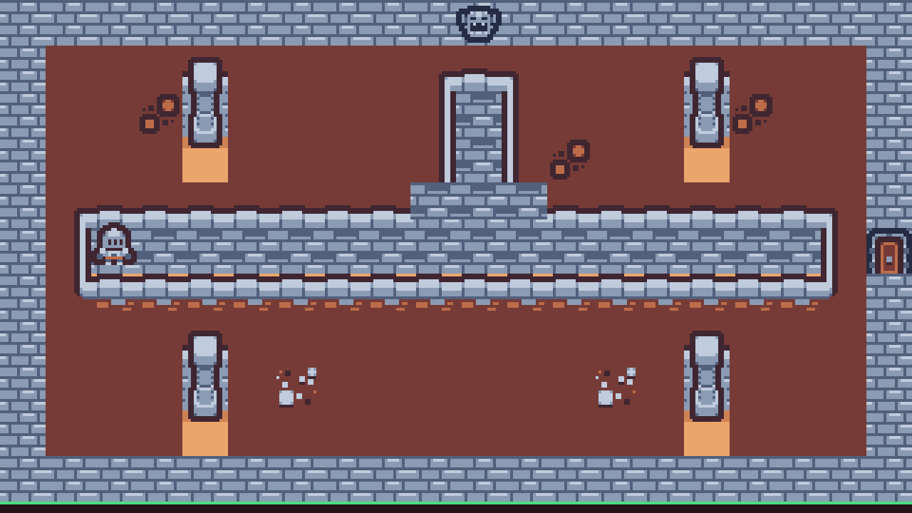

# Tile maps and terrains

This tutorial builds **Dungeon Room**: a walled room with pillars, a raised
stone walkway, a gargoyle that drips and a door the player opens with E.
It is three Tile Maps painted from one tileset. On the way it covers
tilesets and tile sizes, painting, erasing and filling, layers of maps,
colliders on solid tiles, terrains (auto-tiling), animated tiles and
reading and writing tiles from Lua. It takes about thirty minutes.

[Download the finished project](tilemaps/) to compare, or to start from
the end: unzip it and open the folder with **File > Open Project...**.

It assumes you know how to attach a script and read the Console; if not,
do [Lua scripting basics](scripting.md) first. The player is a Character
Mover, as in [Physics and collisions](physics.md).

## 1. Make a project

1. **Help > Welcome > New Project > Empty**, named `Dungeon Room`.
2. Drop the finished project's `textures/dungeon.png` on the editor window
   (Kenney's *Tiny Dungeon*, CC0): 12 x 11 tiles of 16 x 16 pixels.
3. **Project Settings** (the gear in the toolbar): **Video > Virtual
   Resolution** `320 x 180` (the room is 20 x 11 tiles), and **General >
   Physics > Gravity** `0, 0` - a top-down game has no "down".

## 2. A Tile Map and its tileset

A **Tile Map** (`TileMapNode`) is a grid of cells, each holding one tile of
a tileset image, or nothing. Tiles are numbered from 0, left to right and
then top to bottom: in `dungeon.png` tile 0 is the dirt floor, 40 a brick
wall, 45 a door.

1. **Add Node > Tile Map**, named `Floor`, at `0, 0`. The bottom panel
   switches to the **Tile Map** tab (or press **Edit in Tile Map Tab** in
   the Inspector).
2. In the tab's top row, set **Tileset** to `dungeon.png`, **Tile Size** to
   `16, 16` (one tile in the image, in pixels) and **Map Size** to
   `20, 11` (columns and rows). The map's outline shows in the viewport.
3. Click the dirt tile (tile 0) in the tile list: **Paint** turns on.
4. Click **Fill** (the paint bucket), then click inside the outline: the
   whole map fills with dirt.



The three tools:

| Tool | Left button |
|---|---|
| **Paint** (brush) | Paints the picked tile on each cell the mouse crosses; drag for a line |
| **Erase** (eraser) | Empties cells |
| **Fill** (paint bucket) | Fills the connected cells that hold the same tile as the clicked one |

The right button always erases, whatever the tool, and each stroke is one
undo step. Click the lit tool again to turn it off and select nodes in the
viewport as usual. The **-** / **+** buttons size the tile list. The map
size is an outline, not a limit: tiles painted outside it are kept, and
making the map smaller never deletes any.

## 3. Walls on a map of their own: layers

One map holds one tile per cell, so a wall over the floor is a second map
on top. Make as many as you need - floor, decoration, walls - and order
them with **Z Index** (in the Inspector's Transform section): higher draws
over lower.

1. Select nothing (**Esc**), then **Add Node > Tile Map**, named `Walls`,
   at `0, 0`, with the same tileset, tile size and map size.
2. Pick the brick wall (tile 40) and drag along the map's edge: the top
   row, the left and right columns, the bottom row.
3. The door: pick **Erase**, click the wall cell in the middle of the
   right side (column 19, row 5), then click the door tile (45): picking a
   tile switches back to **Paint**. Click the cell again.
4. The finished room adds four pillars (tiles 6, 18 and 30, one above the
   other) and sets the Z Index of `Floor` to `-2`.

### Colliders: Solid

Tick **Solid** in the Inspector (the Node tab's **Properties** section).
When the scene runs, the map makes a static body child named
`Walls_Colliders` with one box per horizontal run of painted tiles - the
player bumps into every wall tile. The colliders aren't there while you
edit (Simulate and Play make them), and they cast [Light](../nodes/LightNode.md)
shadows too. A map is solid or not as a whole: keep walls and floor apart
for that reason too. To see the boxes in the game, **Game > Show
Colliders in Game**.



## 4. Terrains: tiles that pick themselves

The stone walkway is made of nine pieces: four corners, four edges and
the middle. Painting each piece by hand is slow; a **terrain** picks them.
A terrain is a set of the tileset's tiles, one for each way a cell's
neighbours can be the same terrain - its **pattern**. Paint "Stone" and
each cell takes the tile for its pattern, and its neighbours are re-tiled.

There are two kinds for square maps:

| Kind | Patterns | Looks at |
|---|---|---|
| **Blob (47)** | 47 | All 8 neighbours; a corner counts only when both sides next to it are the terrain. For tilesets with inner corners too. |
| **Edges (16)** | 16 | The 4 sides (north, east, south, west). |

(A third, **Hex (64)**, is for hex grids.) `dungeon.png` has the nine
pieces, no inner corners: **Edges** it is.

1. Select nothing, **Add Node > Tile Map**, named `Path`, at `0, 0`, with
   the same tileset, tile size and map size, and a Z Index of `-1` (over the
   floor, under the walls).
2. In the Tile Map tab, click **Terrains** (next to **Tiles**), then **New
   Terrain**. Name it `Stone` (type over "Terrain" and press Enter) and set
   its kind to **Edges (16)**.
3. **Edit Tiles** opens the **Terrain Tiles** window: the 16 patterns, each
   a 3 x 3 picture - green the cell, blue its neighbours that are Stone
   too - and the tileset. Click a pattern, then its tile:

| Stone on these sides | Tile | | Stone on these sides | Tile |
|---|---|---|---|---|
| all four (the middle) | 14 | | east, south (top-left corner) | 1 |
| east, south, west (top edge) | 2 | | south, west (top-right corner) | 3 |
| north, east, west (bottom edge) | 26 | | north, east (bottom-left corner) | 25 |
| north, east, south (left edge) | 13 | | north, west (bottom-right corner) | 27 |
| north, south, west (right edge) | 15 | | | |

   **Next pattern after a pick** moves on by itself; a pattern can have
   several tiles (one is picked per cell, for variety) and right-click
   clears one. The tiles are saved as you pick them, then **Done**.



A pattern without a tile falls back to the same pattern without its
corners (Blob), then to the full tile: give the full tile (all sides)
first and painting already works, then add the edges and corners.

4. Click the Stone card in the terrain list and paint the walkway: three
   rows across the room (columns 1 to 18, rows 4 to 6) and a branch up to
   the north wall (columns 9 to 11, rows 1 to 3). The edges and corners
   draw themselves as you paint. **Erase** (or the right button) empties
   cells and re-tiles their neighbours; **Fill** fills an area with the
   terrain.



The terrains are kept next to the tileset image, in
`textures/dungeon.tileset.json`, so every map using `dungeon.png` shares
them - and so does the [Level Generator](levelgen.md), whose rules can
name a terrain (its tile outputs also have **pattern rules**, which look
at the 3 x 3 cells around each cell to place decoration: grass on top of
the ground, torches on walls - see
[Pattern rules](../../engine/docs/level_generator.md#nodes) in the guide).

## 5. An animated tile

The gargoyle on the north wall drips: tile 19 and tile 20 in turns.

1. Select the `Walls` map, click **Tiles** in the Tile Map tab and click
   the gargoyle (tile 19).
2. Click the film button next to *Tile 19 of 132* (**Animate**). The
   **Tile Animation** window opens with **Add Frames** on: click tile 20
   in the tile list - it becomes the second frame.
3. Set each frame's time to `400` ms (or type it once and press **Set
   Every Frame**), turn **Add Frames** off and close the window.
4. Paint tile 19 in the middle of the top wall (column 10, row 0).



Wherever tile 19 is painted it plays those frames, on every map using the
tileset, by the game's clock (paused with the game). All copies change
together; **Desync** starts each at its own point (flickering candles,
grass in the wind). The animation is kept in the same
`dungeon.tileset.json`.

## 6. The player

1. **Add Node > Character Mover**, named `Player`, at `40, 88` (on the
   walkway). Make its capsule **Radius** `5`, **Size** `10, 2`, set
   **Control Mode** to **Script** and add the tag `player`.
2. Its picture: **Add Node > Animation Player** under it, named `Sprite`,
   at `0, -3`. In the **Animation** tab's **▾** menu, **Slice a Sprite
   Sheet...** with `dungeon.png`: **Slice by** **Cell Size** `16 x 16`,
   click the knight (cell 96, the first of row 8) and **Add Animation**.
3. A **Text** node named `Hint` at `160, 165`, **Origin** `0.5, 0`,
   **Layer** `Layer8`, font size `10`: the script writes in it.
4. Attach `scripts/player.lua`, and in the Inspector set its **Path Map**
   to `Path` and **Walls Map** to `Walls` (or leave them: the script finds
   the maps by name).

## 7. Reading and writing tiles from Lua

A script sees a map's cells by column and row, from 0 at the map's
top-left. `tilemap_cell_at(x, y)` turns a world position into a cell,
`tilemap_get_tile(cx, cy)` reads the tile there (-1: empty) and
`tilemap_set_tile(cx, cy, tile)` paints one (-1 erases).
`scripts/player.lua` walks faster on the stone, and opens the door:

```lua
-- The player: a Character Mover (Control Mode "Script") that walks in eight
-- directions with WASD or the arrows. It reads the Path map under its feet
-- (faster on the stone walkway) and opens the door in the Walls map with E.

---@class Player : ScriptInstanceBase
---@field path_map TileMapNode
---@field walls TileMapNode
local Player = {}

-- The door's tile in textures/dungeon.png (tiles count left to right, then
-- top to bottom, from 0).
local DOOR = 45

Player.properties = {
    --- Walking speed on the dirt, in pixels per second.
    speed = { type = "float", default = 60, min = 0, max = 300, label = "Speed" },
    --- Walking speed on the stone path.
    path_speed = { type = "float", default = 100, min = 0, max = 300, label = "Path Speed" },
    --- The Tile Map with the stone path.
    path_map = { type = "node", label = "Path Map" },
    --- The Tile Map with the walls and the door (Solid on).
    walls = { type = "node", label = "Walls Map" },
}

function Player:ready()
    self.path_map = self.path_map or Scene.find_node("Path")
    self.walls = self.walls or Scene.find_node("Walls")
    self.hint = Scene.find_node("Hint") ---@type TextNode
    self.sprite = self.node:get_child("Sprite")
end

---@param dt number
function Player:update(dt)
    local node = self.node
    -- The cell under the player's feet (the same grid in every map here).
    local cx, cy = self.path_map:tilemap_cell_at(node:get_global_position())
    local on_path = self.path_map:tilemap_get_tile(cx, cy) ~= -1

    local x, y = Input.get_vector("move_left", "move_right", "move_up", "move_down")
    local speed = on_path and self.path_speed or self.speed
    node:character_set_velocity(x * speed, y * speed)
    node:character_move_and_slide()
    if x ~= 0 then self.sprite:set_scale(x < 0 and -1 or 1, 1) end

    -- The door: the tile right of the player in the Walls map.
    if self.walls:tilemap_get_tile(cx + 1, cy) == DOOR then
        self.hint.text = "E: open the door"
        if Input.is_action_pressed("interact") then
            -- Erasing the tile also removes its collider (at the end of the frame).
            self.walls:tilemap_set_tile(cx + 1, cy, -1)
            self.hint.text = "The door is open"
        end
    elseif self.hint.text == "E: open the door" then
        self.hint.text = ""
    end
end

return Player
```

The two `---@field` lines say what the node properties hold - Tile Maps -
so the Code tab completes and checks the `tilemap_` calls on them (a node
property is any node otherwise).

On a **Solid** map the colliders follow a `tilemap_set_tile` at the end of
the frame, and path finding (`nav_find_path`) sees the change: walk up to
the door, press **E** (the built-in `interact` action) and walk out. The
same calls work from the Console's Lua line while simulating - here moving
the player to the door and erasing it by hand:



More from Lua: `tilemap_cell_position(cx, cy)` is a cell's centre in the
world, `tilemap_neighbors(cx, cy)` the cells sharing a side, and
`tilemap_cell_outline(cx, cy)` its corners for drawing a highlight. The
[Tile Map page](../nodes/TileMapNode.md#example) has an enemy that finds
its way round a solid map.

Press **F5**: walk the stone (faster than the dirt) to the door, open it
with E and leave the room.



## 8. Components on the grid

A map's third layer in the Tile Map tab, **Components**, paints component
instances (coins, crates, enemies - `.component.json` files made with
**Save as Component**) on the cells, one per cell: pick one and paint as
with tiles; Shift places one off the grid. Scripts do the same:

```lua
local map = Scene.find_node("Walls") ---@type TileMapNode
map:tilemap_set_component(4, 2, "components/Coin.component.json")
local coin = map:tilemap_component_at(4, 2)
map:tilemap_clear_component(4, 2)
```

The [Tile Map tab](../editor/tab-tilemap.md#the-component-list-components-layer)
page has the details.

## Where next

- The finished project is in the [download](tilemaps/).
- Every control of the tab: [Tile Map tab](../editor/tab-tilemap.md); the
  node: [Tile Map](../nodes/TileMapNode.md) - including isometric,
  staggered and hex grids (the tab's **Grid**) and Y-sorted walls.
- Levels with many layers, auto-tiling rules and entities with fields:
  the [Level tab](../../engine/docs/level_editor.md) (LDtk levels).
- Let a generator paint the map: [The level generator](levelgen.md).
