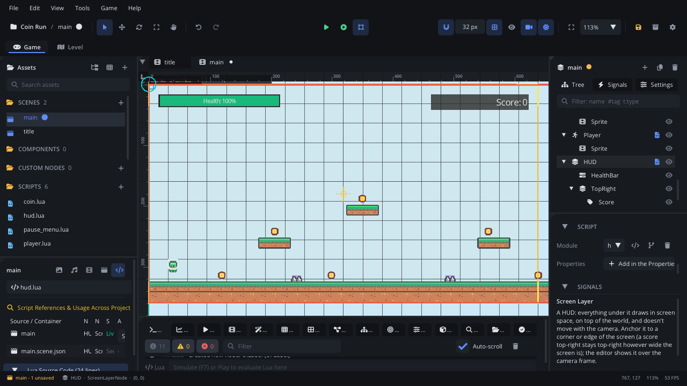
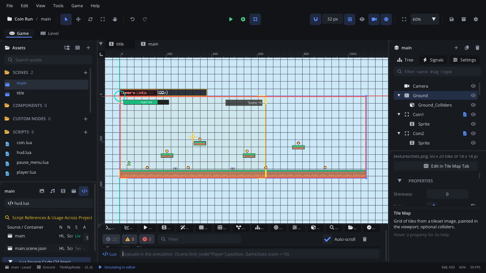
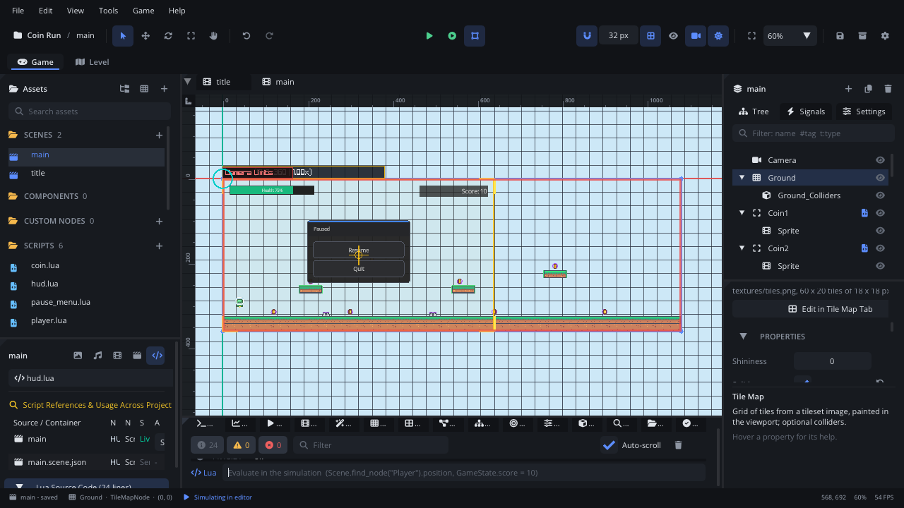
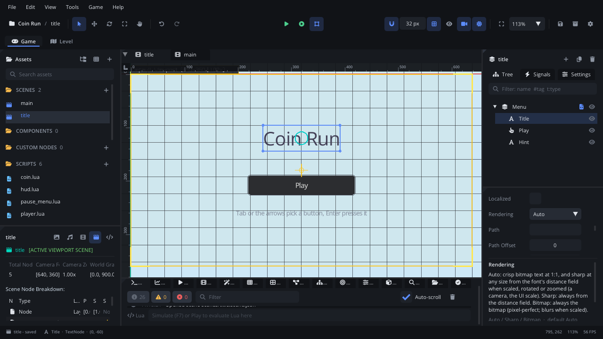
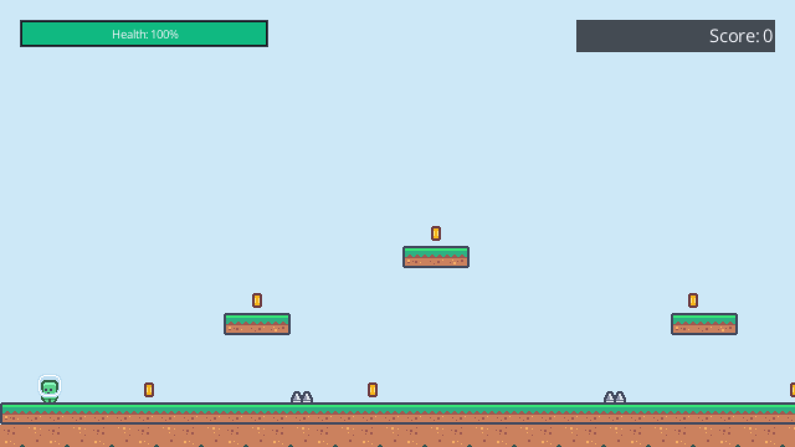

# UI and HUD

This tutorial builds **Coin Run**: a short run past spikes and coins with
a HUD - a health bar and a score that stay on the screen while the camera
follows the player - a pause menu on Esc with **Resume** and **Quit**, and
a title screen with **Play** and **Quit**. On the way it covers the UI
nodes, the Screen Layer, updating the HUD from Lua with events, fonts and
how text is drawn, pausing the game, keyboard and gamepad focus, quitting
the game, and on-screen touch controls. It takes about thirty minutes.

[Download the finished project](ui/) to compare, or to start from the
end: unzip it and open the folder with **File > Open Project...**.

It assumes you know how to attach a script and connect events; if not, do
[Lua scripting basics](scripting.md) first. The level uses a Character
Mover and Trigger Areas from [Physics and collisions](physics.md) and a
Tile Map from [Tile maps and terrains](tilemaps.md).

## 1. Make a project and the level

1. **Help > Welcome > New Project > Empty**, named `Coin Run`.
2. Drop the finished project's `textures/characters.png` and
   `textures/tiles.png` on the editor window (Kenney's *Pixel Platformer*,
   CC0).
3. **Project Settings** (the gear in the toolbar): **Video > Virtual
   Resolution** `640 x 360`, and **General > Physics > Gravity** `0, 900`.
   The HUD is laid out in these 640 x 360 pixels, whatever the window's
   size.

The level isn't the point here: copy the finished project's
`scenes/main.scene.json` and `scripts/` and delete its `HUD` and
`PauseLayer` to build them yourself, or make it from what you know:

- `Ground`: a **Tile Map** of `tiles.png` (tiles of 18 x 18, 60 x 20 of
  them), grass along the bottom and four small platforms, **Solid**.
- `Camera`: a **Camera** whose **Follow Target** is the player, with
  **Has Limits** on and **Left / Right Limit** `0` / `1080`, **Top /
  Bottom Limit** `0` / `360`, so it stops at the level's edges.
- `Coin1` ... `Coin8`: **Trigger Areas** with a circle shape, the tag
  `coin`, an Animation Player of the coin's two cells and
  `scripts/coin.lua`.
- `Spikes1`, `Spikes2`: Trigger Areas with a small box shape, an Animation
  Player of the spikes' cell (68) and `scripts/spikes.lua`.
- `Player`: a **Character Mover** (**Control Mode** Script, the tag
  `player`) with an Animation Player `Sprite` sliced from `characters.png`
  (idle, run, jump; see [Animation](animation.md)) and
  `scripts/player.lua`.

The scripts tell the rest of the game what happens with **events**
(`Events.emit`), so the HUD doesn't need to know who sends them.
`scripts/coin.lua`:

```lua
-- A coin: a Trigger Area. Touching it is worth 10 points: it tells the HUD
-- with the "coin_collected" event and goes.

---@class Coin : ScriptInstanceBase
local Coin = {}

---@param body Node?
function Coin:on_body_entered(body)
    if body == nil or not body:has_tag("player") then return end
    Events.emit("coin_collected", 10)
    self.node:destroy()
end

return Coin
```

`scripts/spikes.lua`:

```lua
-- Spikes: a Trigger Area that hurts the player.

---@class Spikes : ScriptInstanceBase
local Spikes = {}

---@param body Node?
function Spikes:on_body_entered(body)
    if body == nil or not body:has_tag("player") then return end
    body:get_script():hurt(25)
end

return Spikes
```

`scripts/player.lua` runs and jumps, and has health: `hurt` lowers it,
emits `health_changed`, bounces the player up and blinks it for a second;
at 0 the level starts again.

```lua
-- The player: a Character Mover (Control Mode "Script") that runs with
-- A / D or the arrows and jumps with Space. It has health: spikes call
-- hurt(), which tells the HUD with the "health_changed" event.

---@class Player : ScriptInstanceBase
local Player = {}

Player.properties = {
    --- Running speed, in pixels per second.
    speed = { type = "float", default = 100, min = 0, max = 400, label = "Speed" },
    --- Upward speed of a jump, in pixels per second.
    jump_speed = { type = "float", default = 290, min = 0, max = 1000, label = "Jump Speed" },
    --- Health at the start.
    max_health = { type = "int", default = 100, min = 1, max = 1000, label = "Max Health" },
}

function Player:ready()
    self.sprite = self.node:get_node("Sprite") ---@type AnimationPlayerNode
    self.health = self.max_health
    self.safe = 0 -- seconds left without damage after a hit
end

---@param dt number
function Player:update(dt)
    local node = self.node
    local vx, vy = node:character_get_velocity()
    local _, gy = node:character_get_gravity()
    vy = vy + gy * dt
    vx = Input.get_axis("move_left", "move_right") * self.speed
    if Input.is_action_pressed("jump") and node:character_is_on_floor() then
        vy = -self.jump_speed
    end
    node:character_set_velocity(vx, vy)
    node:character_move_and_slide()

    if not node:character_is_on_floor() then self.sprite:animation_play("jump")
    elseif vx ~= 0 then self.sprite:animation_play("run")
    else self.sprite:animation_play("idle") end
    if vx ~= 0 then self.sprite:set_scale(vx < 0 and -1 or 1, 1) end

    -- Blink while safe after a hit.
    if self.safe > 0 then
        self.safe = self.safe - dt
        self.sprite:set_visible(self.safe <= 0 or math.floor(self.safe * 10) % 2 == 0)
    end
end

-- hurt: lose health (spikes.lua calls it), bounce up, restart at 0.
---@param amount number
function Player:hurt(amount)
    if self.safe > 0 then return end
    self.health = math.max(0, self.health - amount)
    self.safe = 1
    Events.emit("health_changed", self.health)
    local vx = self.node:character_get_velocity()
    self.node:character_set_velocity(vx, -220)
    if self.health == 0 then Scene.reload() end
end

return Player
```

## 2. The UI nodes

**Add Node > UI & Interface** has the widgets. The ones used here:

| Node | Shows |
|---|---|
| [UI Label](../nodes/UILabelNode.md) | A line of text in a box: the score, a caption. |
| [UI Button](../nodes/UIButtonNode.md) | Something to click; raises `clicked`. Works with the mouse, the keyboard and a gamepad. |
| [UI Progress Bar](../nodes/UIProgressBarNode.md) | How full something is: health, loading. |
| [UI Container](../nodes/UIContainerNode.md) | A panel that lays out its UI children in a column, a row or a grid. |
| [Screen Layer](../nodes/ScreenLayerNode.md) | Not a widget: everything under it is drawn on the screen, over the world, and never moved by the camera. |

There are more - checkboxes, sliders, dropdowns, text inputs, lists, tabs;
each has its page under **Nodes** in the docs. A UI widget's **Position** is
its top-left corner and its **Size** its width and height (in the Node
tab's **Properties** section).

A UI node that isn't under a Screen Layer is drawn in the world: the
camera scrolls it away. That's right for a sign or a name over an enemy
(better a **Text** node there), wrong for a HUD.

## 3. The HUD: a Screen Layer

1. Select nothing (**Esc**), then **Add Node > Screen Layer**, named
   `HUD`. Its **Anchor** is **TopLeft**: the layer sits at the screen's
   top-left corner, and its **Position** is an offset from there. Attach
   `scripts/hud.lua` (section 4).
2. With `HUD` selected, **Add Node > UI Progress Bar**, named `HealthBar`,
   at `16, 16`. Set **Size** `200, 22`, **Label** `Health`, **Max Value**
   `100` and **Value** `100`. **Show Text** draws "Health: 100%" on it;
   **Fill Color** is the filled part's.
3. The score goes in the top-right corner, however wide the screen is. With
   `HUD` selected, **Add Node > Screen Layer**, named `TopRight`, **Anchor**
   **TopRight**, at `-176, 16`: 176 pixels left of the right edge. (Screen
   Layers inside each other each anchor to the screen.)
4. Under `TopRight`, **Add Node > UI Label**, named `Score`, at `0, 0`:
   **Size** `160, 26`, **Text** `Score: 0`, **Font Size** `20`, **Align**
   **Right**, and tick **Draw Background** so the white text reads on the
   sky (**Background Color** is the box's).

The editor draws Screen Layers over the scene camera's frame, where the
player will see them; **Shift+Home** fits that frame in the viewport.



## 4. The HUD from Lua

`scripts/hud.lua` listens to the two events and shows them. A label's
text is set with `set_text` (or `label.text = ...`); other widget
settings with `set_property`, by their names in snake case.

```lua
-- The HUD: a Screen Layer (anchored top left) with the health bar, and a
-- second Screen Layer (top right) with the score. It listens to the
-- player's and the coins' events and shows them.

---@class Hud : ScriptInstanceBase
local Hud = {}

function Hud:ready()
    self.score = 0
    self.bar = self.node:get_node("HealthBar") ---@type UIProgressBarNode
    self.label = self.node:get_node("TopRight/Score") ---@type UILabelNode
    Events.connect("coin_collected", function(points)
        self.score = self.score + points
        self.label:set_text("Score: " .. self.score)
    end)
    Events.connect("health_changed", function(health)
        self.bar:set_property("value", health)
        -- Red when it's low.
        self.bar:set_property("fill_color", health <= 25 and "#e53e3eff" or "#10b981ff")
    end)
end

return Hud
```

Simulate (**F7**) and try it from the Console's Lua line without playing:
`Events.emit("coin_collected", 10)` adds 10 to the score, and
`Scene.find_node("Player"):get_script():hurt(25)` takes the bar to 75%.



## 5. A pause menu

Pausing stops the game, but the menu must keep running to take the
clicks. `Engine.set_paused(true)` stops every node whose **Pause Mode**
is *Pausable* - the default, inherited from the parent - and the physics;
nodes set to **Always** go on.

1. Select nothing, then **Add Node > Screen Layer**, named `PauseLayer`,
   **Anchor** **Center**. In the Inspector's Transform section set **Pause
   Mode** to **Always**: its children inherit it. Attach
   `scripts/pause_menu.lua`.
2. Under it, **Add Node > UI Container**, named `Menu`, at `-120, -80`
   (its top-left corner, so the panel is centred): **Size** `240, 160`,
   **Title** `Paused`, and tick **Auto Size Height** (as tall as its
   children).
3. Under `Menu`, **Add Node > UI Button**, named `Resume`, **Text**
   `Resume`. Select `Menu` again and add another, `Quit`, **Text** `Quit`.

The container lays its buttons out in a column (**Direction** Vertical,
**Alignment** Stretch: each as wide as the inside of the panel) while the
game runs; in the editor the buttons stay where they are put.

`scripts/pause_menu.lua` opens and closes it with the built-in `pause`
action (Esc, P or a gamepad's Start):

```lua
-- The pause menu: a Screen Layer (anchored at the centre, Pause Mode
-- Always) with a UI Container of two buttons. Esc (the built-in "pause"
-- action: Esc, P or the gamepad's Start) opens and closes it.

---@class PauseMenu : ScriptInstanceBase
local PauseMenu = {}

function PauseMenu:ready()
    self.menu = self.node:get_node("Menu") ---@type UIContainerNode
    self.menu:get_node("Resume"):connect("clicked", function() self:show(false) end)
    -- Quit leaves the level for the title screen (whose Quit closes the game).
    self.menu:get_node("Quit"):connect("clicked", function()
        Engine.set_paused(false)
        Scene.change_scene("scenes/title.scene.json")
    end)
    self:show(false)
end

function PauseMenu:update(dt)
    if Input.is_action_pressed("pause") then
        self:show(not Engine.is_paused())
    end
end

---@param open boolean
function PauseMenu:show(open)
    Engine.set_paused(open)
    -- Disabled, the menu neither draws nor takes clicks.
    self.menu:set_enabled(open)
    -- Opened, Resume has the focus: Enter resumes, Down and Enter quit.
    if open then self.menu:get_node("Resume"):ui_focus() end
end

return PauseMenu
```

`set_enabled(false)` hides the menu and its buttons, stops their clicks
and their updates; `set_visible(false)` would hide them and stop their
clicks too, but keep them updating. Opening it,
`ui_focus()` gives **Resume** the keyboard and gamepad focus (section 6),
so Enter resumes straight away. **Quit** unpauses first - the pause
belongs to the game, not to the scene - and goes back to the title screen
rather than closing the game: in a game, Quit in the pause menu leaves
the level, and the title screen's Quit (section 7) leaves the game.



## 6. Keyboard and gamepad

UI controls take the keyboard and the gamepad without a script: **Tab**
and **Shift+Tab** move the focus from control to control, the **arrow
keys** (or the D-pad and the left stick) move it to the nearest one in
that direction, and **Enter**, **Space** or the gamepad's **A** clicks the
focused button. A click focuses too; the focused button has a highlighted
border.

Nothing has the focus until a key or a click gives it, so a menu that
opens should focus its first button itself: `button:ui_focus()` does what
Tab would, and returns `true`. The pause menu focuses **Resume** when it
opens and the title screen focuses **Play**, so Enter alone resumes or
plays, and Down then Enter quits. `ui_focus()` returns `false` and warns
in the console when the node can't take the focus - a label, a disabled
or hidden button, or one inside a disabled container (call it after
`set_enabled(true)`); `ui_has_focus()` tells whether a widget has it.

Buttons beside gameplay keys (a pause button in a game that uses the
arrows and Space) should have **Keyboard Focus** off: Tab and the arrows
skip them and a click doesn't focus them, so the next Space goes to the
game.

## 7. A title screen, and fonts

`scenes/title.scene.json` is a centred Screen Layer `Menu` with a
**Text** node `Title` (`Coin Run`, **Font Size** `48`), UI Buttons `Play`
at `-100, 10` and `Quit` at `-100, 56`, and a Text `Hint` under them.
`scripts/title.lua` on the layer starts the game, closes it with
`Engine.quit()`, focuses Play and makes the title pulse with a tween:

```lua
-- The title screen: Play starts the game, Quit closes it. The title pulses
-- with a tween; a Text node's Auto rendering keeps it sharp while it is
-- scaled.

---@class Title : ScriptInstanceBase
local Title = {}

function Title:ready()
    local title = self.node:get_node("Title")
    Tween.to(title, "scale", {1.1, 1.1}, 0.8, "in_out_sine", {loops = -1, yoyo = true})
    local play = self.node:get_node("Play") ---@type UIButtonNode
    play:connect("clicked", function()
        Scene.change_scene("scenes/main.scene.json", { transition = "fade", duration = 0.3 })
    end)
    self.node:get_node("Quit"):connect("clicked", function() Engine.quit() end)
    -- Play has the focus from the start: Enter plays, Down and Enter quit.
    play:ui_focus()
end

return Title
```

Make it the start: **Project Settings > General > Startup Scene**
`scenes/title.scene.json`.

`Engine.quit()` ends the game as closing its window does. In the editor
it never closes the editor: in Simulate it stops the simulation, and in
Play it ends the game window. A web page can't close itself: on the web
it does nothing and returns `false`, so a Quit button can do something
else there (`if not Engine.quit() then ... end`).

UI widgets draw their text in the UI's built-in font. A **Text** node can
use any font in the project (a `.ttf`, `.otf` or `.fnt` in its **Font**
field; *None* is the engine font), rich text such as
`[color=yellow]gold[/color]`, wrapping and a typewriter. Its
**Rendering** picks how the letters are drawn:

| Rendering | Draws |
|---|---|
| **Auto** (the default) | The ordinary font at 1:1; sharp from a distance field (MSDF) when scaled, rotated or zoomed - the pulsing title stays crisp. |
| **Sharp** | Always from the distance field. |
| **Bitmap** | Always the ordinary font: pixel-perfect at 1:1, blurry or blocky when scaled. |

Pixel fonts look best at the sizes they were drawn for (whole multiples of
them); try a size before you settle on it.



## 8. Touch controls

On phones and tablets (the web export), on-screen controls press the same
input actions as the keys, so the scripts above work unchanged: put a
[Touch Joystick](../nodes/TouchJoystickNode.md) under a Screen Layer
anchored **BottomLeft** (it presses `move_left` / `move_right` /
`move_up` / `move_down`) and a [Touch Button](../nodes/TouchButtonNode.md)
with **Action** `jump` under one anchored **BottomRight**. They show only
on touch screens unless **Always Show** is ticked. With **Touch as Mouse**
(Project Settings > Input) a tap clicks UI buttons, so the menus work too.
The **Platformer** template has both.

Press **F5**: Play, run right for the coins, mind the spikes, and press
Esc to pause.



## Where next

- The finished project is in the [download](ui/).
- Every widget: the UI nodes under **Nodes** (start at
  [UI Container](../nodes/UIContainerNode.md)); HUDs:
  [Screen Layer](../nodes/ScreenLayerNode.md) and
  [Draw order](../../engine/docs/draw_order.md#huds-screen-layers).
- Pausing, time scale and hit-stop: [Engine](../lua/Engine.md); events:
  [Events](../lua/Events.md).
- Animate the HUD: [Animation](animation.md), and
  [Tween](../lua/Tween.md) for one-off motion.
