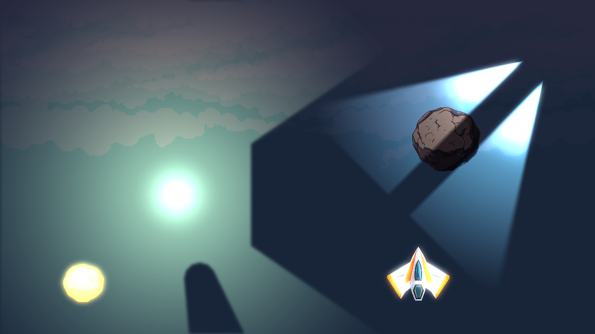

# Lighting

Rayzr's 2D lighting turns a flat scene into a lit one. You darken the
scene with an **ambient** colour, then bring places back with **lights**:
torches and lamps, a flashlight's cone, the sun. Lights cast soft or hard
shadows from walls and props, can shade normal-mapped art, and work with
glowing art, light layers and bloom.



## How it works

Each frame, after the world is drawn, Rayzr builds a **light map**:

1. It starts as the **ambient** colour.
2. Each light adds its colour on top, minus its shadows.
3. The map is **multiplied** over the world. Where it is white you see the
   art as drawn; where it is dark, so is the art.
4. Anything that **glows** (emission) is added afterwards, so it shows
   even in the dark.
5. **Bloom**, when it's on, makes the brightest parts glow past their edges.

The light map only covers the world: **Layer8** and anything under a
[Screen Layer](../../docs/nodes/ScreenLayerNode.md) (your HUD) is never
darkened. A scene with a white ambient and no lights costs nothing.

## Getting started

1. **Darken the scene.** Add an **Environment** node (Add Node > *Environment*)
   and set its **Ambient**, or use the Scene panel's **Settings** tab
   (presets: *Dusk*, *Night*, *Dark*). White means unlit.
2. **Add a light.** Add Node > *Light* - or a preset: *Torch*, *Lamp*,
   *Flashlight*, *Sun*, *Neon*.
3. **Give it something to block it.** Walls and props that are physics
   bodies cast shadows already. For art that isn't a body, add a
   **Light Occluder**, or right-click a sprite > **Make Light Occluder
   from Sprite**.

The toolbar's sun button switches the lighting preview in the viewport on
and off.

## Lights

| Setting | What it does |
|---|---|
| **Kind** | *Point* shines all round; *Spot* in a cone along the node's rotation; *Directional* is the sun - one direction over the whole view. |
| **Color**, **Energy** | Its colour and brightness. Energy multiplies the colour (0 is off). |
| **Radius**, **Falloff** | How far it reaches, and how it fades: 1 evenly, 2 smoothly (the default), higher keeps it tight around the centre. |
| **Spread** | A spot's half-angle. |
| **Texture** | A *light texture* ("cookie") shapes the light: a project image (its brightness), or a built-in one - *ring* (a flashlight), *window*, *blinds*, *noise* (light through leaves). It turns with the light. Not for the sun. |
| **Layers** | The light layers it lights (see Light layers below). |
| **Shadows**, **Softness**, **Shadow Strength** | Whether it casts shadows, how soft their edges are (0 = hard), and how dark (1 = full, 0.5 = half). |
| **Ignore Parent Bodies** | The bodies the light sits in don't block it - a lantern inside its crate still lights the room. On by default. |
| **Height** / **Elevation** | For normal maps: how high the light is (a sun's angle). Low light rakes across bumps. |
| **Shadow Length** | The sun's shadows' length (0: to the edge of the view). |
| **Flicker**, **Flicker Speed** | Random dips in brightness, like a flame - no script needed. |
| **Pulse**, **Pulse Speed** | A steady rise and fall: neon, alarms, magic. |

Rotate a spot or the sun to aim it: at rotation 0 a spot points right and
the sun shines from the left.

### Presets

| Preset | |
|---|---|
| **Torch** | Warm orange, flickering, soft shadows. |
| **Lamp** | Steady warm white with a wide reach. |
| **Flashlight** | A spot with the *ring* texture. |
| **Sun** | A directional light with long shadows. |
| **Neon** | A saturated colour that pulses, no shadows. |

They are ordinary Lights afterwards: change anything you like.

## Shadows

A light with **Shadows** on is blocked by:

- **Physics bodies** - static, dynamic and kinematic bodies and Character
  Movers - with **Casts Shadows** on (the default). Sensors (trigger
  areas) never block light. Turn Casts Shadows off for glass, water or
  anything light should pass through; the body still collides.
- **Tile Maps** (Solid) and **LDtk levels** (Physics on): their colliders.
  The editor shows these shadows too, before the game runs.
- **Light Occluders**: shapes that only block light.

Each light's shadows only darken that light's own contribution: another
light can still fill them.

**Soft shadows**: **Softness** blurs the shadow's edge by that many pixels.
New lights start soft; lights in scenes made before this stay hard until
you change them.

### Light Occluders

A **Light Occluder** holds shapes - boxes, circles, polygons - edited like
collision shapes (Inspector > **Edit in Viewport**). Use it for things that
block light but aren't solid: a wall painted in the background, a pillar,
a tree's canopy. The viewport draws occluders in violet.

**Make Light Occluder from Sprite** (right-click a Sprite or Atlas Sprite
in the Scene panel) traces the image's opaque pixels into an occluder
child: a tree casts the shadow of its silhouette.

## What a light touches

### Light layers

There are 8 **light layers**. Name them in **Project Settings > General >
Light Layers** ("World", "Player", "Background"...).

- A **light** lights its **Layers**.
- A **node** is lit by its **Lit By** layers (Inspector > *Lighting*).
- A **Light Occluder** blocks the lights on its **Layers**.

A light lights a node when they share a layer. Everything starts on all
eight, so nothing changes until you use them. For example: a rim light on
*Player* only lights the player; a background on *Background* ignores the
torches on *World*.

### Ignore Lighting

**Ignore Lighting** (Inspector > *Lighting*) draws a node at full
brightness whatever the lights and the ambient: signs, pickups, things
that light themselves.

### Emission (glow)

Emission makes art glow in the dark, added after the lighting:

- **Emission** colour and **Emission Strength** (Inspector > *Lighting*)
  make a whole node glow.
- An **emission map**, `<image>_e.png` next to the image, makes parts of
  it glow: eyes, windows, lava. Black means no glow. It's found by itself;
  in Assets, the image's **Emission** setting can point at another file or
  turn it off.

Bloom catches emission, so glowing parts can bleed light around them.

## The Environment

The **Environment** node holds the scene's look:

| Setting | |
|---|---|
| **Ambient** | The colour where no light reaches. |
| **Overbright** | Lights can make art up to twice as bright as drawn (Energy above 1 overexposes). |
| **Bloom**, **Threshold**, **Strength**, **Radius** | Bright parts glow past their edges: how bright a pixel must be, how much glow, how far it spreads. |
| **Half Resolution** | Builds the light map at half size: faster with many lights, a little softer. |

The first enabled Environment in the scene applies. Without one, the
scene's **Settings** tab ambient does. Because it's a node, you can:

- key its **Ambient** in the [Animation tab](animation_editing.md) for a
  day-night cycle, or drive it with an [Oscillator](../../docs/nodes/OscillatorNode.md);
- put it in a component and reuse a look across scenes;
- swap or change it from a script.

## Normal maps

Normal-mapped art is shaded by each light's direction. `<image>_n.png`
next to an image is its normal map; Assets can **Generate Normal Map...**
for images without one. A light's **Height** decides how it rakes across
the bumps; **Shininess** (and `<image>_s.png`) adds highlights. See the
[Light node](../../docs/nodes/LightNode.md#normal-maps) for the details.

## Scripting

Every Light setting has a getter and setter (`light:light_set_softness(8)`,
`light:light_get_layers()`), as do the Environment's (`env:env_set_bloom(true)`)
and the occluder's layers. A few helpers:

```lua
-- A day-night cycle: dusk falls over 10 seconds.
Scene.get_environment():env_fade_ambient("#1a1a33", 10)

-- Switch a lamp off smoothly, then disable it.
lamp:light_fade(0, 1.5, function() lamp:set_enabled(false) end)

-- Stealth: is the player in the dark?
if Lighting.brightness_at(player:get_global_position()) < 0.3 then
    self:hide()
end

-- A torch from a preset, on a pickup.
local torch = Scene.create_light("Torch", self.node)
torch:light_set_layers({"World"})

-- A sign that glows and ignores the lighting.
sign:set_emission("#ff4020", 2)
sign:set_ignore_lighting(true)
```

`Scene.set_ambient` sets the Environment's ambient when there is one.
The whole API: [Lighting](../../docs/lua/Lighting.md), and the Light node's
methods in the Lua reference.

## Performance

- Each visible light is one pass; a light whose reach is off screen is
  skipped. Lights without shadows are the cheapest.
- Shadowed lights draw a shadow mask; soft ones blur it too.
- Light layers, Ignore Lighting and emission draw the world once more into
  a small buffer, only when some node or light uses them.
- **Half Resolution** (Environment) halves the light map's cost.
- Normal maps add a pass when the project has any.

Dozens of lights are fine; many large soft-shadowed lights on screen at
once cost the most.

## Tips

- Start with a dark ambient and one light; add more where the eye should go.
- A light's shadow only shows where that light is the one lighting: lower
  the ambient to make shadows read.
- Put the HUD on a Screen Layer (or Layer8): it is never darkened.
- Lights in a [component](components.md) work in every instance; while
  you edit the component alone, darken its document's ambient to see them
  (that ambient isn't saved with the component).
- Use **Lighting.set_enabled(false)** (or the toolbar's sun in the editor)
  to compare the scene lit and unlit.
